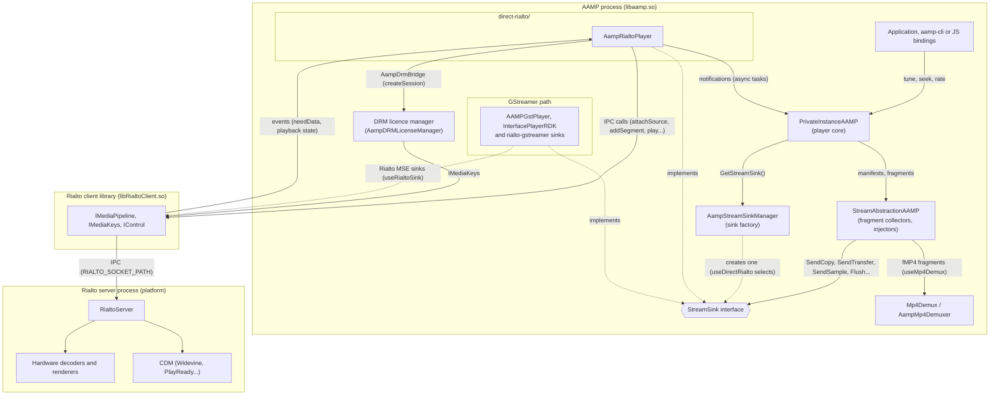

# Direct Rialto - Overview

## Purpose

`direct-rialto` is the AAMP component that plays media by calling the Rialto client API (`IMediaPipeline`, `IMediaKeys`, `IControl`) directly, instead of building a GStreamer pipeline with Rialto sink elements. It implements AAMP's `StreamSink` contract in one class, `AampRialtoPlayer`, so the rest of AAMP (fragment collectors, injectors, ABR, DRM, events) uses it exactly as it would use the GStreamer player. This page is the entry point to the documentation set: it says what the component is, when it is selected, how it relates to the GStreamer path, summarises every other page, and gives a glossary of the terms you will meet.

## Source files

| File | Role |
| --- | --- |
| `direct-rialto/AampRialtoPlayer.h/.cpp` | The `StreamSink` implementation and orchestration; the main entry point |
| `direct-rialto/` (49 files, about 13.6k lines) | Everything else: sources, handshake, state machine, controller, timers, monitors, DRM, adapters |
| `StreamSink.h` | The contract AAMP core calls |
| `AampStreamSinkManager.cpp:CreateSinkInstance` | Selects `AampRialtoPlayer` or `AAMPGstPlayer` |
| `AampConfig.cpp`, `AampConfig.h` | `useDirectRialto` and `useRialtoSink` options and the rules that tie them to `useMp4Demux` |
| `priv_aamp.cpp` (constructor) | Installs the DirectRialto CC manager and the Rialto DRM session creator |
| `docs/rialto-integration/rialto-gstreamer-overview.md` | Description of the other path (rialto-gstreamer) for comparison |
| `test/rialto/` | Rialto simulator used when real Rialto is not linked |

## What it is

Rialto is a client/server media framework for RDK. A privileged **RialtoServer** process owns the decoders and the content decryption module (CDM); applications link a Rialto **client library** (`libRialtoClient.so`) and talk to the server over a socket (`RIALTO_SOCKET_PATH`). AAMP can use Rialto in two ways:

1. **Through GStreamer** (`useRialtoSink`): AAMP's `AAMPGstPlayer` and the middleware `InterfacePlayerRDK` build a GStreamer pipeline whose video, audio and subtitle sinks are the rialto-gstreamer elements (`rialtomsevideosink` and friends). These forward buffers to RialtoServer. This path is described in `docs/rialto-integration/rialto-gstreamer-overview.md`.
2. **Directly** (`useDirectRialto`): `AampRialtoPlayer` creates the Rialto media pipeline itself, attaches one Rialto source per track, answers Rialto's data requests with demuxed samples and drives playback with `play()`, `pause()`, `setPosition()` and so on. No GStreamer header or element is involved; the folder's only GStreamer-flavoured names are enum values shared with the existing `StreamSink` interface.

*System context: AAMP core reaches Rialto through a `StreamSink`, either `AAMPGstPlayer` (via rialto-gstreamer) or `AampRialtoPlayer` (direct).*

### How the two paths differ

| Aspect | GStreamer path (`useRialtoSink`) | direct-rialto (`useDirectRialto`) |
| --- | --- | --- |
| Sink class | `AAMPGstPlayer` with `InterfacePlayerRDK` and rialto-gstreamer sink elements | `AampRialtoPlayer` |
| Demuxing | GStreamer `qtdemux` inside the pipeline; rialto-gstreamer extracts codec data from caps | AAMP demuxes ISO BMFF itself (`Mp4Demux` / `AampMp4Demuxer`); `useMp4Demux` is forced on |
| Data hand-off | AAMP pushes buffers into `appsrc`; a per-track queue (24 entries) is pulled by RialtoServer; a full queue blocks AAMP | AAMP's injector thread waits until Rialto sends `needData`, then calls `addSegment()` and `haveData()` (the handshake) |
| Init segments | Not forwarded; codec data travels in caps | Parsed by the source; codec information drives `attachSource()` |
| Playback control | GStreamer state changes and events | Rialto calls (`play`, `pause`, `setPosition`, `setPlaybackRate`, `stop`) plus AAMP-side holds and gates |
| Seek and flush | GStreamer flush events | `setPosition()` then wait for `SEEK_DONE`, with staged positions and gating |
| DRM | Default session creator (for example OCDM) plus decryption in the pipeline | `RialtoMediaKeySystem` sessions (`IMediaKeys`) installed through `DrmSessionCreator`; decryption in the Rialto server |
| Closed captions | Rialto GStreamer CC manager | `PlayerDirectRialtoCCManager` driving `IDirectRialtoCC` on the player |

### Why it exists

The repository records its origin: the first commit (`bdf96a74`, "Direct Rialto Integration for VIPA") describes "a PoC to stream video using Rialto Client directly rather than via Rialto Gstreamer sinks". The code shows what that buys and costs: AAMP controls the whole data path and state machine (no GStreamer pipeline, elements or bus messages between AAMP and Rialto), at the price of re-implementing behaviour that GStreamer or rialto-gstreamer used to provide, such as pacing, flush sequencing, pre-roll and demuxing. The business motivation (footprint, latency, platform constraints) is not written down in the repository; see Open questions.

## When direct-rialto is selected

1. `eAAMPConfig_useDirectRialto` (name `useDirectRialto`, default false) is read when the player instance is created (`PlayerInstanceAAMP` constructor, then `AampStreamSinkManager::CreateSinkInstance`).
2. If true, the sink is `AampRialtoPlayer`; otherwise it is `AAMPGstPlayer`. The setting cannot be changed after the player exists: `AampConfig::DoCustomSetting` reverts attempts made through app, stream or tune settings.
3. Turning it on also forces `useMp4Demux` on, selects the DirectRialto CC manager and installs the Rialto DRM session creator.
4. `useRialtoSink` is an independent option for the GStreamer path. `AampConfig::IsUsingRialto()` (and `PrivateInstanceAAMP::UsingRialto()`) is true if either is set, and does not say which one; core code that needs the distinction checks `useDirectRialto`.
5. A `StreamSink` supplied by the embedding client bypasses the factory.

Details and the build/runtime requirements are on the integration page.

## Page guide

Titles below are the page titles in this documentation set.

| Page | Summary |
| --- | --- |
| [Overview](00-direct-rialto-overview.md) | This page. |
| [Architecture and class model](01-architecture-and-class-model.md) | Layers, a responsibility table for every class and interface, ownership and lifetime of the Rialto objects, the dependency-injection seams used by the tests and the design patterns involved, with component, class and creation-sequence diagrams. |
| [Lifecycle and state machine](02-player-lifecycle-and-state-machines.md) | The player's lifecycle from construction through `Configure()`, pipeline creation, source attachment, `allSourcesAttached()`, play, pause and stop; the `PlayerStateMachine` states and transitions; the play-hold arbitration. |
| [Media data path](03-media-data-path.md) | How samples travel from the injector threads to Rialto: per-track sources, the needData/haveData handshake, back-pressure, gating, EOS, encrypted samples, codec and caps selection and timestamps. |
| [Flush and seek](04-flush-seek-and-preroll.md) | The flush cycle (`Flush()` to `SEEK_DONE`), staged and authoritative positions, the deferred flush for content without a known position, trickplay interaction and the failure paths. |
| [Threading model and locking](05-threading-and-locking-model.md) | The threads that call into the player, the lock hierarchy and the atomics, and the reasons for the design choices (for example scheduler hops for notifications). |
| [DRM](06-drm.md) | How a DRM session is created for an encrypted track: `AampDrmBridge`, the Rialto key system, session adapter and creator, key status and output protection. |
| [Subtitles and TTML](07-subtitles-cc-and-ttml-offset.md) | The subtitle source in its three forms (raw TTML or WebVTT, TTML in MP4, inband closed caption), the TTML display-offset logic and the CC control interface. |
| [Monitoring and diagnostics](08-av-monitoring-timers-and-position.md) | Progress reporting, the AV health monitor, pre-roll monitoring and the logging that helps debugging. |
| [Integration, configuration and build](09-integration-configuration-and-build.md) | How `AampRialtoPlayer` plugs into AAMP core: every `StreamSink` method and what it does, every notification back into `PrivateInstanceAAMP`, the configuration options, CMake and scripts, runtime requirements, aamp-cli usage and the special cases that live outside the folder. |
| [Testing](10-testing.md) | L1 suites and seams, how to build and run them, the Rialto simulator, the L2 suites, the coverage-gap table and testability limits. |
| [Workarounds and improvement register](11-workarounds-and-improvement-register.md) | Every known workaround, limitation, stub, stale comment, possible bug and tech-debt item in one place, with location, risk, suggested fix and effort, plus a prioritised shortlist. |
| [Troubleshooting and glossary](12-troubleshooting-and-glossary.md) | Symptom-to-cause guide, key log messages and what they mean, debugging tips, and the full glossary. |

Diagrams are Mermaid blocks embedded in each page, so GitHub renders them in place. Edit a diagram by editing its block in the page.

## Recommended reading order

1. This page, then [Architecture and class model](01-architecture-and-class-model.md) to learn the vocabulary and who owns what.
2. [Lifecycle and state machine](02-player-lifecycle-and-state-machines.md), then [Media data path](03-media-data-path.md): together these explain normal playback.
3. [Flush and seek](04-flush-seek-and-preroll.md), then [Threading model and locking](05-threading-and-locking-model.md): the hard parts. Read the threading page before changing any lock or atomic.
4. [DRM](06-drm.md) and [Subtitles and TTML](07-subtitles-cc-and-ttml-offset.md) when working on those features.
5. [Monitoring and diagnostics](08-av-monitoring-timers-and-position.md) when reading logs.
6. [Integration, configuration and build](09-integration-configuration-and-build.md) when enabling the path, building, or touching code outside the folder.
7. [Testing](10-testing.md) before writing or changing tests.
8. [Workarounds and improvement register](11-workarounds-and-improvement-register.md) before planning clean-up work, and [Troubleshooting and glossary](12-troubleshooting-and-glossary.md) when investigating a field issue.

## Glossary seed

Only terms verified in the code are listed. The full glossary is on [Troubleshooting and glossary](12-troubleshooting-and-glossary.md).

| Term | Meaning |
| --- | --- |
| Track vs slot | AAMP names tracks `eMEDIATYPE_VIDEO/AUDIO/SUBTITLE`; the player keeps up to three sources in slots of the same names. They differ only for audio-only content, where AAMP's VIDEO track is served by the AUDIO slot (`m_audioInVideoSlot`, `toSourceSlot()`) |
| SourceId | The integer Rialto assigns when a source is attached (`attachSource()`); -1 while unattached. Events such as needData carry it (`AampRialtoMediaSource::sourceId`) |
| `mks_id` | Media key session id: the Rialto key session that decrypts a track, returned by `IDrmBridge::createSession` and stamped on every encrypted segment |
| needData | Rialto's request for a number of frames (`frameCount`) for one source, with a request id; delivered as `OnNeedMediaData` on Rialto's event thread |
| haveData | The answer to a needData request, with a status (`OK`, `EOS`, `NO_AVAILABLE_SAMPLES`); sent after the segments were added with `addSegment()` |
| Handshake | `AampRialtoNeedDataHandshake`: the per-source state that reconciles Rialto's pull requests with AAMP's push injection |
| Claim | A pending needData request handed to the caller, who must answer it with `haveData()` after releasing the handshake lock |
| Gate mode | Per-source injection mode: NONE (flow), BLOCKED (hold new samples), DROPPED (discard new samples) |
| Generation | Abort token bumped by reset or unblock so that blocked injectors give up |
| `attachSource` / `allSourcesAttached` | Rialto calls that register each track's source, then declare the set complete so the server can proceed |
| Pipeline states | `PlayerStateId`: IDLE, PIPELINE_CREATED, SOURCES_ATTACHING, SOURCES_ATTACHED, PLAYING, PAUSED, FLUSHING, FLUSHED, ERROR |
| `SEEK_DONE` | The Rialto playback state that ends a flush after `setPosition()`; the player waits for it (with a timeout) |
| Flush cycle | `Flush()` stages a position and rate, enters FLUSHING, gates sources, issues the seek; `SEEK_DONE` commits them and moves to FLUSHED |
| PlayHold | A bit that blocks `play()`: `SourcesNotAttached`, `Flushing`, `PositionPending`, `FragmentCaching`, `PreRollIncomplete` |
| Play request | AAMP's `Stream()` call; `play()` is issued once a request exists and no hold remains |
| Pre-roll | Pausing with data flowing until a frame floor, no-space, EOS or timeout is reached, before `play()` (`gstBufferAndPlay`) |
| Position pending / deferred flush | State where the real position of a new period is not known; the first sample from an elected track triggers the flush |
| Staged position, baseline, authoritative | Flush position and rate awaiting commit; the segment-start position subtracted when reporting position; a flag that the staged position is the real resume position |
| Inband CC | Closed-caption data carried in the video stream, controlled through a subtitle source with MIME `text/cc` |
| Notifiable | `IStreamSinkNotifiable`: the narrow interface through which the sink tells `PrivateInstanceAAMP` what happened |
| Control backend | `IRialtoControlBackend`: waits for the Rialto server's `ApplicationState::RUNNING` before the pipeline is created |
| Single-pipeline mode | One sink shared by several `PrivateInstanceAAMP` instances; the sink is re-targeted with `ChangeAamp()` |
| Simulator | `test/rialto/RialtoSimulator.cpp`: an in-process stand-in for `libRialtoClient.so` used when real Rialto is not linked |

## Related pages

- [Architecture and class model](01-architecture-and-class-model.md)
- [Lifecycle and state machine](02-player-lifecycle-and-state-machines.md)
- [Media data path](03-media-data-path.md)
- [Flush and seek](04-flush-seek-and-preroll.md)
- [Threading model and locking](05-threading-and-locking-model.md)
- [DRM](06-drm.md)
- [Subtitles and TTML](07-subtitles-cc-and-ttml-offset.md)
- [Monitoring and diagnostics](08-av-monitoring-timers-and-position.md)
- [Integration, configuration and build](09-integration-configuration-and-build.md)
- [Testing](10-testing.md)
- [Workarounds and improvement register](11-workarounds-and-improvement-register.md)
- [Troubleshooting and glossary](12-troubleshooting-and-glossary.md)

## Workarounds and improvement candidates

All items are collected on [Workarounds and improvement register](11-workarounds-and-improvement-register.md), which starts with a prioritised shortlist.

## Open questions

- The reason this path was created is recorded only as "PoC to stream video using Rialto Client directly rather than via Rialto Gstreamer sinks" in the first commit. Footprint, latency or platform motivations are not documented in the repository.
- It is not documented which products ship with `useDirectRialto` enabled by default; the default in `AampConfig.cpp` is false, so it must be set through device or operator configuration.
