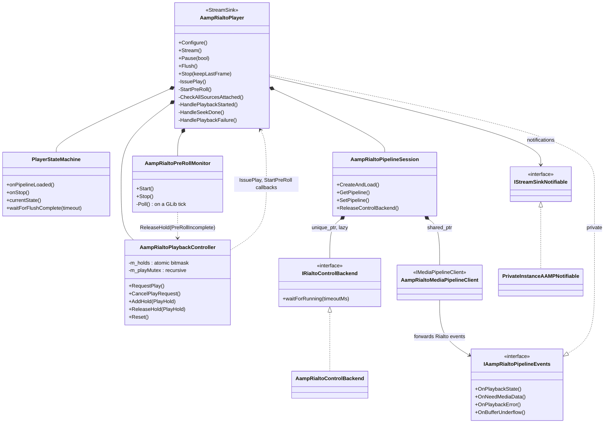
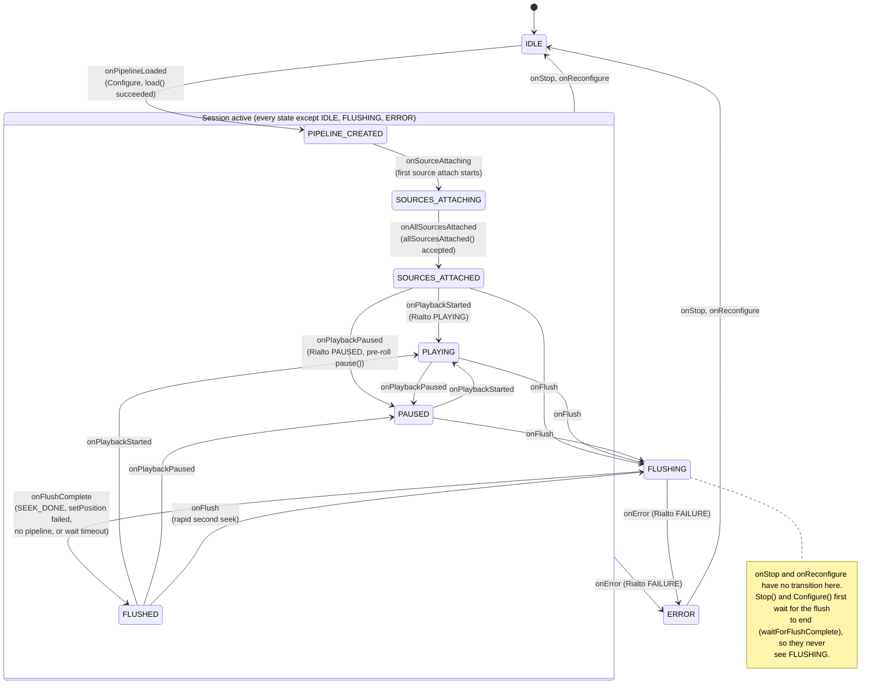
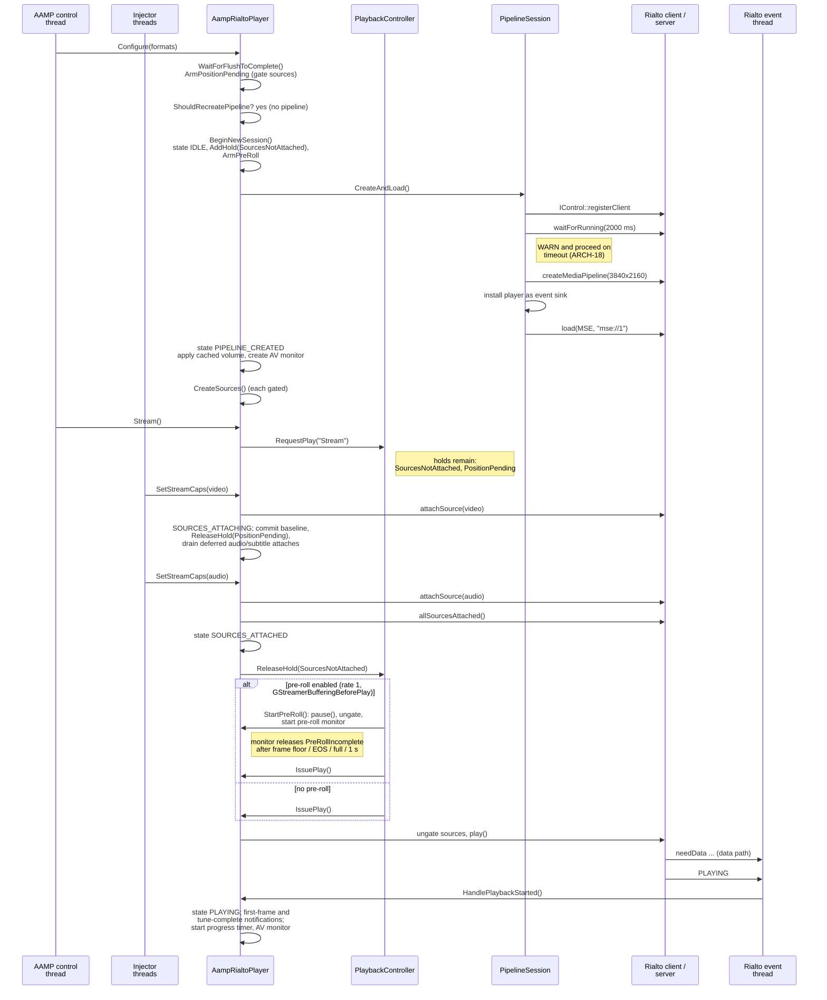
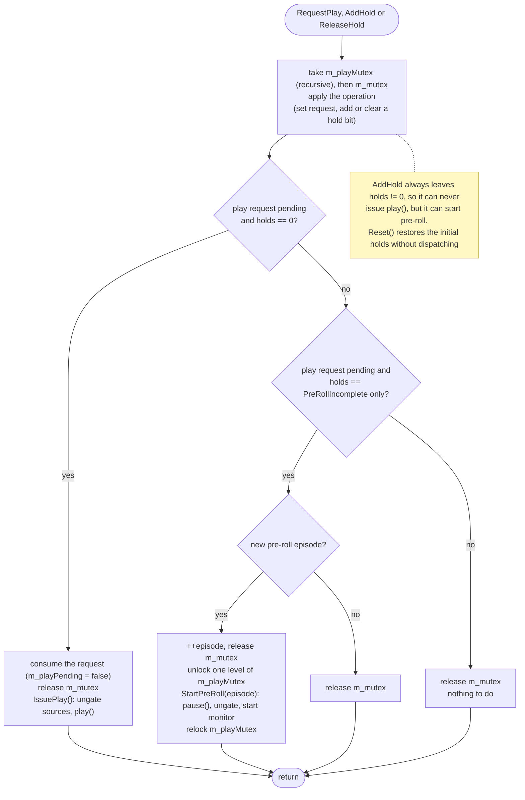
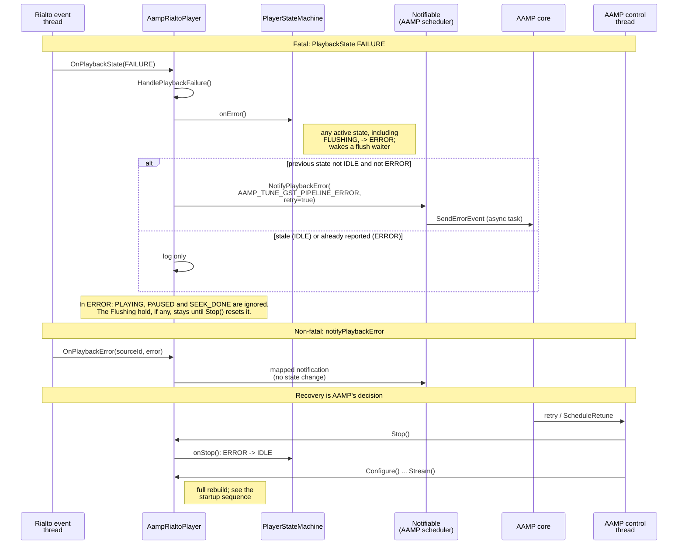
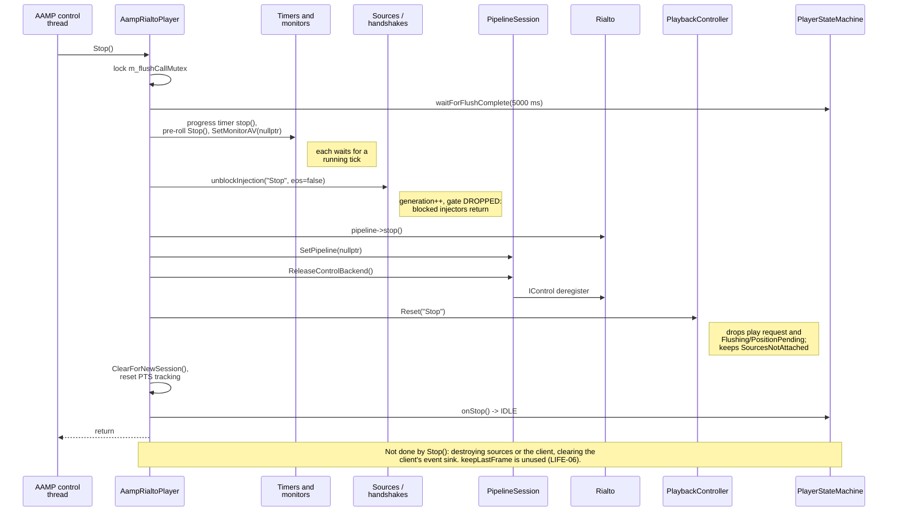

# Direct Rialto - Lifecycle and state machine

## Purpose

This page explains how one `AampRialtoPlayer` session is born, runs and
dies: the `PlayerStateMachine` that records the lifecycle, the
`AampRialtoPlaybackController` that decides when Rialto's `play()` may
be issued (the PlayHold bitmask), how Rialto playback-state events become
AAMP notifications, and what happens on end of stream, errors and
`Stop()`. It is written so that an engineer can predict the player's
behaviour for an unusual call order without reading the code.

## Source files

| File | Role |
|---|---|
| `AampPlayerStateMachine.h/.cpp` | `PlayerStateMachine`: table-driven lifecycle record (`IDLE` ... `ERROR`), flush wait with timeout |
| `AampRialtoPlaybackController.h/.cpp` | `PlayHold` bitmask and the single "may `play()` be issued now?" decision; pre-roll episodes |
| `AampRialtoPipelineSession.h/.cpp` | Owns the Rialto pipeline, client, factories, capabilities and control backend; `CreateAndLoad` |
| `IRialtoControlBackend.h`, `AampRialtoControlBackend.h/.cpp` | Wraps Rialto `IControl`; `waitForRunning` blocks until `ApplicationState::RUNNING` |
| `AampRialtoMediaPipelineClient.h/.cpp` | Rialto `IMediaPipelineClient`; forwards events to `IAampRialtoPipelineEvents` (the player) |
| `AampRialtoPlayer.h/.cpp` | The `StreamSink`: `Configure`, `AttachSource`, `CheckAllSourcesAttached`, `Stream`, `Pause`, `Flush`, `Stop`, `OnPlaybackState` and friends |
| `IStreamSinkNotifiable.h`, `PrivateInstanceAAMPNotifiable.h/.cpp` | What AAMP core sees: notifications posted to `PrivateInstanceAAMP` (mostly via `ScheduleAsyncTask`) |
| `RialtoSessionCreator.h/.cpp` | `makeRialtoSessionCreator`: DRM session factory handed to the licence manager by `priv_aamp.cpp`; not part of the pipeline lifecycle (see [DRM](06-drm.md)) |

## 1. Lifecycle at a glance

A session is the span between a `Configure()` that builds a Rialto
pipeline and the next `Stop()` (or the next `Configure()` that has to
rebuild the pipeline). In order:

1. **Construction.** `AampRialtoPlayer` is built by `AampStreamSinkManager`.
   Nothing talks to Rialto yet. The controller starts with
   `PlayHold::SourcesNotAttached`; the state machine is `IDLE`.
2. **`Configure()`** (AAMP control thread). Waits for any flush, arms
   `PositionPending`, then either reuses the current pipeline (source set
   unchanged) or rebuilds: release the old pipeline, `BeginNewSession`
   (state to `IDLE`, holds re-armed), `CreateAndLoad` (wait for Rialto
   `RUNNING`, create pipeline, `load()`), create sources (gated).
3. **Attach.** Sources attach as their codec becomes known
   (`SetStreamCaps`, `SendTransfer` demuxer, or directly for subtitles).
   Video goes first; when every source is attached the player calls
   `allSourcesAttached()` and releases `SourcesNotAttached`.
4. **`Stream()`** records a play request. When every hold is released the
   controller ungates the sources and calls `play()` (after pre-roll, if
   enabled).
5. **Run.** Rialto reports `PLAYING`/`PAUSED`; the first `PLAYING` produces
   AAMP's first-frame and tune-complete notifications. Pause, flush/seek,
   fragment caching and discontinuities add and release holds.
6. **End.** Rialto `END_OF_STREAM` is forwarded to AAMP; `FAILURE` moves
   the machine to `ERROR` and reports an error (with retry enabled) once.
7. **`Stop()`** waits for any flush, stops timers, wakes injectors, calls
   `stop()` and drops the pipeline, deregisters from `IControl`, resets
   the controller and returns the machine to `IDLE`. The player object
   survives and can be configured again.
8. **Destruction** releases the pipeline (which joins Rialto's event
   thread) before clearing the client's event sink.

## 2. Collaborators

*Classes that take part in the lifecycle and the calls between them. Data-path and DRM classes are omitted; see [Architecture and class model](01-architecture-and-class-model.md).*

| Collaborator | Lifecycle responsibility | Owned by |
|---|---|---|
| `PlayerStateMachine` | Records the lifecycle state; `waitForFlushComplete` | `AampRialtoPlayer::m_stateMachine` (value) |
| `AampRialtoPlaybackController` | Holds and play request; calls back `IssuePlay` and `StartPreRoll` | `AampRialtoPlayer::m_playbackController` (value) |
| `AampRialtoPreRollMonitor` | Polls the primary source after pre-roll starts; releases `PreRollIncomplete` | `AampRialtoPlayer::m_preRollMonitor` (`unique_ptr`) |
| `AampRialtoPipelineSession` | Creates, loads and releases the `IMediaPipeline`; owns client and control backend | `AampRialtoPlayer::m_session` (value) |
| `IRialtoControlBackend` / `AampRialtoControlBackend` | Registers with Rialto `IControl`, waits for `RUNNING` | Session (`unique_ptr`); created lazily on first `CreateAndLoad`, released by `Stop()` |
| `AampRialtoMediaPipelineClient` | Receives Rialto callbacks, forwards to the installed sink | Session (`shared_ptr`; the pipeline holds a `weak_ptr`) |
| `IAampRialtoPipelineEvents` | The sink interface; implemented privately by `AampRialtoPlayer` | Installed by `CreateAndLoad`, cleared by the destructor |
| `IStreamSinkNotifiable` / `PrivateInstanceAAMPNotifiable` | Outbound notifications to AAMP core | Player owns the adapter unless a test injects one |

The constructor overload that takes `IStreamSinkNotifiable *`,
`unique_ptr<IRialtoControlBackend>` and a `SourceCreator` exists for L1
tests; production passes nulls, so the control backend is created by
the first `Configure()`. That deferral mirrors rialto-gstreamer, which
registers on NULL->READY, so a player that is created but never tuned
does not register a client with the Rialto server
(`AampRialtoPipelineSession.cpp:EnsureFactories`).

## 3. PlayerStateMachine: states and transitions

`PlayerStateMachine` (`AampPlayerStateMachine.cpp`) is a small table-driven
machine that records where the player is in its lifecycle. It does not
drive Rialto; it is a record that the player consults to make decisions
(for example `HandleSeekDone` only acts in `FLUSHING`, `HandlePlaybackFailure`
reports only the first failure, `Flush` chooses its strategy from the
pre-flush state). The table is the single source of truth:
`AampPlayerStateMachine.cpp:PlayerStateMachine::NextState`.

*PlayerStateMachine states and transitions, as listed in the transition table.*

Notes on the diagram:

- **FLUSHING**: any event with no transition is ignored with a WARN, for example `onPlaybackPaused` in PAUSED or `onPlaybackStarted` in FLUSHING.
- **IDLE**: `onStop` is ignored quietly, `onReconfigure` stays IDLE and `onError` is ignored (no session). `onSourceAttaching` is accepted by the guard in IDLE and ERROR but has no transition there, so it logs a WARN.
- **ERROR**: terminal until `Stop()`, a teardown `Flush()`, or a `Configure()` that rebuilds the pipeline moves the machine back to IDLE. Only the first FAILURE (previous state not IDLE or ERROR) is reported to AAMP.
- **Threading**: each event dispatch takes the state machine's mutex, so a single call is atomic. A sequence such as "read `currentState()`, then act" is not. The one sequence that must be atomic, entering FLUSHING after waiting for a previous flush, is serialised by the player's `m_flushCallMutex`. Every transition wakes `waitForFlushComplete()`.

### 3.1 States

| State | Meaning | Entered when |
|---|---|---|
| `IDLE` | No Rialto session (constructed, stopped, or a new session starting) | Construction, `Stop()`, `Configure()` that rebuilds the pipeline |
| `PIPELINE_CREATED` | `IMediaPipeline::load()` succeeded | `CreateAndLoadPipeline` |
| `SOURCES_ATTACHING` | At least one `attachSource()` has started | First `AttachSource` of the session |
| `SOURCES_ATTACHED` | `allSourcesAttached()` accepted by Rialto | `CheckAllSourcesAttached` |
| `PLAYING` | Rialto reported `PLAYING` | `OnPlaybackState(PLAYING)` |
| `PAUSED` | Rialto reported `PAUSED` | `OnPlaybackState(PAUSED)` |
| `FLUSHING` | A flush (pipeline `setPosition()`) is in flight; waiting for `SEEK_DONE` | `Flush()` |
| `FLUSHED` | `SEEK_DONE` received (or flush ended early); waiting for Rialto's next `PLAYING`/`PAUSED` | `HandleSeekDone`, `IssueFlushSeek` failure paths, flush timeout |
| `ERROR` | Rialto reported `FAILURE` | `HandlePlaybackFailure` |

There is no separate "stopped" state: `Stop()` returns to `IDLE`.

### 3.2 Transition table

Every row below is one entry of `NextState`. Any other (state, event)
pair is ignored and logged at WARN ("event ... has no transition"), except
three tolerated repeats that are filtered before the table and logged
quietly: `onSourceAttaching` once past `PIPELINE_CREATED`, `onPlaybackStarted`
while `PLAYING`, and `onStop` while `IDLE`.

| Event (method) | From | To | Trigger (caller) | Guard / note |
|---|---|---|---|---|
| `onPipelineLoaded` | `IDLE` | `PIPELINE_CREATED` | `AampRialtoPlayer::CreateAndLoadPipeline` | Only when `CreateAndLoad` returns `Loaded` |
| `onSourceAttaching` | `PIPELINE_CREATED` | `SOURCES_ATTACHING` | `AampRialtoPlayer::AttachSource` | Pre-filter: ignored (TRACE) unless state is `IDLE`, `PIPELINE_CREATED` or `ERROR`; in `IDLE`/`ERROR` it then WARNs |
| `onAllSourcesAttached` | `SOURCES_ATTACHING` | `SOURCES_ATTACHED` | `AampRialtoPlayer::CheckAllSourcesAttached` | After `allSourcesAttached()` returned true |
| `onPlaybackStarted` | `SOURCES_ATTACHED`, `PAUSED`, `FLUSHED` | `PLAYING` | `HandlePlaybackStarted` (Rialto `PLAYING`) | Repeat in `PLAYING` filtered (INFO); in `FLUSHING` it WARNs |
| `onPlaybackPaused` | `SOURCES_ATTACHED`, `PLAYING`, `FLUSHED` | `PAUSED` | `OnPlaybackState(PAUSED)` | `SOURCES_ATTACHED -> PAUSED` is the pre-roll `pause()` |
| `onFlush` | `SOURCES_ATTACHED`, `PLAYING`, `PAUSED`, `FLUSHED` | `FLUSHING` | `AampRialtoPlayer::Flush` | Caller first waits for any previous flush, under `m_flushCallMutex` |
| `onFlushComplete` | `FLUSHING` | `FLUSHED` | `HandleSeekDone`; `IssueFlushSeek` (no pipeline or `setPosition()` failed); `waitForFlushComplete` timeout | The only non-error exit from `FLUSHING` |
| `onStop` | every state except `IDLE` and `FLUSHING` | `IDLE` | `StopInternal` | `Stop()` waits for the flush first, so `FLUSHING` is never seen |
| `onError` | every state except `IDLE` and `ERROR` | `ERROR` | `HandlePlaybackFailure` (Rialto `FAILURE`) | Returns the previous state so the caller reports only once |
| `onReconfigure` | every state except `FLUSHING` (including `IDLE -> IDLE`) | `IDLE` | `BeginNewSession` (from `Configure()` when the pipeline is rebuilt) | `Configure()` waits for the flush first |

Why `FLUSHED` exists and remembers nothing: Rialto always sends
`SEEK_DONE` before the `PLAYING`/`PAUSED` of the same flush cycle, so the
machine just waits for that notification instead of guessing the
pre-flush state (comment in `NextState`). See
[Flush and seek](04-flush-seek-and-preroll.md) for the flush cycle itself.

### 3.3 Waiting for a flush

`PlayerStateMachine::waitForFlushComplete(timeout, onAbandoned)` blocks
until the state is not `FLUSHING`. Every transition notifies the
condition variable, so `SEEK_DONE`, an error or an early flush end all
wake the waiter. On timeout (`m_flushCompleteTimeout`) the machine
itself performs `FLUSHING -> FLUSHED` under its mutex, runs
`onAbandoned` without the lock, and wakes waiters. The reason is
recovery: without it a lost `SEEK_DONE` would block `Stop()` forever.
`AampRialtoPlayer::WaitForFlushToComplete` uses `onAbandoned` to commit
the staged rate, then releases `PlayHold::Flushing` ("FlushTimeout").

### 3.4 Thread safety

Every event takes the machine's internal `m_mutex`, so a single call is
atomic. "Read `currentState()`, then act" is not atomic; the one sequence
that must be (wait for a previous flush, then enter `FLUSHING`) is
serialised by `AampRialtoPlayer::m_flushCallMutex`. Every valid
transition is logged at MIL as `PlayerState: A -> B`, which makes the
machine the best first anchor when reading a log.

## 4. Startup: from construction to PLAYING

*First tune: RUNNING wait, pipeline creation and load, source attach, allSourcesAttached and the first play().*

### 4.1 Configure()

`AampRialtoPlayer::Configure` runs on the AAMP control thread. It does
not take `m_flushCallMutex`; it relies on AAMP having stopped injection
(and so any deferred flush) before calling it.

1. `WaitForFlushToComplete` so the committed rate is current before it
   is compared.
2. `StopProgressTimer`.
3. `ArmPositionPendingForConfigure`: adds `PlayHold::PositionPending` and
   gates existing sources, because `Configure()` cannot know whether an
   explicit `Flush()` with the real position will follow (DASH, HLS-TS) or
   not (HLS fMP4). It is skipped only when the machine is `FLUSHED` after
   an authoritative-position `Flush()` (single-pipeline ad transition),
   because no sample would ever arrive to resolve it and `Stream()` would
   wait forever. Details: [Flush and seek](04-flush-seek-and-preroll.md).
4. `TryReuseExistingPipeline`: if `ShouldRecreatePipeline` is false (same
   tracks and codecs, pipeline present, no `bESChangeStatus` or
   `setReadyAfterPipelineCreation`) the pipeline is kept. Rialto does not
   support adding or removing sources dynamically, so any other change
   needs a rebuild. Audio going `FORMAT_INVALID` (trick-play entry) is
   handled on the reused pipeline by signalling EOS on audio and subtitle.
5. Otherwise rebuild:
   - `ReleasePipelineForReconfigure`: unblock injectors, drop the AV
     monitor, `stop()` and release the old pipeline.
   - `BeginNewSession`: `onReconfigure()` (state to `IDLE`), reset the
     first-frame flag, reset sources, add `SourcesNotAttached`,
     `ArmPreRoll`, clear deferred attachments. It deliberately does not
     cancel a pending play request: a mid-session `Configure()` from the
     injector thread (codec identified late in muxed HLS-TS) must keep the
     `Stream()` already issued for this tune.
   - `CreateAndLoadPipeline` (below). If no pipeline results, `Configure()`
     returns early and no sources are created.
   - `CreateSources`: one source per present track, each gated before it
     can ever be attached, plus a subtitle source (sidecar or inband CC).
     Sidecar and inband-CC subtitle sources are attached immediately (they
     queue behind video).

### 4.2 Waiting for Rialto RUNNING and loading

`AampRialtoPipelineSession::CreateAndLoad`:

1. Registers the Rialto log bridge, creates the control backend,
   `IMediaPipelineFactory` and capabilities if missing, and the client.
2. `AampRialtoControlBackend::waitForRunning(2000 ms)`. The backend's
   constructor called `IControl::registerClient`; the initial state and
   any later `notifyApplicationState` are merged under its mutex and
   signalled on a condition variable. The wait exists because the
   pipeline proxy registers itself internally at construction, and
   `NeedMediaData` events are silently dropped if the server is not
   `RUNNING` at that moment. On timeout it logs a WARN and proceeds
   anyway (ARCH-18).
3. `createMediaPipeline` with 3840x2160 requirements. Null gives
   `CreateFailed`.
4. Installs the player as the client's event sink before `load()`, so
   events delivered during loading are not lost.
5. `load(MSE, "", "mse://1", isLive=false)`. Failure gives `LoadFailed`,
   but the pipeline is kept.

Only `Loaded` moves the machine `IDLE -> PIPELINE_CREATED`; the player
then re-applies the cached volume and creates the AV monitor.

### 4.3 Attaching sources

`AttachSource` (under `m_attachMutex`, from the control thread for
subtitles or from injector threads via `SetStreamCaps`/demuxer):

- Non-video sources wait until video is attached
  (`DeferAttachUntilVideo`, ARCH-13); their injector threads block
  rather than drop samples.
- The first attach of the session fires `onSourceAttaching()`
  (`PIPELINE_CREATED -> SOURCES_ATTACHING`).
- A newly attached video source commits the segment baseline and
  releases `PositionPending` (an ordinary tune has no position to
  resolve), then drains deferred audio/subtitle attaches.
- A failed attach with a known codec is reported to AAMP as a
  `AAMP_TUNE_GST_PIPELINE_ERROR` with retry disabled; an unknown codec (muxed TS
  before PMT) is only a WARN because a later `Configure()` will fix it.
- Gating is never cleared by attach; only play-issuing points ungate.

`CheckAllSourcesAttached` runs after each new attach. When the state is
`SOURCES_ATTACHING` and every existing source is attached it calls
`allSourcesAttached()`; on success the machine moves to
`SOURCES_ATTACHED` and `PlayHold::SourcesNotAttached` is released. The
state check makes the call happen exactly once per pipeline.

### 4.4 Stream(), pre-roll and play()

`Stream()` calls `RequestPlay("Stream")` if a pipeline exists. With no
holds left, the controller calls `IssuePlay`: ungate every source, then
`play()`. If only `PreRollIncomplete` remains, the controller instead
calls `StartPreRoll`: `pause()`, ungate, and start
`AampRialtoPreRollMonitor`; when enough frames are accepted (or EOS,
buffer full or 1 s timeout) the monitor releases the hold and the
controller issues `play()`. Pre-roll is enabled only at rate 1 with
`eAAMPConfig_GStreamerBufferingBeforePlay`. Pre-roll and position
resolution are covered in [Flush and seek](04-flush-seek-and-preroll.md).

Rialto then reports `PAUSED` (pre-roll) and `PLAYING`; the first
`PLAYING` of the session sends AAMP the first-frame and tune-complete
notifications (section 6).

## 5. PlayHold: deriving the effective play/pause

### 5.1 The model

`AampRialtoPlaybackController` keeps two things:

- a **play request** (`m_playPending`, guarded by `m_mutex`): "AAMP wants
  playback";
- a set of **holds** (`m_holds`, an atomic bitmask written under
  `m_mutex`, readable lock-free via `IsHeld`): "reasons playback must not
  start yet".

After every change (`RequestPlay`, `AddHold`, `ReleaseHold`) the
controller evaluates: if a request is pending and the mask is zero, the
request is consumed and the play action (`AampRialtoPlayer::IssuePlay`)
runs exactly once. If a request is pending and the mask is exactly
`PreRollIncomplete`, the pre-roll action (`StartPreRoll`) runs once per
entry into that condition (an "episode"). `AddHold` and `Reset` never
issue `play()`. Before this controller, many sites issued `play()`
themselves; centralising the decision is what lets a flush or a pending
position reliably defer a `Stream()` that arrived early.

The actions run with `m_mutex` released but under the recursive
`m_playMutex`, which every controller operation takes first. So an
`AddHold(Flushing)` that races a `play()` already decided cannot return
until that `play()` (and its ungating) has finished. Pre-roll steps run
through `RunIfPreRollCurrent(episode, ...)`, so a stale pre-roll (its
episode ended by a flush, `Configure()` or `Stop()`) never ungates
sources or releases a re-armed hold (commit 74b99c21).

*How a controller operation decides between doing nothing, starting pre-roll, and issuing play().*

Pre-roll steps run through `RunIfPreRollCurrent(episode)`, so a stale pre-roll (its episode ended by `Flush()`, `Configure()` or `Stop()`) can neither ungate the sources nor release a re-armed hold.

### 5.2 Hold table

| Hold (bit) | Meaning | Added by | Released by |
|---|---|---|---|
| `SourcesNotAttached` (0x1) | `allSourcesAttached()` not yet accepted | Controller construction; `BeginNewSession` ("Configure"); kept by `Reset` | `CheckAllSourcesAttached` after `allSourcesAttached()` succeeds |
| `Flushing` (0x2) | A flush cycle is in progress | `Flush()` on entry, before anything else | `HandleSeekDone` (before `onFlushComplete`); `IssueFlushSeek` when `setPosition()` fails or there is no pipeline; `FlushByTeardown`; `FlushWithoutCycle`; `WaitForFlushToComplete` timeout ("FlushTimeout"); dropped by `Reset` |
| `PositionPending` (0x4) | The real start position of the current period is not yet known | `ArmPositionPending` from `Configure()` (unless skipped, section 4.1) and from `Discontinuity()` when AAMP will not flush on discontinuity | `Flush()` as soon as it stages a position; `OnSourceNewlyAttached` for video; dropped by `Reset`. `MaybeFlushForPendingPosition` resolves it by calling `Flush()` |
| `FragmentCaching` (0x8) | AAMP is refilling its fragment cache and paused the pipeline | `NotifyFragmentCachingOngoing` (also records a play request and calls `pause()` unless already `PAUSED`) | `NotifyFragmentCachingComplete`; `Pause(true)`; dropped by `Reset` |
| `PreRollIncomplete` (0x10) | Pre-roll enabled and not finished | `ArmPreRoll` from `BeginNewSession` and `Flush()` when rate is 1 and `GStreamerBufferingBeforePlay` is set | `ArmPreRoll` when pre-roll does not apply; pre-roll monitor completion; `StartPreRoll` when it cannot run (no pipeline or attached primary); `Pause(true, forceStopGstreamerPreBuffering=true)`; dropped by `Reset` |

### 5.3 Play request table

| Operation | Callers | Effect |
|---|---|---|
| `RequestPlay` | `Stream()` (only if a pipeline exists); `MaybeFlushForPendingPosition` and `SeekStreamSink` (both via `Stream()` right after their `Flush()`); `NotifyFragmentCachingOngoing` | Sets the request; plays now if unheld. Repeated calls while unheld re-issue `play()` each time |
| `CancelPlayRequest` | `Pause(true)` | Drops the request without playing |
| `Reset` | `StopInternal` | Drops the request and every hold except `SourcesNotAttached`; bumps the pre-roll episode |

### 5.4 What is actually sent to Rialto

The effective state Rialto sees is the last of these calls to reach it:

| Call | Issued by | Goes through the controller? |
|---|---|---|
| `play()` | `IssuePlay` (controller play action; ungates first) | Yes |
| `pause()` | `StartPreRoll` (pre-roll start) | Yes (pre-roll action) |
| `play()` | `Pause(false)` (ungates first) | No |
| `play()` | `StopBuffering` (ungates first; also from `Discontinuity`) | No |
| `pause()` | `Pause(true)` | No (but cancels the request and releases `FragmentCaching`) |
| `pause()` | `NotifyFragmentCachingOngoing` when state is not `PAUSED` | No (but adds `FragmentCaching` and a request) |

So the holds govern only the "start or resume after a deferral" path.
`Pause(false)` and `StopBuffering` are explicit AAMP commands that
resume unconditionally, as the GStreamer reference does; they are not
blocked by `Flushing` or `PositionPending` (LIFE-02).
`HandlePlaybackStarted` deliberately does not ungate, because a
`PLAYING` can be a late echo of `StopBuffering`'s `play()` while
`PositionPending` must still hold the gate.

Gating and the play request are two halves of one decision: sources
created or flushed are gated (samples are held, not dropped), and every
point that issues `play()` ungates first. See
[Media data path](03-media-data-path.md) for gate modes.

## 6. Rialto playback states and what AAMP core sees

Rialto calls `AampRialtoMediaPipelineClient::notifyPlaybackState` on its
event thread. The client reads the sink pointer under its own mutex and
calls `AampRialtoPlayer::OnPlaybackState` without it. The player updates
the state machine and calls `IStreamSinkNotifiable`. The production
adapter, `PrivateInstanceAAMPNotifiable`, posts almost every
notification to AAMP with `ScheduleAsyncTask`, because the caller is a
Rialto IPC thread that may hold a Rialto-side lock while AAMP holds its
own (AB/BA deadlock risk). AAMP therefore sees these events slightly
later and on its own async-task thread.

Generic event delivery path (owned by page 01): see the diagram in [Integration, configuration and build](09-integration-configuration-and-build.md).

| Rialto `PlaybackState` | Player handler | State machine | What AAMP core sees (`IStreamSinkNotifiable` -> `PrivateInstanceAAMP`) |
|---|---|---|---|
| `PLAYING`, first in the session | `HandlePlaybackStarted` | `onPlaybackStarted` | `LogFirstFrame`, `LogTuneComplete`, `NotifyFirstBufferProcessed(videoRect)`, `NotifyFirstFrameReceived(ccHandle)`, `NotifyFirstVideoFrameDisplayed`; then progress timer and AV monitor start |
| `PLAYING`, later, while AAMP is `eSTATE_SEEKING` | same | same | `NotifyFirstBufferProcessed`, `NotifyFirstFrameReceived`, `NotifyFirstVideoFrameDisplayed` (completes the seek) |
| `PLAYING`, later, otherwise | same | same (repeat in `PLAYING` ignored) | `NotifyFirstBufferProcessed`, `NotifyFirstFrameReceived` |
| `PAUSED` | `OnPlaybackState` | `onPlaybackPaused` | Nothing. Sources are not paused either, because `PAUSED` also comes from buffering pauses and Rialto keeps requesting data |
| `SEEKING` | log only | none | Nothing |
| `SEEK_DONE` | `HandleSeekDone` (only in `FLUSHING`) | `onFlushComplete` | Nothing directly; the following `PLAYING` produces the seek notifications above. See [Flush and seek](04-flush-seek-and-preroll.md) |
| `END_OF_STREAM` | `OnPlaybackState` | none | `NotifyEOSReached` -> `PrivateInstanceAAMP::NotifyEOSReached` |
| `FAILURE` | `HandlePlaybackFailure` | `onError` | First failure only (previous state not `IDLE`/`ERROR`): `NotifyPlaybackError(AAMP_TUNE_GST_PIPELINE_ERROR, "Rialto PlaybackState FAILURE", retry=true)` -> `SendErrorEvent` |
| `IDLE`, `STOPPED`, `UNKNOWN` | ignored (`default`) | none | Nothing |

"First in the session" is `m_firstFrameNotified`, an atomic reset by
`BeginNewSession` and by `ResetFirstFrame` (called by `ActivatePlayer`
when an incomplete tune is resumed in single-pipeline mode).

Other Rialto events that reach AAMP:

| Rialto event | What AAMP core sees |
|---|---|
| `notifyPlaybackError(DECRYPTION)` | `NotifyPlaybackError(AAMP_TUNE_DRM_DECRYPT_FAILED, retry=true)` |
| `notifyPlaybackError(OUTPUT_PROTECTION)` | `NotifyOutputProtectionRecovered`: mute the sink and `ScheduleRetune(eGST_ERROR_OUTPUT_PROTECTION_ERROR)`. Rialto sends it once, at HDCP recovery, so it is not escalated to an error event |
| `notifyPlaybackError(UNKNOWN/other)` | `NotifyPlaybackError(AAMP_TUNE_GST_PIPELINE_ERROR, retry=true)` |
| `notifyBufferUnderflow(sourceId)` | `NotifyBufferUnderflow(track)`: retune with `eGST_ERROR_UNDERFLOW` unless AAMP's underflow monitor is enabled (ARCH-16) |
| `notifyDuration` | Cached in `m_durationMs` for `GetDurationMilliseconds`; no notification |
| `notifyPosition` | Ignored (`OnPosition` is empty); position is computed from PTS |

`OnPlaybackError` is not a state-machine event: Rialto classes these as
non-fatal, so the machine stays where it is and AAMP decides whether to
retune.

## 7. End of stream

1. AAMP calls `EndOfStreamReached(track)` on the injector thread when a
   track has delivered its last fragment. The source sends
   `haveData(EOS)` (or defers it while gated; see
   [Media data path](03-media-data-path.md), section "EOS").
2. Rialto emits `END_OF_STREAM` only after every attached source has
   reported EOS. Subtitle has no natural end in many streams (adverts, or
   the subtitle source built from a saved header), so a video EOS
   auto-signals subtitle EOS. `Discontinuity()` does the same when it
   signals EOS on video.
3. `OnPlaybackState(END_OF_STREAM)` calls `NotifyEOSReached`. The state
   machine has no EOS state and stays `PLAYING`; AAMP decides what
   follows (stop, loop, next period, or a seek).
4. Trick-play entry reuses EOS: when `Configure()` sees audio going
   `FORMAT_INVALID` it signals EOS on audio and subtitle so video can
   continue alone; trick-play exit clears the audio EOS.
5. After EOS a seek works normally: the machine is still `PLAYING` (or
   `PAUSED`), so `Flush()` takes the flushable path, and
   `ResetSourcesForFlush` clears each source's EOS flag (keeping
   audio/subtitle EOS only for trick-play rates).

## 8. Error handling

*Fatal Rialto FAILURE (including during a flush), non-fatal playback errors, and AAMP's retune.*

The player itself never retunes. It reports to AAMP, which decides
(via `SendErrorEvent` retry logic or `ScheduleRetune`) whether to stop
and tune again; recovery then flows through `Stop()` and `Configure()`.

| Failure | Detected in | What the player does | What AAMP sees |
|---|---|---|---|
| No `IMediaPipelineFactory` | `CreateAndLoad` (`FactoryUnavailable`) | ERR log; `Configure()` returns with no pipeline and no sources | Nothing (LIFE-03) |
| Rialto not `RUNNING` in 2 s | `CreateAndLoad` | WARN, proceed anyway (ARCH-18) | Nothing; `NeedMediaData` may be lost |
| `createMediaPipeline` returns null | `CreateAndLoad` (`CreateFailed`) | ERR log; as no factory | Nothing (LIFE-03) |
| `load()` fails | `CreateAndLoad` (`LoadFailed`) | ERR log; pipeline kept, machine stays `IDLE`; sources are still created and attached | Whatever the attach attempts report (see next row); `allSourcesAttached()` is never called because the machine never reaches `SOURCES_ATTACHING` (LIFE-04) |
| `attachSource` fails, codec known | `AttachSource` -> `ReportAttachFailure` | Wakes injectors blocked on the deferred attach | `NotifyPlaybackError(AAMP_TUNE_GST_PIPELINE_ERROR, retry=false)` |
| `attachSource` fails, codec unknown (muxed TS before PMT) | same | WARN only; a later `Configure()` is expected | Nothing |
| `allSourcesAttached()` fails | `CheckAllSourcesAttached` | ERR log; `SourcesNotAttached` stays held, so `play()` is never issued | Nothing (LIFE-03) |
| `play()` / `pause()` fails | `IssuePlay`, `Pause`, `StopBuffering`, `StartPreRoll` | ERR/WARN log only | Nothing directly |
| `setPosition()` fails | `IssueFlushSeek` | Ends the flush at once: commit staged rate, `FLUSHING -> FLUSHED`, release `Flushing` | Nothing |
| `SEEK_DONE` never arrives | `WaitForFlushToComplete` in the next `Flush()`, `Configure()` or `Stop()` | After `m_flushCompleteTimeout` (5 s default) abandon the flush as above | Nothing. The timeout only runs when some caller waits; there is no background timer (LIFE-05) |
| Rialto `FAILURE` | `HandlePlaybackFailure` | `onError()`; report only if previous state was not `IDLE` (stale) or `ERROR` (already reported). A waiter on a flush is woken because the state leaves `FLUSHING`. The `Flushing` hold is not released; `Stop()`'s `Reset` drops it | `NotifyPlaybackError(AAMP_TUNE_GST_PIPELINE_ERROR, retry=true)`, once |
| Rialto `notifyPlaybackError` | `OnPlaybackError` | No state change | Section 6 table |

In `ERROR` the player is inert until AAMP acts: `PLAYING`, `PAUSED` and
`SEEK_DONE` are ignored (no transition, or the `FLUSHING` guard), a
non-teardown `Flush()` only stages parameters, and a teardown `Flush()`,
`Stop()` or a rebuilding `Configure()` returns the machine to `IDLE`.

## 9. Stop and teardown

*Stop(): serialise with flushes, wait for any flush, stop timers, wake injectors, stop and release the pipeline, deregister, reset.*

`AampRialtoPlayer::Stop(keepLastFrame)` calls
`StopInternal(keepLastFrame, preservePendingPosition=false)` on the AAMP
control thread. In order:

1. Take `m_flushCallMutex`, so a deferred flush on an injector thread
   (with its trailing `Stream()`) cannot interleave and leave a stale
   play request behind the reset.
2. `WaitForFlushToComplete`, so `onStop()` is never dispatched from
   `FLUSHING` (the table has no such row). A lost `SEEK_DONE` costs at
   most the flush timeout here.
3. Stop the progress timer and the pre-roll monitor; destroy the AV
   monitor (which holds its own pipeline reference).
4. `unblockInjection(..., newEosState=false)` on every source: injector
   threads blocked on need-data or on a deferred attach abandon their
   batch, and sources are left in `DROPPED` mode so no caller thread can
   block until the next `Configure()`/`Flush()` gates them again.
5. `pipeline->stop()` (failure is only logged), then release the
   pipeline immediately rather than at the next `Configure()`; every
   other user null-checks it.
6. `ReleaseControlBackend()`: deregister from Rialto `IControl`,
   mirroring rialto-gstreamer's READY->NULL. The next `Configure()`
   re-creates it.
7. `m_playbackController.Reset("Stop")`: the canonical place to drop a
   play request, and to drop holds such as `Flushing` left by a failure.
8. `ClearForNewSession()` on the staged seek position (skipped for the
   internal teardown-recovery stop), and reset the PTS-change tracking.
9. `onStop()`: any state except `IDLE` -> `IDLE`.

What `Stop()` does not do: it does not destroy the source objects or the
client, and it does not clear the client's event sink. A later
`Configure()` sees no pipeline, so it always rebuilds and replaces the
sources.

`keepLastFrame` is accepted but not used; Rialto `stop()` has no
equivalent (LIFE-06).

**Internal stop.** `Flush(..., shouldTearDown=true)` in a non-flushable
state (`IDLE` with a pipeline, `PIPELINE_CREATED`, `SOURCES_ATTACHING`,
`ERROR`) calls `StopInternal(true, preservePendingPosition=true)` to
recover, keeping the position it has just staged for the following
`Configure()`. `IDLE` with no pipeline (a pre-`Configure()` seek
pre-stage) skips the stop.

**Destructor.** Stops the pre-roll monitor and progress timer, unblocks
every source, destroys the AV monitor, releases the pipeline (the last
release joins Rialto's event thread, so no event can still be running),
then clears the client's event sink, and finally invalidates its CC
handle in `PlayerCCManager`. That order matters because members declared
after `m_session` are destroyed before it.

## 10. What happens when X

| Situation | Behaviour | Why |
|---|---|---|
| `Stop()` during a flush | Waits (up to the flush timeout) for `SEEK_DONE`, then stops from `FLUSHED` (or `PLAYING`/`PAUSED` if Rialto's next state already arrived) | `onStop` has no row for `FLUSHING`; waiting guarantees a defined source state |
| `Stop()` before sources are attached | `PIPELINE_CREATED`/`SOURCES_ATTACHING` -> `IDLE`; injectors waiting on a deferred attach are woken (generation change) and discard their frame; the pending-attach list is cleared at the next `BeginNewSession` | `Stop` unblocks every source; `Reset` restores `SourcesNotAttached` |
| `Stop()` when already `IDLE` | Still stops timers, unblocks sources, deregisters and resets; `onStop` is ignored quietly | Stop is idempotent by design |
| `Stop()` twice from different threads | Serialised by `m_flushCallMutex`; second one finds no pipeline and `IDLE` | |
| Error while flushing | `FLUSHING -> ERROR`; a thread in `WaitForFlushToComplete` wakes immediately; a later `SEEK_DONE` is ignored; `Flushing` stays held until `Stop()` | Every transition notifies the flush condition variable |
| `Configure()` during a flush | Waits for the flush first (no `m_flushCallMutex`; AAMP stops injection before `Configure()`) | Rate must be committed before `ShouldRecreatePipeline` reads it |
| `Configure()` after `Stop()` | Always rebuilds (no pipeline); `onReconfigure` keeps `IDLE`; control backend re-registered; a new `RUNNING` wait | `ShouldRecreatePipeline` returns true when there is no pipeline |
| `Configure()` with the same tracks mid-session | Pipeline reused; state unchanged; `PositionPending` armed and sources gated; downloads resumed | Rialto cannot add/remove sources; only a changed source set rebuilds |
| `Configure()` mid-session with a new codec (muxed TS) | Rebuild; the pending `Stream()` request is kept and fires after the new `allSourcesAttached()` | `BeginNewSession` deliberately does not cancel the request |
| `Stream()` before sources attached | Request recorded; `play()` is issued by `CheckAllSourcesAttached` when it releases the last hold | Deferred by `SourcesNotAttached` |
| `Stream()` before `Configure()` (no pipeline) | Ignored; no request is recorded | `Stream()` checks `GetPipeline()` (LIFE-07) |
| `Pause(true)` before `PLAYING` | Pending request cancelled, `FragmentCaching` released, `pause()` sent if a pipeline exists. Rialto's `PAUSED` moves `SOURCES_ATTACHED -> PAUSED`. A later `Pause(false)` ungates and plays directly | Explicit pause beats any deferred play |
| `Pause(true)` with no pipeline | WARN, returns false; the pending request is not cancelled | The early return happens before `CancelPlayRequest` |
| `Pause(false)` while a flush is in flight | Ungates and calls `play()` immediately, bypassing the `Flushing` hold | Direct AAMP command (LIFE-02) |
| EOS then seek | Machine still `PLAYING`/`PAUSED`, so `Flush()` runs a normal cycle and clears the sources' EOS flags | No EOS state in the machine |
| `FAILURE` after `Stop()` (stale) | `onError` from `IDLE` is ignored; nothing reported | Previous state `IDLE` means no live session |
| Two `FAILURE`s | Only the first is reported | Second comes from `ERROR` |
| `SEEK_DONE` outside a flush | Ignored with an INFO log | `HandleSeekDone` checks for `FLUSHING` |
| `PLAYING` while `FLUSHING` | Ignored with a WARN | Rialto must send `SEEK_DONE` first; the table refuses to guess |
| Rialto never reports `RUNNING` | Pipeline is created after 2 s anyway | ARCH-18 |
| Rapid second seek after `SEEK_DONE` but before `PLAYING` | `FLUSHED -> FLUSHING` again | `FLUSHED` is a flushable pre-state |
| `NotifyFragmentCachingOngoing` | `FragmentCaching` added, play request recorded, `pause()` unless `PAUSED`; `NotifyFragmentCachingComplete` releases and plays | Resume is owed, but only after the cache refills |

## 11. Threading and locks for lifecycle entry points

| Entry point | Calling thread | Guarding lock / atomic |
|---|---|---|
| `Configure`, `Stream`, `Pause`, `Stop`, `Flush`, `SeekStreamSink` | AAMP control thread | `Stop`, `Flush`: `m_flushCallMutex` (recursive). `Configure`: none of its own, relies on AAMP stopping injection; source list under `m_sourcesMutex` |
| `AttachSource`, `SetStreamCaps` | Injector threads (and control thread for subtitles) | `m_attachMutex` (never held with `m_flushCallMutex`) |
| `MaybeFlushForPendingPosition` (deferred `Flush()` + `Stream()`) | Injector thread | `m_flushCallMutex` |
| `OnPlaybackState`, `OnPlaybackError`, `OnBufferUnderflow` | Rialto event thread | State machine `m_mutex` per event; controller locks; `m_firstFrameNotified` atomic |
| `PlayerStateMachine` events | Any | Internal `m_mutex`; condition variable for flush waiters |
| `AampRialtoPlaybackController` operations | Any | `m_playMutex` (recursive, outer) then `m_mutex`; `m_holds` atomic for lock-free `IsHeld` |
| `AampRialtoControlBackend::waitForRunning` | AAMP control thread (inside `Configure`) | Shared state mutex + condition variable; notified from Rialto's thread |
| Pre-roll monitor completion | GLib main loop | `RunIfPreRollCurrent` under `m_playMutex`; `m_preRollEpisode` atomic |
| Pipeline pointer | Any | `AampRialtoPipelineSession::m_pipelineMutex` (leaf, copy only) |

Lock order: `m_flushCallMutex` -> state machine mutex, or ->
controller play lock; `m_attachMutex` -> controller play lock (and, as
page 05 found, the state-machine mutex too, THR-01). Full detail is on
[Threading model and locking](05-threading-and-locking-model.md).

## Open questions

- **Silent startup failures.** When there is no pipeline factory, `createMediaPipeline` returns null, `load()` fails or `allSourcesAttached()` fails, AAMP is not told (LIFE-03, LIFE-04). Does AAMP's tune timeout always catch these, and is that the intended behaviour?
- **`Pause(false)` during a flush.** Resuming bypasses the `Flushing` and `PositionPending` holds, as the GStreamer reference does (LIFE-02). Can AAMP actually send `Pause(false)` while a flush is in flight, for example from a user unpause during a seek?
- **Does Rialto guarantee `SEEK_DONE` before `PLAYING`/`PAUSED`** for the same flush cycle? `HandlePlaybackStarted` relies on it (code comment). The table ignores `PLAYING` in `FLUSHING`, so if the guarantee were broken the machine would stay `FLUSHING` until the next waiter's timeout.
- **`keepLastFrame`.** Is there a Rialto equivalent (for example a server option) that should be used, or is the last-frame behaviour fixed by the platform (LIFE-06)?

## Related pages

- [Overview](00-direct-rialto-overview.md)
- [Architecture and class model](01-architecture-and-class-model.md)
- [Media data path](03-media-data-path.md)
- [Flush and seek](04-flush-seek-and-preroll.md)
- [Threading model and locking](05-threading-and-locking-model.md)
- [Monitoring and diagnostics](08-av-monitoring-timers-and-position.md)
- [Workarounds and improvement register](11-workarounds-and-improvement-register.md)

## Workarounds and improvement candidates

See the [LIFE rows in the register](11-workarounds-and-improvement-register.md#lifecycle-and-state-machine-life). Related rows from other pages: ARCH-13 (audio waits for video attach), ARCH-16 (underflow never retunes), ARCH-18 (proceed without `RUNNING`), ARCH-19 (hard-coded 4K requirements), ARCH-20 (`isLive=false`).

- LIFE-01: `Pause(true)` with no pipeline returns early and does not cancel a pending play request.
- LIFE-02: `Pause(false)` and `StopBuffering` issue `play()` regardless of the `Flushing`/`PositionPending` holds.
- LIFE-03: pipeline creation, load and `allSourcesAttached()` failures are not reported to AAMP.
- LIFE-04: after a `load()` failure the machine stays `IDLE`, so `allSourcesAttached()` is never called.
- LIFE-05: the flush timeout only fires when some caller waits; there is no background timer.
- LIFE-06: `Stop(keepLastFrame)` ignores `keepLastFrame`.
- LIFE-07: `Stream()` before `Configure()` is silently dropped.
