# Direct Rialto - Media data path

## Purpose

This page explains how compressed media travels from AAMP's fragment injectors to Rialto's shared memory in the direct-rialto sink (`AampRialtoPlayer`), and how the pull-style needData/haveData protocol of Rialto is reconciled with AAMP's push-style injection. The core idea: every track has a source object (`AampRialtoMediaSource`) and every source owns a small state machine (`AampRialtoNeedDataHandshake`) that decides, under one lock, whether a sample may be added, who must answer Rialto's request, and when an injector thread must wait or give up.
Read it to understand back-pressure, gating, EOS, encrypted samples, codec/caps selection and timestamp handling without reading the code.

## Source files

| File | Role |
| --- | --- |
| `AampRialtoNeedDataHandshake.{h,cpp}` | Per-source handshake state and every decision taken under its mutex. Never calls Rialto. |
| `AampRialtoMediaSource.{h,cpp}` | Abstract per-track source: attach/DRM session, injection loop (`injectOneSample`), EOS, gating wrappers, haveData replies, statistics. |
| `AampRialtoVideoSource.{h,cpp}` | Video specialisation: codec to mime/stream-format mapping, `MediaSourceVideo`, `MediaSegmentVideo`. |
| `AampRialtoAudioSource.{h,cpp}` | Audio specialisation: codec mapping, `AudioConfig`, `MediaSegmentAudio`. |
| `AampRialtoSourceCreators.cpp` | `makeDefaultSourceCreator()`: factory used by the player (tests substitute a fake). |
| `AampRialtoSegmentPosition.{h,cpp}` | Staged flush position/rate, deferred-flush election, segment-start baseline used by position reporting. |
| `AampRialtoMediaPipelineClient.{h,cpp}` | `IMediaPipelineClient`: forwards Rialto events (needData, cancel, underflow, state) to the player. |
| `AampRialtoPlayer.cpp` (data-path parts) | `SendCopy`, `SendTransfer`, `SendSample`, `SetStreamCaps`, `AttachSource`, `Discontinuity`, `EndOfStreamReached`, `Configure` (source creation), ID3, position reporting. |
| `AampRialtoTime.h` | `SecondsToNs` / `SecondsToMs` (rounded conversions). |

Related code outside the folder: `mp4demux/AampMp4Demuxer.cpp` (AAMP-side fMP4 demux that calls `SendSample`/`SetStreamCaps`), `priv_aamp.cpp` (`SendStreamCopy`, `SendStreamTransfer`), `tsprocessor.cpp` and `fragmentcollector_hls.cpp` (HLS-TS demux that calls `SendCopy`).

## 1. End-to-end narrative

```mermaid
flowchart LR
    subgraph aamp ["AAMP core (one inject thread per track)"]
        INJ["MediaTrack::InjectFragment<br/>(inject thread)"]
        MP4D["AampMp4Demuxer<br/>(fMP4, DASH and HLS-MP4)"]
        TSP["TSProcessor<br/>(muxed HLS-TS)"]
        PIA["PrivateInstanceAAMP<br/>SendStream...()"]
    end
    subgraph dr ["direct-rialto"]
        PLAYER["AampRialtoPlayer<br/>SendSample, SendCopy,<br/>SendTransfer, SetStreamCaps"]
        SRC["AampRialtoMediaSource<br/>(Video, Audio, Subtitle)<br/>injectOneSample()"]
        HS["AampRialtoNeedDataHandshake<br/>one per source, own mutex"]
        POS["AampRialtoSegmentPosition<br/>staged position and baseline"]
        CLIENT["AampRialtoMediaPipelineClient<br/>IMediaPipelineClient"]
    end
    subgraph rl ["Rialto client library"]
        PIPE["IMediaPipeline<br/>addSegment, haveData,<br/>attachSource"]
    end
    SHM[("Rialto server<br/>shared memory")]

    INJ -- "fMP4 fragment" --> MP4D
    INJ -- "TS fragment" --> TSP
    MP4D -- "SendSample (1 sample)" --> PIA
    TSP -- "SendCopy (1 ES frame)" --> PIA
    INJ -- "SendTransfer (init, TTML/WebVTT, no playContext)" --> PIA
    PIA -- "via StreamSink" --> PLAYER
    PLAYER -- "injectSingleSample, processDataFragment" --> SRC
    SRC -- "BeginInject, WaitForGate, WaitForRequest, Complete" --> HS
    SRC -- "addSegment, haveData" --> PIPE
    PIPE -- "copy payload" --> SHM
    SHM -. "needData, cancelNeedData, underflow" .-> CLIENT
    CLIENT -. "OnNeedMediaData..." .-> PLAYER
    PLAYER -. "handleNeedData()" .-> SRC
    SRC -. OnNeedData .-> HS
    PLAYER -- "Flush, SEEK_DONE: stage and commit" --> POS
```

*Components and threads on the data path. Solid arrows run on the track's injector thread, dotted arrows on Rialto's event thread.*

Solid arrows run on the injector thread and dotted arrows on the Rialto event thread. The control thread (`Flush`, `Stop`, `Configure`) reaches the handshake through `unblockInjection()` and `gateInjection()`.

1. **AAMP downloads a fragment** and a per-track inject thread (`MediaTrack::InjectFragment`) hands it to the track's `playContext`. With direct Rialto, AAMP forces `useMp4Demux` on (`AampConfig.cpp`), so DASH and HLS-MP4 audio/video use `AampMp4Demuxer`, which parses the fMP4 and calls `PrivateInstanceAAMP::SendStreamTransfer(type, AampMediaSample&&, morePending)` once per sample. Muxed HLS-TS goes through `TSProcessor`, which calls `SendStreamCopy` once per elementary-stream (ES) frame. Anything with no `playContext` (initialisation-only headers of disabled tracks, raw TTML/WebVTT) arrives as `SendStreamTransfer(buffer, ..., initFragment, discontinuity)`.
2. `PrivateInstanceAAMP` forwards to the active `StreamSink`, which is `AampRialtoPlayer`: `SendSample`, `SendCopy` or `SendTransfer`. Every entry point first calls `ReportID3Metadata` (see section 10), then resolves the track to a source with `getSource()` (video track to the audio source in audio-only content, see section 9).
3. Before the first sample, **a source must be attached** to the Rialto pipeline: `AttachSource` is driven by `SetStreamCaps` (from `AampMp4Demuxer` after parsing the init segment), by `SendTransfer(initFragment=true)` or by the "attach everything" loop in `SendCopy` (HLS-TS). `attachOrUpdate()` maps the codec to a mime type and stream format, creates a DRM session if protection is queued, builds `MediaSourceVideo`/`MediaSourceAudio` and calls `IMediaPipeline::attachSource`.
4. Once `allSourcesAttached()` has been issued, Rialto sends **needData** (`notifyNeedMediaData(sourceId, frameCount, requestId)`) on its event thread. `AampRialtoMediaPipelineClient` forwards it to `AampRialtoPlayer::OnNeedMediaData`, which finds the source by Rialto `sourceId` and calls `handleNeedData()`.
5. The **injector thread** calls `injectOneSample()`. It waits at the gate (only if the gate is BLOCKED), then waits for a pending request, builds a `MediaSegment*` (pts/duration in nanoseconds, optional codec data, encryption metadata), and calls `IMediaPipeline::addSegment(requestId, segment)`. Rialto's client library copies the payload into shared memory.
6. When the batch is complete (the requested number of frames was added, or the fragment ended) the injector sends `haveData(OK, requestId)`. Rialto then asks again. The injector call **does not return until Rialto has asked for and accepted the sample**: this is the back-pressure that throttles AAMP's downloaders (section 8).
7. At the end of the content AAMP calls `EndOfStreamReached(type)`; the pending or next request is answered with `haveData(EOS)`. When every attached source has said EOS, Rialto reports `END_OF_STREAM`.
8. Flush, Stop, Configure and pause/resume notifications reach the same state machine from the control thread via `unblockInjection()` / `gateInjection()` and either abort or hold the injectors.

## 2. The handshake types (`AampRialtoNeedDataHandshake`)

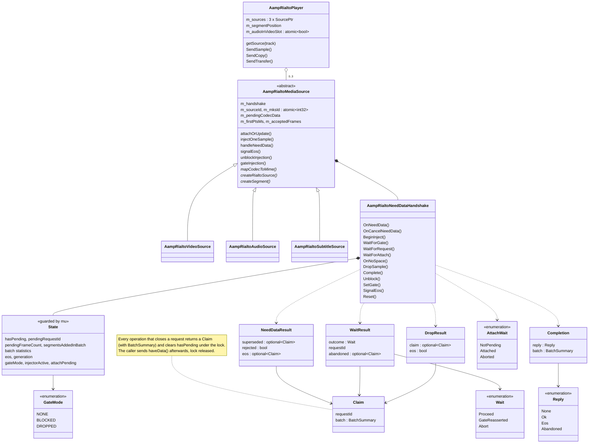

*Source hierarchy and handshake types. `AampRialtoSubtitleSource` is covered on the subtitles page.*

One handshake object lives inside each `AampRialtoMediaSource`. All of its state is in `State`, guarded by `State::mu` and signalled by `State::cv`. The class never calls Rialto: each operation that closes a request returns a `Claim`, and the caller sends the matching `haveData()` after the call returns, so no Rialto IPC happens with the lock held.

| Type / field | Meaning |
| --- | --- |
| `GateMode` `NONE` | Normal. needData is staged; injectors wait for it. |
| `GateMode` `BLOCKED` | Genuinely wanted data must be held back (new session, flush in flight). needData is rejected, injectors block in `WaitForGate`, EOS resolution is deferred. |
| `GateMode` `DROPPED` | Abort: needData rejected, new samples discarded immediately, injectors never block. Set by `Unblock()`. |
| `State::hasPending`, `pendingRequestId`, `pendingFrameCount` | The open Rialto request: its id and how many frames Rialto asked for (clamped to at least 1). |
| `State::segmentsAddedInBatch`, `batch*` sums | Progress of the current batch (count, first PTS, summed duration, media bytes, DRM metadata bytes). Used to decide completion and for log lines. |
| `State::eos` | EOS latched by `SignalEos()`/`SetEos()`/`Unblock(newEos)`. Answered with `haveData(EOS)` when it is safe. |
| `State::generation` | Abort token. `Reset()` and `Unblock()` increment it. An injector captures it before it blocks (`captureGeneration()`); if it changed, the injector abandons its sample. |
| `State::injectorActive` | True between `BeginInject()` and the end of the sample. Stops other threads from answering EOS/abandonment that the active injector will answer itself. |
| `State::attachPending` | True while this source's attachment is deferred (waiting for video). Injectors wait in `WaitForAttach`. |
| `BatchSummary` | Snapshot of the batch taken when a request is claimed (frameCount, first PTS, duration sum, media bytes, metadata bytes). Only for logging the eventual haveData. |
| `Claim` | `{requestId, BatchSummary}`: the right and duty to answer one request. Created by `ClaimPendingLocked()`, which clears `hasPending` and the batch in the same critical section, so exactly one thread can own it. |
| `NeedDataResult` | Result of `OnNeedData()` for the event thread: `superseded` (older unanswered request to answer with NO_AVAILABLE_SAMPLES), `rejected` (gate not NONE: answer the new request with NO_AVAILABLE_SAMPLES), `eos` (answer the new request with EOS now). |
| `AttachWait` | `NotPending`, `Attached`, `Aborted` (generation change). Outcome of `WaitForAttach`. |
| `Wait` | Outcome of the two injector waits: `Proceed`, `GateReasserted` (gate went back to BLOCKED before a request arrived: restart at stage 1), `Abort` (generation changed or DROPPED). |
| `WaitResult` | `{Wait outcome, requestId, abandoned}`. On `Abort`, `abandoned` is a pending request the injector now owns and must answer with NO_AVAILABLE_SAMPLES. |
| `DropResult` | `{claim, eos}` from `DropSample()`: answer with EOS if `eos` else NO_AVAILABLE_SAMPLES. |
| `Segment` | `{ptsSec, durationSec, mediaBytes, metadataBytes}` of a segment Rialto took (whatever the AddSegmentStatus). |
| `Reply` | Decision from `Complete()`: `None` (batch not complete), `Ok`, `Eos`, `Abandoned` (generation changed while addSegment was in flight). |
| `Completion` | `{Reply, BatchSummary}`. |
| `m_bufferFull` (atomic) | Set when addSegment returned NO_SPACE for the current generation; cleared by `Reset()`/`Unblock()` only. Read by pre-roll and logging via `bufferFull()`. |

Operations by calling thread:

| Operation | Called from | What it does |
| --- | --- | --- |
| `OnNeedData`, `OnCancelNeedData`, `WakeWaiters` | Rialto event thread (via `handleNeedData`/`handleCancelNeedData`) | Stage a request (or reject/supersede), drop a cancelled request, wake injectors. |
| `BeginInject`, `WaitForAttach`, `WaitForGate`, `WaitForRequest`, `DropSample`, `OnNoSpace`, `Complete` | The track's injector thread | The injector protocol (section 4). |
| `Unblock`, `SetGate`, `SetEos`, `SignalEos`, `Reset` | Control thread (Flush/Stop/Configure/Ungate sites); `SignalEos` from the AAMP thread calling `EndOfStreamReached`/`Discontinuity` | Abort, gate, EOS and new-session reset. |

## 3. Claim, commit and drop: who answers a request?

A request is open from `OnNeedData()` until exactly one thread **claims** it. Every closing path calls `ClaimPendingLocked()`, which returns a `Claim` once and clears `hasPending`; the claimant then sends `haveData(status, requestId)` outside the lock. Because the claim and the clearing are one critical section, a request is never answered twice and never left open when someone is responsible.

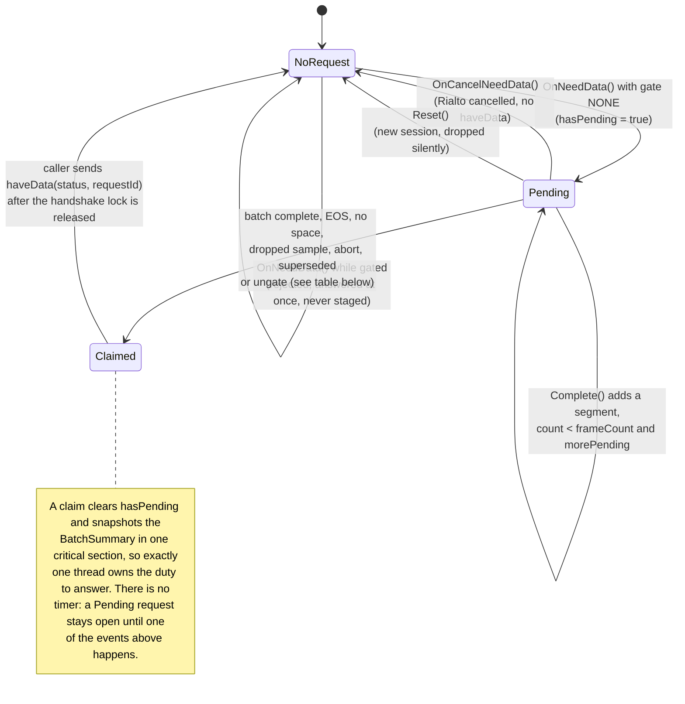

*Lifecycle of one needData request. There is no timer: a Pending request stays open until an event in the diagram happens.*

Events that claim a pending request, and the status of the reply:

| Event | Reply |
|---|---|
| `Complete()` with the batch full, or `morePending` false | `OK` |
| `Complete()` with EOS latched | `EOS` |
| `OnNoSpace()` | `OK`, or `NO_AVAILABLE_SAMPLES` if no frame was added |
| `DropSample()` | `EOS` or `NO_AVAILABLE_SAMPLES` |
| `Unblock()`, or a `WaitFor*()` abort | `NO_AVAILABLE_SAMPLES` |
| A new `OnNeedData()` supersedes it | `NO_AVAILABLE_SAMPLES` |
| `SignalEos()` or `SetGate(false)` | `EOS` |

| Closing path | Status sent | Claimant |
| --- | --- | --- |
| `Complete()` with batch full (`count >= pendingFrameCount`) or `morePending == false` | `OK` | Injector |
| `Complete()` with EOS latched | `EOS` | Injector |
| `OnNoSpace()` (addSegment returned NO_SPACE) | `OK` if at least one frame in batch, else `NO_AVAILABLE_SAMPLES` | Injector (stays active, retries the same sample) |
| `DropSample()` (segment could not be built, DRM rejection, size) | `EOS` if latched, else `NO_AVAILABLE_SAMPLES` (only if it still owns the request) | Injector |
| `WaitForGate`/`WaitForRequest` abort, `Complete()` with changed generation | `NO_AVAILABLE_SAMPLES` | Injector |
| `Unblock()` with no active injector | `NO_AVAILABLE_SAMPLES` | Control thread |
| `OnNeedData()` finds an older unanswered request | `NO_AVAILABLE_SAMPLES` for the old one | Event thread |
| `OnNeedData()` while gate is not NONE | `NO_AVAILABLE_SAMPLES` for the new one (never staged) | Event thread |
| `OnNeedData()` with EOS latched, no active injector, gate not BLOCKED | `EOS` | Event thread |
| `SignalEos()` with pending request, no active injector, gate not BLOCKED | `EOS` | Whoever called `EndOfStreamReached`/`Discontinuity` |
| `SetGate(false)` with a deferred EOS | `EOS` | Control thread |
| `OnCancelNeedData()` | none (Rialto cancelled) | n/a |
| `Reset()` (new session) | none (request dropped silently) | n/a |

"Commit" in this document means the batch bookkeeping: `Complete()` counts each segment Rialto took (even if `addSegment` returned an error status) into the batch; the batch is committed to Rialto by the haveData reply. A batch is complete when the frame count Rialto asked for is reached, or the injector says no more samples are pending (`morePending == false`, end of the current fragment), whichever is first.

## 4. The handshake protocol, scenario by scenario

The injector protocol inside `injectOneSample()`:

1. `BeginInject()`: returns false (sample ignored) only if EOS is already latched and no request is pending; otherwise `injectorActive = true`.
2. Stage 1, `WaitForGate(gen)`: waits while the gate is BLOCKED. Aborts if the generation changed or the gate is DROPPED.
3. Stage 2, `WaitForRequest(gen)`: waits until a request is pending. Aborts on generation change; returns `GateReasserted` if the gate went back to BLOCKED first (loop back to stage 1).
4. Build the segment outside the lock, `addSegment`, then `Complete()` (or `OnNoSpace()` and loop).

Neither wait has a timeout (documented as by design in `AampRialtoMediaSource.h`).

### 4.1 Normal: needData first, then segments

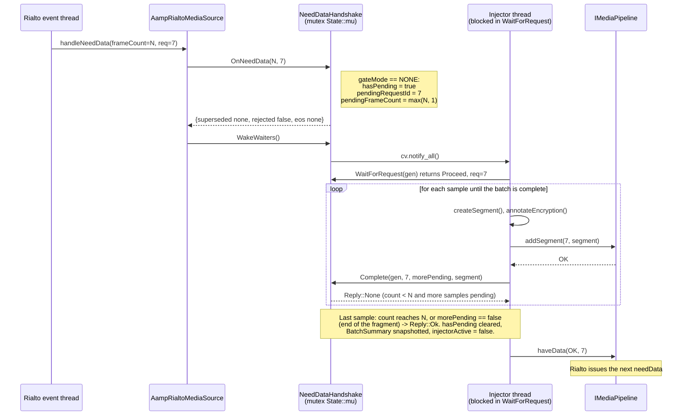

*The event thread stages the request, wakes the injector, which adds samples until the batch is complete.*

`WakeWaiters()` is called by `handleNeedData()` after any replies so that an injector cannot add segments to a request before the superseded/rejected reply is on its way.

### 4.2 Segment arrives before needData

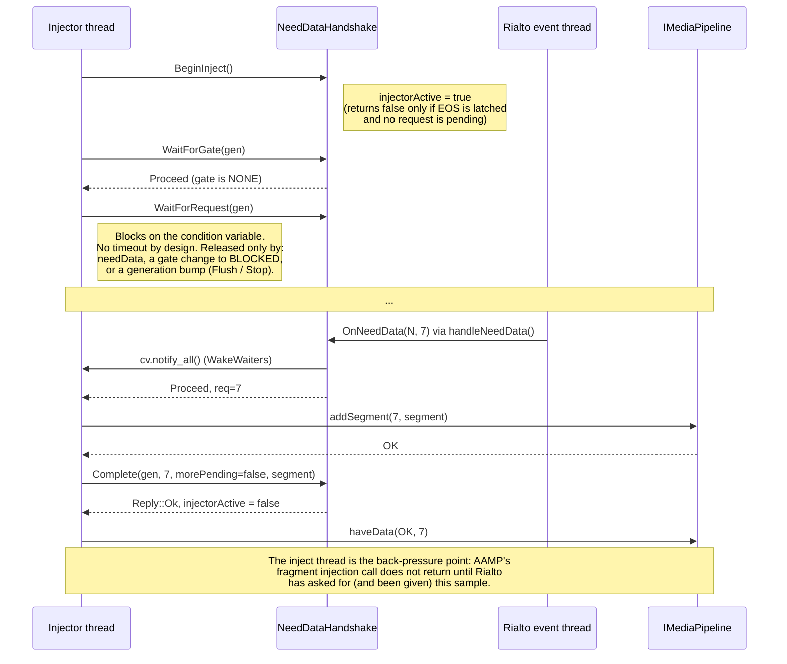

*The injector is already waiting in `WaitForRequest` when Rialto asks.*

This is the steady state for a fast producer: the injector sits in `WaitForRequest` with `injectorActive = true`. Because the injector is active, an EOS signalled meanwhile is not answered by the event thread; it is answered by the injector (`Reply::Eos`) right after the sample, so EOS never overtakes a held sample.

### 4.3 needData when there is nothing to give

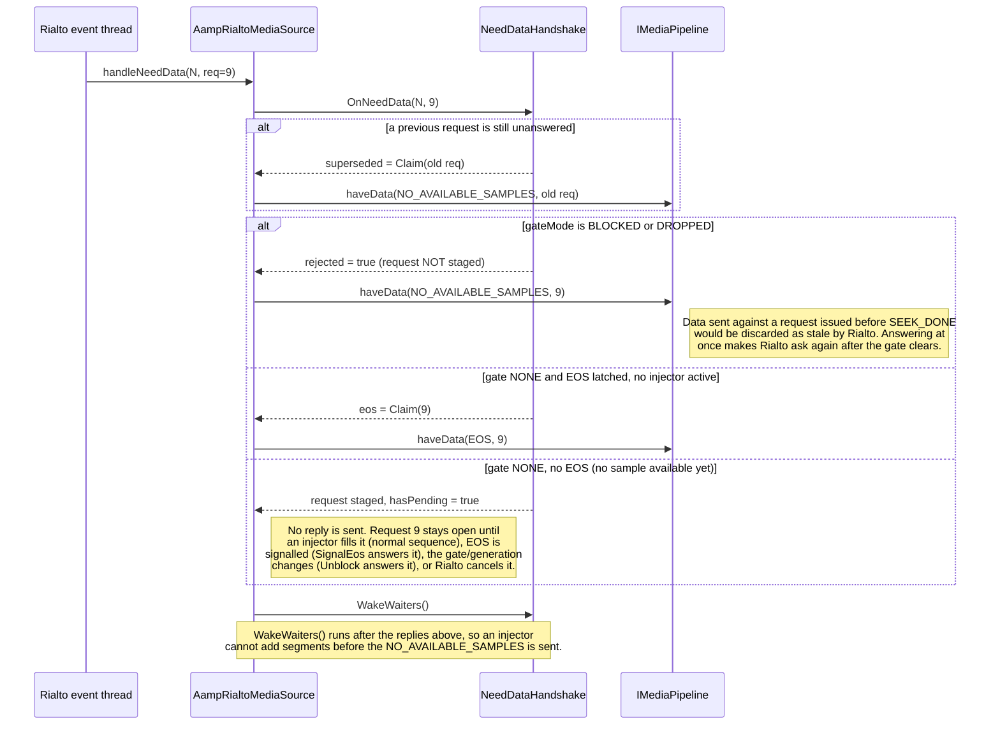

*Rejected, EOS, or simply left open.*

- Gate BLOCKED or DROPPED: the request is answered `NO_AVAILABLE_SAMPLES` immediately and not staged. Rialto treats data sent against a request issued before its `SEEK_DONE` as stale and discards it, so staging it would waste the sample; Rialto asks again once playback resumes.
- EOS latched and nobody active: answered `EOS`.
- Otherwise the request is staged with no reply. It stays open (Rialto waits) until AAMP supplies a sample, EOS, a flush/stop, or Rialto cancels it.

### 4.4 needData expiry, cancellation and supersession

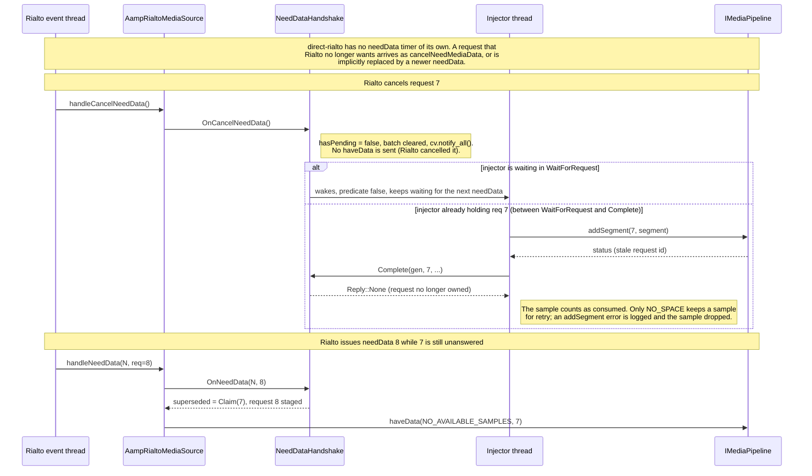

*direct-rialto has no needData timer; it reacts to Rialto's cancel or replacement.*

There is no timeout or "reply deadline" in direct-rialto. A request Rialto no longer wants arrives as `cancelNeedMediaData`; `OnCancelNeedData()` clears the pending request and batch and wakes waiters without replying. A newer needData before an answer (should not normally happen) closes the old request with `NO_AVAILABLE_SAMPLES`, because overwriting it would leave it open on Rialto's side and desynchronise the two. If a cancel races with an injector that already holds the request, the injector's `addSegment` uses a stale id; the sample is counted as consumed (see the edge-case table). Whether Rialto itself times out a request is not visible from this code.

### 4.5 Flush while waiting

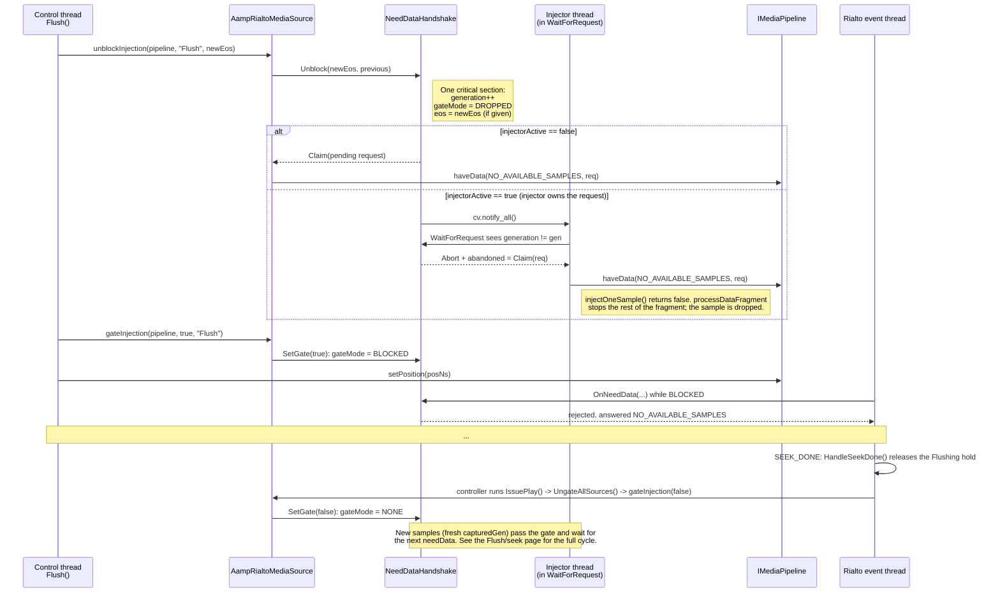

*Flush bumps the generation, drops the gate, then re-gates; SEEK_DONE ungates.*

`Flush()` calls `ResetSourcesForFlush()`, which for every source calls `unblockInjection()` (generation++, DROPPED, optional new EOS value, answer any request nobody owns) and then `gateInjection(true)` (BLOCKED) on the flushable path, so post-seek data is held, not dropped, until `IssuePlay`/`UngateAllSources` runs after `SEEK_DONE`. On the non-flushable path the gate is cleared immediately because no Stream() will follow. An injector that was waiting aborts, answers its own request, and returns false from `injectOneSample`; `processDataFragment` then stops the rest of the fragment. Details of the whole cycle are on the Flush/seek page.

### 4.6 Stop while waiting

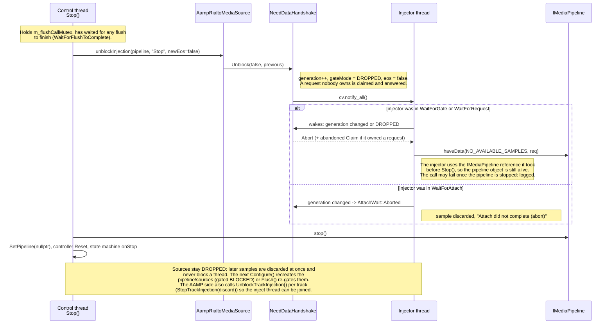

*Stop leaves sources DROPPED, so nothing can block after it.*

`Stop()` unblocks with `newEos = false`, then stops and releases the pipeline. No `gateInjection(true)` follows: Stop ends the session, and a BLOCKED gate with no later ungate would hang an injector forever. The injector keeps its own `shared_ptr` to the pipeline (taken at the start of `SendCopy`/`SendSample`), so its abandoned-request `haveData` still has a live object; the call may fail on a stopped pipeline and is only logged.

### 4.7 Discontinuity

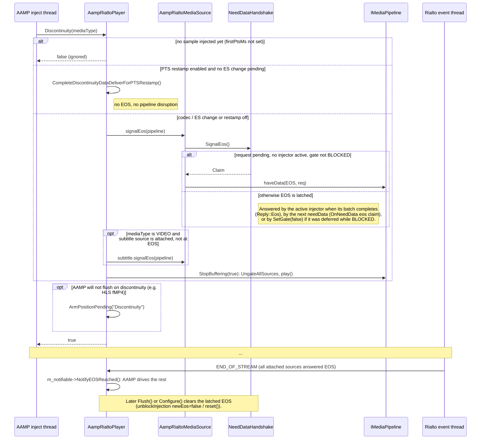

*Discontinuity either absorbs a restamped period change or ends the track with EOS.*

`Discontinuity()` is ignored if the track has not injected a sample yet. With PTS restamping enabled and no elementary-stream change pending, it just tells AAMP to complete the discontinuity (no pipeline disruption). Otherwise it signals EOS on the track (and on the subtitle source when the track is the video track), calls `StopBuffering(true)` (ungates all sources and plays) and tells the underflow monitor the pipeline is paused. Rialto only reports `END_OF_STREAM` once every attached source has delivered `haveData(EOS)`, and AAMP drives the rest of the discontinuity from that notification. If AAMP will not issue an explicit flush for this content (`WillFlushOnDiscontinuity()` false, e.g. HLS fMP4) the player arms `PositionPending`, and the first sample of the elected track performs the flush (section 7).

## 5. Gate mode state diagram

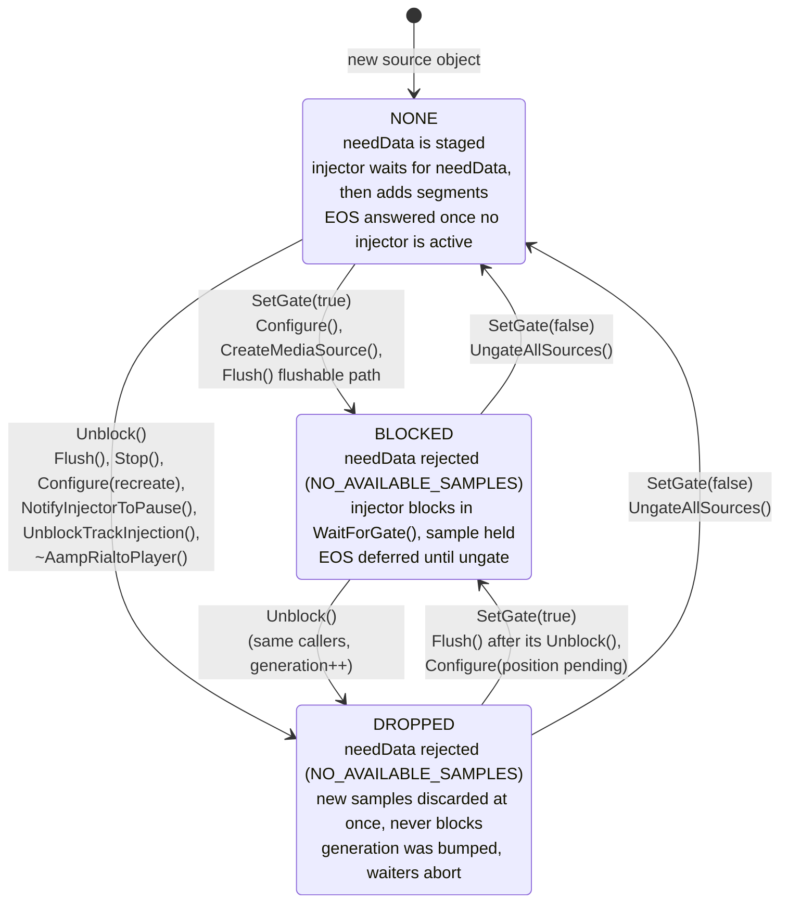

*Gate transitions per source. Ungating happens only where playback is genuinely about to resume.*

Ungate (`SetGate(false)`) happens only where playback really resumes: `IssuePlay()`, `StartPreRoll()`, `Pause(false)`, `StopBuffering()`, `NotifyInjectorToResume()`, and `Flush()` on a non-flushable state. The PLAYING notification does **not** ungate. `Reset()` (new session) deliberately leaves the gate mode unchanged.

Key rules, all from comments in `AampRialtoNeedDataHandshake.h` and `AampRialtoPlayer.cpp`:

- A newly created source is gated BLOCKED immediately (`CreateMediaSource`, before any attach), so an early needData cannot let samples through before the position is known. The same applies to every `Configure()` (`ArmPositionPendingForConfigure`).
- DROPPED means "never block a caller thread" (pause notification, Stop, teardown). BLOCKED means "hold wanted data" (new session, flush in flight).
- `SetGate(false)` is called only from the sites that issue `play()` or resume injection: `IssuePlay()`, `StartPreRoll()`, `Pause(false)`, `StopBuffering()`, `NotifyInjectorToResume()`, and `Flush()` on a non-flushable state. A late `PLAYING` notification deliberately does **not** ungate: it can be an echo of a `play()` issued while `PositionPending` is set, and ungating then would let stale-position data through.
- `Reset()` (new session) leaves the gate alone; clearing it would reopen the gate part-way through a multi-step Configure/Flush sequence (e.g. trickplay `Flush(0)` -> `Configure()` -> `Flush(correctPos)` -> `Stream()`).
- `AttachSource` does not clear the gate either, for the same reason.

The broader "may play be issued" question is in the existing gating diagram:

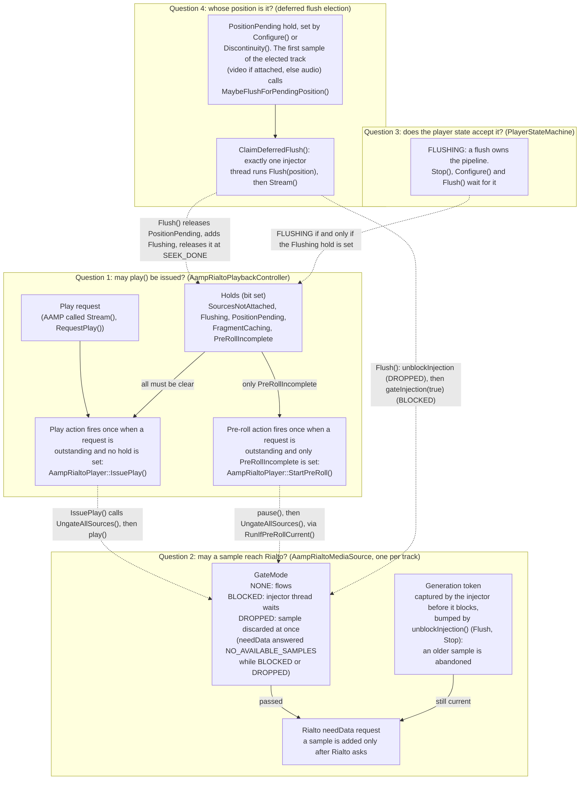

*When may playback start and when may a sample reach Rialto.*

`Configure()` gates every new source (BLOCKED), so an early needData cannot slip samples in before the position is known. Ungating happens only where the controller issues `play()` or starts pre-roll, and in a few explicit resume paths. A late PLAYING notification deliberately does not ungate. Both run under the controller's play lock, so a `Flush()` cannot add its hold (and gate) part-way through, and a pre-roll whose episode a hold has already ended does nothing.

## 6. `SendCopy`, `SendSample` and `SendTransfer`

| Entry point | Used for | What it does |
| --- | --- | --- |
| `SendSample(type, AampMediaSample&&, morePending)` | fMP4 samples demuxed by AAMP's `AampMp4Demuxer` (DASH, HLS-MP4), including trickplay I-frames | ID3 check, `getSource()`, `MaybeFlushForPendingPosition(type, pts)`, `source->injectSingleSample()` (`waitForAttach`, capture generation, take pending codec data, `injectOneSample`). Returns the injection result (the caller ignores it). |
| `SendCopy(type, buffer, fpts, fdts, fDuration)` | HLS-TS ES frames from `TSProcessor`, ID3 (DSM-CC) packets, progressive | See activity diagram below. Wraps the buffer as one sample (ES path). |
| `SendTransfer(type, buffer, fpts, fdts, fDuration, fragmentPTSoffset, initFragment, discontinuity)` | Tracks with no `playContext`: init segments of disabled tracks, raw TTML/WebVTT | `initFragment`: `processInitFragment()` (own `Mp4Demux`), then `AttachSource` under `m_attachMutex`. Otherwise `MaybeFlushForPendingPosition` then `processDataFragment()`. Returns true for "no source" or empty buffer. `discontinuity` is only logged. |

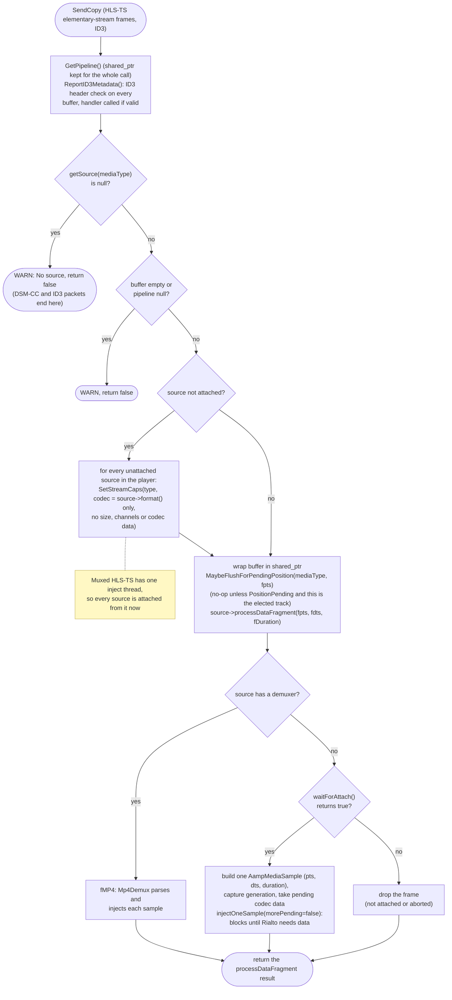

*Decision flow of `SendCopy`.*

`processDataFragment()` has two modes. Without a demuxer (HLS-TS ES, raw subtitle) it builds one `AampMediaSample` from the buffer (`mData` aliases the buffer so the buffer lives as long as the sample), with `morePending = false`. With a demuxer it parses the fMP4 with `Mp4Demux`, injects each sample, passes the pending codec data only with the first sample and sets `morePending` for all but the last. If `injectOneSample` returns false mid-batch, the loop `break`s (a flush or stop aborted it).

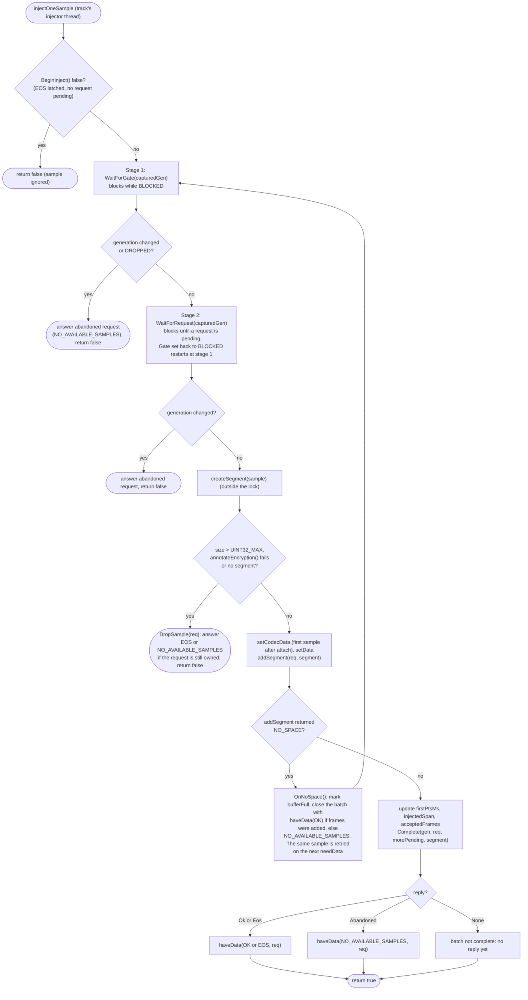

*What happens to one sample on the injector thread.*

## 7. Segment positions: stage, commit, elect

`AampRialtoSegmentPosition` (all atomics, no blocking) holds three independent things:

| Concept | API | Meaning |
| --- | --- | --- |
| Staged request | `StageRequested(posNs, rate, authoritative)`, `StagedPositionNs()`, `StagedRate()`, `ConsumeAuthoritative()` | What `Flush()` asked for and has not yet committed. `AttachSource` uses the staged position to place a newly attached source (`setSourcePosition(id, pos, resetTime=true, appliedRate)`). `authoritative` says the caller's position is the real resume position, not a placeholder; it is consumed once by `Configure()` to decide whether to re-arm the pending-position gate. |
| Baseline (commit) | `CommitBaseline(posNs)`, `BaselineNs()` | Where the current segment actually starts. Committed on `SEEK_DONE` (to the staged position, since the seek may land mid-fragment) and when the **video** source first attaches (`max(0, staged)`). `GetPositionMilliseconds()` subtracts it from Rialto's `getPosition()`. |
| Deferred-flush claim | `ResetFlushClaim()`, `ClaimDeferredFlush()` | Elects exactly one injector thread to run the deferred `Flush()` when the real position is known only from the first sample of a new period. First caller wins until `ResetFlushClaim()` re-opens it. |

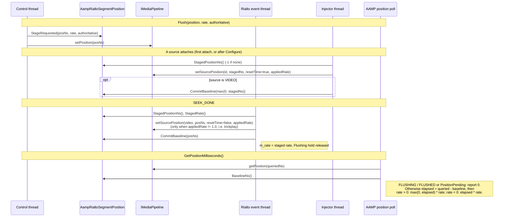

*Stage on Flush, commit on attach/SEEK_DONE, subtract when reporting position.*

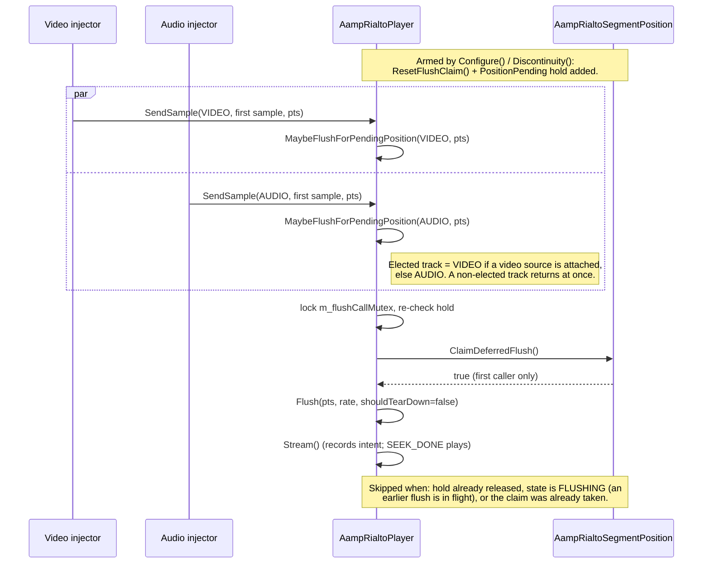

*Video and audio injectors race; only the elected track's first sample, and only the first claimant, flushes.*

Position reporting (`GetPositionMilliseconds`): returns 0 while the state machine is FLUSHING/FLUSHED or `PositionPending` is held (no reliable position yet); otherwise `(getPosition() - baseline)` in ms, clamped at 0 for forward play and multiplied by the rate (negative values allowed in reverse trickplay, mirroring GStreamer's `(pos - segmentStart) * rate`). The caller adds its own seek position, so the value is segment-relative, not absolute. `GetVideoPTS()` has no Rialto API; it derives a 90 kHz PTS from `getPosition()`.

## 8. Timestamps and rate

| Item | Behaviour |
| --- | --- |
| Units | AAMP uses `double` seconds. Segments get nanoseconds: `SecondsToNs(mPts)` and `SecondsToNs(mDuration)`, rounded to nearest (truncation turned 1.001 s into 1000999999 ns). Statistics (`firstPtsMs`, `injectedSpanMs`) use `SecondsToMs`. |
| What reaches Rialto | Only `mPts` (time position) and `mDuration`. `mDts`, `mIsKeyFrame` and `mDisplayOffsetMs` are not put into video/audio segments (subtitles use the display offset: see subtitles page). |
| fMP4 via `SendSample` | `AampMp4Demuxer` computes `mPts = (dts + compositionOffset) / timescale` (in `Mp4Demux`) and, when PTS restamping is on, adds `fragmentPTSoffset` to PTS and DTS **before** calling the sink. direct-rialto adds nothing. |
| HLS-TS via `SendCopy` | `TSProcessor` supplies `info.pts_s`, `info.dts_s`, `info.duration` per ES frame (restamped upstream if enabled). `SendCopy` passes `fpts/fdts/fDuration` straight through and `0.0` as offset. |
| `SendTransfer` + internal `Mp4Demux` | `fragmentPTSoffset` is accepted but **ignored** by `processDataFragment()` (parameter is unnamed). Internal demux times are used raw. |
| `firstPtsMs` | PTS of the first segment Rialto accepted since the last `reset()`/`unblockInjection()`. Used by `Discontinuity()` ("has this track injected yet?") and for diagnostics. |
| Rate | Not applied to segment timestamps. Trickplay uses Rialto's applied rate: `computeAppliedRate()` returns the rate only for the video source when `rate != 1` and Rialto reports the video is not the master clock (`isVideoMaster`). It is passed on attach and, after `SEEK_DONE`, via `setSourcePosition(video, pos, resetTime=false, appliedRate)`. During trickplay audio and subtitle sources are forced EOS so Rialto's clock is not stalled waiting for audio (audio stays live in audio-only content). |

## 9. Back-pressure: what blocks the injector, for how long, and what releases it

The injector thread (one per track; one shared thread for muxed HLS-TS) blocks **inside** `SendSample`/`SendCopy`/`SendTransfer`, so AAMP's fragment cache fills and its downloader slows. direct-rialto does not translate needData/enoughData into `StopTrackDownloads`/`ResumeTrackDownloads` (`BlockUntilGstreamerWantsData`); the only `ResumeTrackDownloads` calls are on source creation/reuse and after a subtitle caps update.

| Where it blocks | Condition | Timeout | Released by |
| --- | --- | --- | --- |
| `WaitForAttach` (`waitForAttach`) | `attachPending` and not attached (audio waiting for video) | none | The source attaching, or a generation change (Flush/Stop/Configure recreate/new session) |
| `WaitForGate` | gate BLOCKED | none | `SetGate(false)` (an ungate site) or generation change (then Abort) |
| `WaitForRequest` | no request pending | none | needData; gate re-set to BLOCKED (back to stage 1); generation change (Abort) |
| NO_SPACE retry | Rialto has no space for the sample | none | Next needData (batch is closed first) or abort |

Things that do **not** release a waiting injector: EOS (`SignalEos` calls `WakeWaiters`, but the wait predicates do not test EOS; an active injector's sample is delivered first), a PAUSED notification (deliberately ignored: Rialto keeps sending needData while paused/buffering, so threads stay blocked rather than discarding data).

Flush and stop abort waits by bumping the generation (see 4.5, 4.6). `DROPPED` makes any later sample return immediately without blocking. For fMP4, `AampMp4Demuxer` additionally has an abort flag checked between samples, because `SendSample`'s result is not returned to it (see register).

## 10. Muxed HLS-TS: one thread feeds all tracks

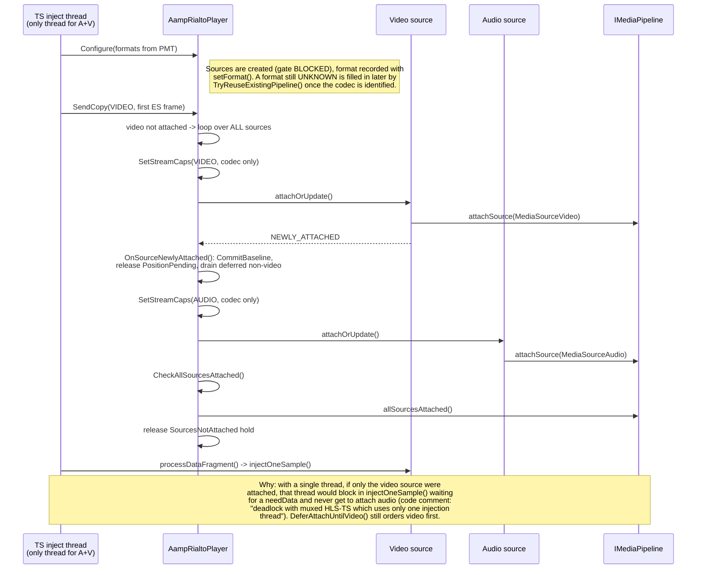

*In `SendCopy`, the first frame attaches every source from the one TS inject thread.*

In muxed HLS-TS, `TSProcessor` demuxes video, audio and ID3 from one stream on a single injection thread. The code comment in `SendCopy` says all sources are attached up front "to avoid deadlock with muxed HLS-TS which uses only one injection thread". The mechanism (inferred from the code): if only the first source were attached, that thread would block in `injectOneSample` waiting for needData, and could never reach the attach of the others; Rialto is not asked for data until `allSourcesAttached()`, which needs every source.

- The codec is unknown until the PMT is parsed. `Configure()` is called again once the TS demuxer identifies it; sources are created with `FORMAT_UNKNOWN` and `TryReuseExistingPipeline()` records the real format with `setFormat()` when the pipeline is reused.
- In `SendCopy`, `SetStreamCaps` is called with a `MediaCodecInfo` holding **only the codec format** (`toGstStreamOutputFormat(source->format())`). The comment: "the codec format is all that Rialto requires to set the stream caps". Width/height, channels, sample rate and codec data are therefore zero/empty on this path.
- A still-`GST_FORMAT_UNKNOWN` attach is "skipped" with a warning, not a playback error (`ReportAttachFailure`), because a later `Configure()` is expected to resolve it. Inband-CC subtitle legitimately uses `GST_FORMAT_UNKNOWN`, so it is excluded.
- `DeferAttachUntilVideo()` makes non-video sources wait for the video attach (a first tune that attached audio first was observed to give `audsrc: not-linked (-1)` and an ERROR; the cause is not confirmed). It returns false when there is no video source (audio-only), so audio attaches directly.
- Because ES frames are passed with `morePending = false`, every frame closes its batch with `haveData(OK)` (see register).

## 11. Source types, caps and codec identification

### 11.1 Where the codec comes from

| Content | Who identifies the codec | How |
| --- | --- | --- |
| DASH / HLS-MP4 (fMP4) | `StreamAbstractionAAMP_MPD/HLS::GetStreamFormat` predicts it from the manifest codec string (`AampUtils.cpp`: `GetMp4DemuxVideoFormatForCodec`, `GetMp4DemuxAudioFormatForCodec`); `Mp4Demux` confirms it from the sample entry box fourcc | Manifest map: `avc1.`, `hvc1.`, `hev1.`, `mp4a.40.2`, `mp4a.40.5`, `ec-3`, `eac3`, `ac-4.02.01.01/02`. Anything else is `FORMAT_UNKNOWN` at `Configure()` time, resolved later by `SetStreamCaps`. Box map in `MP4Demux.cpp`: `avcC`, `hvcC`, `esds`, `dec3`, `dac4`, `stpp`, `wvtt`. |
| HLS-TS | `TSProcessor` after the PMT | `Configure()` again, then `SetStreamCaps(codec only)` from `SendCopy`. |

`StreamOutputFormat` (used by `Configure`) and `GstStreamOutputFormat` (used by the source hooks) share enumerator order; `Configure()` converts with a `static_cast`, whereas `SendCopy` converts with an explicit table (`toGstStreamOutputFormat`).

### 11.2 Mapping to Rialto

`attachOrUpdate()` calls the source's `mapCodecToMime()`; false means `AttachResult::FAILED`.

| Source | AAMP format | Rialto mime | `StreamFormat` | Notes |
| --- | --- | --- | --- | --- |
| Video | `GST_FORMAT_VIDEO_ES_H264` | `video/h264` | `AVC` if `mNaluLengthPrefixed` (avcC samples) else `BYTE_STREAM` (HLS-TS Annex-B) | Codec data = `avcC`. |
| Video | `GST_FORMAT_VIDEO_ES_HEVC` | `video/h265` | `HVC1` if length-prefixed else `BYTE_STREAM` | `HEV1` enum exists in Rialto but is never produced; `hev1.` streams are mapped as hvcC to `HVC1`. |
| Audio | `GST_FORMAT_AUDIO_ES_AAC_RAW` | `audio/aac` | `RAW` | From MP4 `esds`; codec data from the esds config. |
| Audio | `GST_FORMAT_AUDIO_ES_AAC` | `audio/mp4` | `UNDEFINED` | HLS-TS ADTS AAC (per comment). |
| Audio | `GST_FORMAT_AUDIO_ES_AC3`, `GST_FORMAT_AUDIO_ES_EC3` | `audio/x-eac3` | `UNDEFINED` | Pinned rialto-gstreamer v0.20.1 maps both AC-3 and EAC-3 to this mime. |
| Audio | `GST_FORMAT_AUDIO_ES_AC4` | `audio/x-ac4` | `UNDEFINED` | From `dac4`. |
| Audio | `MP3`, `ATMOS` | none | n/a | Not mapped: attach fails (see edge cases). |
| Video | `MPEG2` | none | n/a | Not mapped. |
| Subtitle | TTML, WebVTT, MP4 subtitle, inband CC | see subtitles page | | `AampRialtoSubtitleSource`. |

Per-source attributes passed to Rialto:

| | Video | Audio |
| --- | --- | --- |
| Rialto source | `MediaSourceVideo(mime, hasDrm=true, width, height, SegmentAlignment::AU, streamFormat, codecData)` | `MediaSourceAudio(mime, hasDrm=true, AudioConfig{channels, sampleRate, codecSpecificConfig}, SegmentAlignment::UNDEFINED, streamFormat, codecData)` |
| Cached metadata | width, height | sample rate, channel count (warns if codec data is empty) |
| Segment | `MediaSegmentVideo(sourceId, ptsNs, durationNs, width, height)` | `MediaSegmentAudio(sourceId, ptsNs, durationNs, sampleRate, channels)` |

`hasDrm` is hard-coded `true` in both (the incoming argument is ignored); see register.

### 11.3 Audio-only content on the video slot

Audio-only DASH content with `Mp4Demux` reports an audio codec on the **video** slot with no audio track. A video source cannot map an audio codec, so attach used to fail. `Configure()` now detects `isAudioOutputFormat(reportedVideoFormat) && reportedAudioFormat == FORMAT_INVALID`, treats the content as audio-only on the audio slot (video format becomes `FORMAT_INVALID`, so no video and no inband-CC source) and stores `m_audioInVideoSlot`.

- `getSource(track)` maps the AAMP VIDEO track to the audio source (`toSourceSlot`); `toAampTrack` maps back for notifications (`NotifyBufferUnderflow`, `ResumeTrackDownloads`). `getSourceInSlot` bypasses the mapping.
- The flag is published only when the source set is known (on reuse, or immediately before `CreateSources`) so `getSource` never maps into a mismatching set.
- Protection lookup (`ProtectionFor`) prefers the entry queued under the AAMP track, then the source slot, then (for encrypted non-video sources) the video entry (HLS convention).
- Audio is the primary track: during trickplay audio is not forced EOS (`ResetSourcesForFlush`), pre-roll monitors audio (`StartPreRoll`), and the deferred-flush election picks audio (`MaybeFlushForPendingPosition`) when no video source is attached.
- `DeferAttachUntilVideo` returns false without a video source, so audio attaches immediately.
- `OnSourceNewlyAttached` commits the baseline and releases `PositionPending` only for a **video** attach, so audio-only tunes resolve their position through the deferred flush on the first sample (see Open questions).

## 12. Encrypted samples

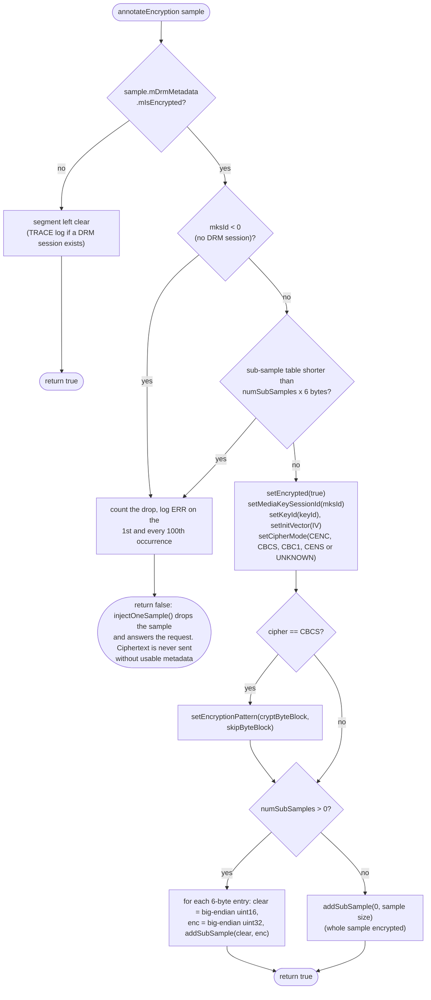

*How an `AampMediaSample` with DRM metadata becomes an encrypted `MediaSegment`.*

- **Session**: `ProtectionParams{systemId, initData, type}` are queued by `QueueProtectionEvent()` (stored player-wide per slot, survive session resets; cleared by `ClearProtectionEvent()`). On first attach, `attachOrUpdate()` calls `drmBridge->createSession()` and stores the `mksId`. If the source is already attached, a new session is created only when the params differ from `m_activeProtection` (so params re-queued every period do not cause license round trips); a failed update keeps the previous `mksId`.
- **Per sample** (`annotateEncryption`, from `sample.mDrmMetadata`): `setEncrypted(true)`, `setMediaKeySessionId(mksId)`, `setKeyId`, `setInitVector`, `setCipherMode` (CENC, CBCS, CBC1, CENS or UNKNOWN via `cipherTypeToRialto`; the demuxer only produces CENC/CBCS). For CBCS, `setEncryptionPattern(cryptByteBlock, skipByteBlock)`.
- **Sub-samples**: the table `mSubSamples` has `mNumSubSamples` entries of 6 bytes: 2-byte big-endian clear count, 4-byte big-endian encrypted count, each added with `addSubSample`. With zero sub-samples the whole payload is declared encrypted (`addSubSample(0, size)`).
- **Rejection**: an encrypted sample with no session (`mksId < 0`) or a sub-sample table shorter than declared is **dropped**, never sent as ciphertext without usable metadata. The drop is counted and logged at ERROR on the first and every 100th occurrence.
- An unencrypted sample on a source with an active session goes out clear (TRACE log). Metadata bytes (key id + IV + table) are only counted for batch logging.

## 13. EOS

`EndOfStreamReached(type)` calls `signalEos` on the source; for the video track it also signals the attached subtitle source if it is not already EOS (Rialto sends `END_OF_STREAM` only when all attached sources answered EOS, and a subtitle source may never receive data). `Discontinuity()` and the trickplay-audio-going-invalid path in `TryReuseExistingPipeline()` use the same mechanism. EOS is latched in the handshake and answered, in this order of precedence: by the active injector after its sample, by the next needData, or by `SetGate(false)` if deferred behind a BLOCKED gate. It is never answered ahead of data held behind the gate, and is cleared by `unblockInjection(newEos=false)` (Stop/Flush), `setEos(false)` (trickplay exit) or `reset()`.

## 14. ID3 metadata

`ReportID3Metadata()` runs first in `SendCopy`, `SendTransfer` and `SendSample`, before the source lookup, on every buffer. If the media type is audio, video or DSM-CC and the first bytes are an ID3v2 header (`"ID3"`, major >= 2), the stored `id3_callback_t` (guarded by `m_id3HandlerMutex`, replaced by `ChangeAamp`) is called with the data and `SegmentInfo{pts, dts, duration}`. Metadata is **not** forwarded to Rialto: HLS-TS ID3 arrives as `eMEDIATYPE_DSM_CC` through `SendCopy`, which has no source, so after the callback it ends with a "No source" warning and returns false.

## 15. Threading and locks on the data path

| Entry point | Thread | Lock(s) |
| --- | --- | --- |
| `SendSample` / `SendCopy` / `SendTransfer(data)` | The track's AAMP injector thread (one shared thread for muxed HLS-TS) | `m_sourcesMutex` (brief, in `getSource`); `State::mu` inside handshake calls, released while waiting on `State::cv`; no player-level lock is held while blocked |
| `SetStreamCaps`, `SendTransfer(init)`, `CreateSubtitleSource` | Injector thread (or the control thread for subtitle creation) | `m_attachMutex` (can be held through a DRM license fetch); `State::mu` briefly for `attachPending` |
| `MaybeFlushForPendingPosition` | Elected injector thread | `m_flushCallMutex` (recursive), then the state-machine/controller locks inside `Flush()` |
| `OnNeedMediaData` -> `handleNeedData`, `OnCancelNeedMediaData`, `OnBufferUnderflow` | Rialto event thread | `State::mu` only inside `OnNeedData`/`OnCancelNeedData`; Rialto calls (`haveData`) made after the lock is released |
| `HandleSeekDone`, `IssuePlay`, `UngateAllSources` | Rialto event thread (SEEK_DONE) or the caller of `Stream()`/`Pause(false)` | controller play lock; `State::mu` briefly per source |
| `Flush`, `Stop`, `Configure` | Control thread | `m_flushCallMutex` (Flush, Stop); `State::mu` briefly via `unblockInjection`/`gateInjection` |
| `Discontinuity`, `EndOfStreamReached` | AAMP thread (not the Rialto event thread) | `State::mu` briefly via `signalEos` |

Per-source atomics: `m_sourceId`, `m_mksId` (written on attach/reset, read from injector and event threads), `m_firstPtsMs`, `m_lastAcceptedEndMs`, `m_acceptedFrames`, `m_needDataCount`, `m_streamFormat`, `m_bufferFull`. `m_pendingCodecData` has its own mutex and is staged by `attachOrUpdate()` and taken by the injector for the first sample. Full lock ordering is on the threading page.

### Per-track versus shared state

| Per track (`AampRialtoMediaSource` instance) | Shared (player-wide) |
| --- | --- |
| Handshake `State` (request, batch, gate, generation, EOS, injector/attach flags) | `AampRialtoSegmentPosition` (staged position/rate, baseline, claim) |
| Rialto source id, DRM session id (`mksId`), `m_activeProtection` | `m_pendingProtection[3]` queued per slot, `m_pendingAttach[3]` deferred attach info |
| Pending codec data, demuxer (internal `Mp4Demux`), stream format | `m_audioInVideoSlot`, `m_rate`, play holds (`PlaybackController`), state machine |
| Statistics: first PTS, accepted frames, accepted span, needData count, dropped-sample count, buffer-full | DRM bridge, ID3 handler, source array `m_sources` (guarded by `m_sourcesMutex`) |
| Width/height or sample rate/channels | Pipeline (`m_session`), progress timer, monitors |

`reset()` (new session) clears handshake state, ids, statistics and codec data but not the gate mode (see section 5) and not `m_streamFormat`, so `Configure()` can compare formats between sessions.

## 16. Logging cadence

`handleNeedData()` logs the first needData after a reset/flush and then every `kNeedDataLogInterval` (100th) at INFO with a summary (accepted frames, injected span, buffer-full); the others are TRACE. `haveData` replies are logged at TRACE with a batch summary. NO_SPACE, first-PTS-set, gate/EOS transitions and abort paths log at INFO. `AampRialtoPlayer::OnNeedMediaData` itself logs at INFO on every request (see register).

## 17. Error and edge-case table

| Situation | Behaviour |
| --- | --- |
| No source for the track | `SendCopy`/`SendSample`: WARN, return false. `SendTransfer`: INFO, return true (ignored). DSM-CC/ID3 packets hit this by design. |
| Empty buffer | `SendCopy`: WARN, false. `SendTransfer`: true. |
| No pipeline | `SendCopy`: WARN, false. `SendTransfer`: init path logs error "pipeline not created"; data path does nothing and returns true. `SendSample`: not injected. |
| Unknown codec for the source (`mapCodecToMime` false) | `AttachResult::FAILED`. If format is `GST_FORMAT_UNKNOWN` (non-subtitle): WARN "codec not yet identified", no error. Otherwise `NotifyPlaybackError(AAMP_TUNE_GST_PIPELINE_ERROR, ..., retry=false)`. |
| `attachSource()` fails | Same FAILED path; `attachPending` cleared and waiters notified. |
| Encrypted sample, no DRM session / short sub-sample table | Sample dropped, request answered, ERROR log on 1st and every 100th. |
| Sample larger than 4 GiB | Dropped (ERROR); Rialto segment size is 32-bit. |
| `createSegment` returns null | Sample dropped via `DropSample()`. |
| `addSegment` NO_SPACE | Batch closed with OK (or NO_AVAILABLE_SAMPLES if empty); `m_bufferFull` set; same sample retried on next needData. |
| `addSegment` ERROR | WARN; sample counted into the batch by `Complete()` and **not** retried. |
| needData frameCount 0 | Treated as 1. |
| needData for unknown Rialto sourceId | WARN "unknown sourceId"; **never answered** (no source to claim it). |
| needData with null pipeline | `respondAbandonedRequest` logs and drops (nothing to answer); EOS reply skipped. |
| Second needData before first answered | First answered NO_AVAILABLE_SAMPLES. |
| needData while gate not NONE | Answered NO_AVAILABLE_SAMPLES immediately, not staged. |
| cancelNeedData | Pending request and batch dropped, waiters woken, no reply. |
| Generation changes while `addSegment` is in flight | `Complete()` returns `Abandoned`: haveData(NO_AVAILABLE_SAMPLES). |
| Sample arrives after EOS answered | `BeginInject()` false: ignored. |
| `WaitForAttach` aborted | Frame discarded, INFO log. |
| `Discontinuity` before first sample | Ignored, returns false. |
| haveData fails | WARN only; no retry. |
| ID3 header invalid or short | Ignored. |
| Pipeline already gone when abandoning | INFO "pipeline gone - dropping abandoned requestId". |

## Open questions

1. **Buffer lifetime versus Rialto's contract.** `MediaSegment::setData` documents that the buffer must stay valid until the matching `haveData()` completes. `injectOneSample` does not copy; the sample (and the demuxer's segment buffer) is kept alive only by the caller until the fragment's last sample returns. Forcing `haveData(OK)` at `morePending == false` appears to guarantee a reply before the buffer dies, but no code comment states this is the reason, and the NO_SPACE path replies while a retained sample is still pending. Needs confirmation with the Rialto owners.
2. **Reachability of the internal `Mp4Demux` path.** With `useMp4Demux` forced on, fMP4 audio/video use `AampMp4Demuxer`. The `processInitFragment`/`processDataFragment`-with-demuxer path in `AampRialtoMediaSource` appears reachable only through `SendTransfer` for tracks with no `playContext` (e.g. cached init headers of disabled tracks). Whether media fragments still take it, and whether the duplicate demuxer is still needed, was not verified.
3. **Audio-only deferred flush.** Because `PositionPending` is released only on a video attach, audio-only tunes always flush on their first sample. Intended, or an oversight of the audio-only change (`673f66d1`)?
4. **Failed deferred attach and waiters.** `ReportAttachFailure` clears `attachPending` and notifies, saying waiters "now discard their frame", but the `WaitForAttach` predicate is `attached() || generation changed`; it does not include `attachPending`. Does a waiter really wake, or only on the next generation bump?
5. **ADTS AAC mime.** `GST_FORMAT_AUDIO_ES_AAC` maps to `audio/mp4` with `UNDEFINED` stream format while the comment describes ADTS. Is that what Rialto's server expects?
6. **`hasDrm` for clear HLS-TS.** The video source forces `hasDrm=true` to avoid a Rialto server crash seen during testing; the GStreamer path uses `false` for HLS-TS video. Root cause not documented.
7. **Rialto-side needData lifetime.** Whether the Rialto server times out an unanswered request (and then sends cancelNeedData) cannot be determined from direct-rialto.
8. **Rationale for the three-way status on NO_SPACE** (OK versus NO_AVAILABLE_SAMPLES by frame count) follows the Rialto API comment on `addSegment`; the effect of NO_AVAILABLE_SAMPLES on Rialto's request pacing was not verified.

## Related pages

- [Lifecycle and state machine](02-player-lifecycle-and-state-machines.md)
- [Flush and seek](04-flush-seek-and-preroll.md)
- [Threading model and locking](05-threading-and-locking-model.md)
- [DRM](06-drm.md)
- [Subtitles and TTML](07-subtitles-cc-and-ttml-offset.md)
- [Workarounds and improvement register](11-workarounds-and-improvement-register.md)

## Workarounds and improvement candidates

See the [DATA rows in the register](11-workarounds-and-improvement-register.md#media-data-path-data). Highlights: no timeouts on injector waits and one INFO log per needData (DATA-01, DATA-02); video `hasDrm` forced true and AC-3 mapped to EAC-3 for a pinned Rialto version (DATA-04, DATA-05); the audio-before-video attach deferral that is observed but not root-caused (DATA-03); muxed HLS-TS attaches with codec-only caps and one haveData per ES frame (DATA-06, DATA-07); `fragmentPTSoffset` ignored on the `SendTransfer` demux path and duplicate demuxers (DATA-08, DATA-09); AAMP-side workarounds caused by blocking injection (`AampMp4Demuxer::mAborted`, `StopTrackInjection` unblock, subtitle `ResumeTrackDownloads`) (DATA-10 to DATA-12); a possible stuck waiter after a failed deferred attach (DATA-16); stale comments and stubs (DATA-15, DATA-20).
