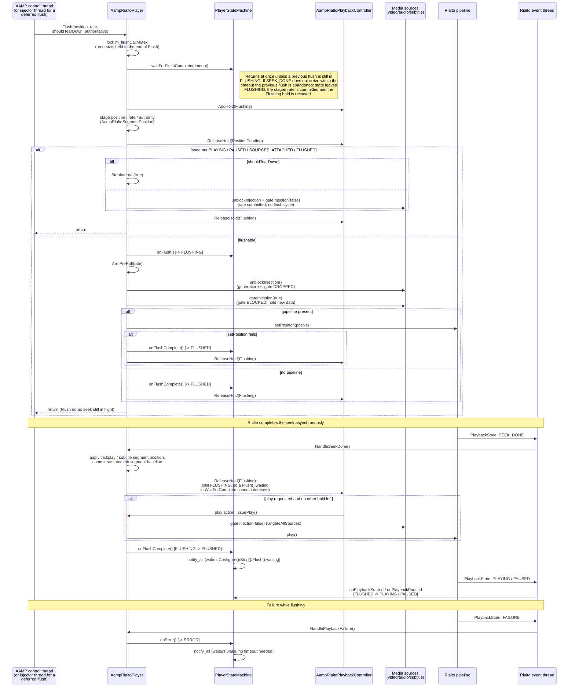
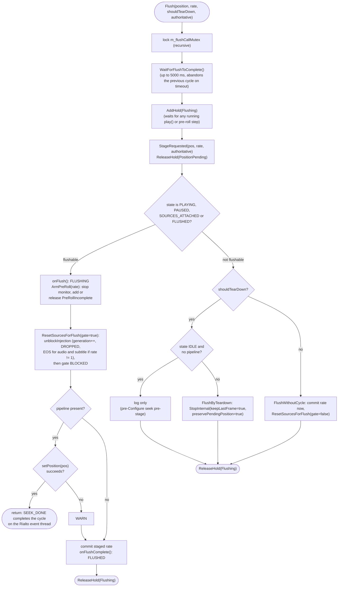
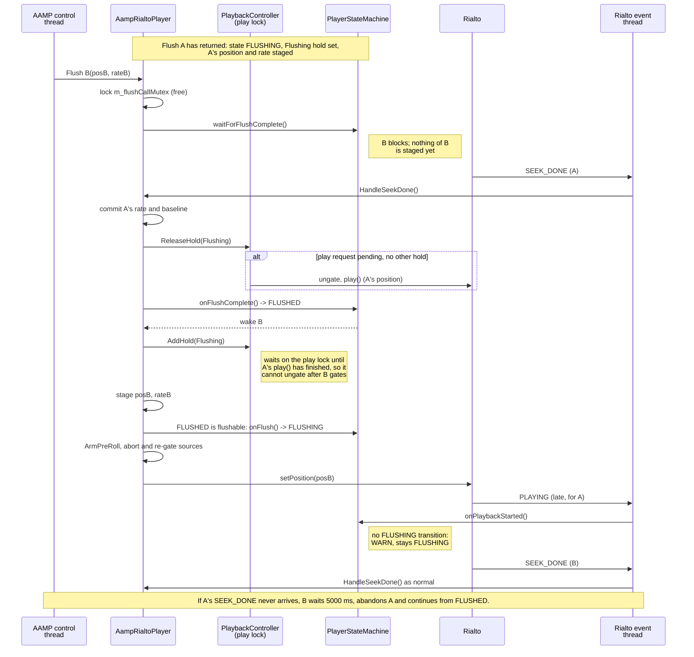
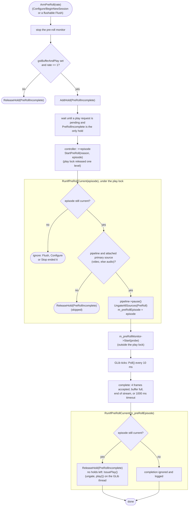
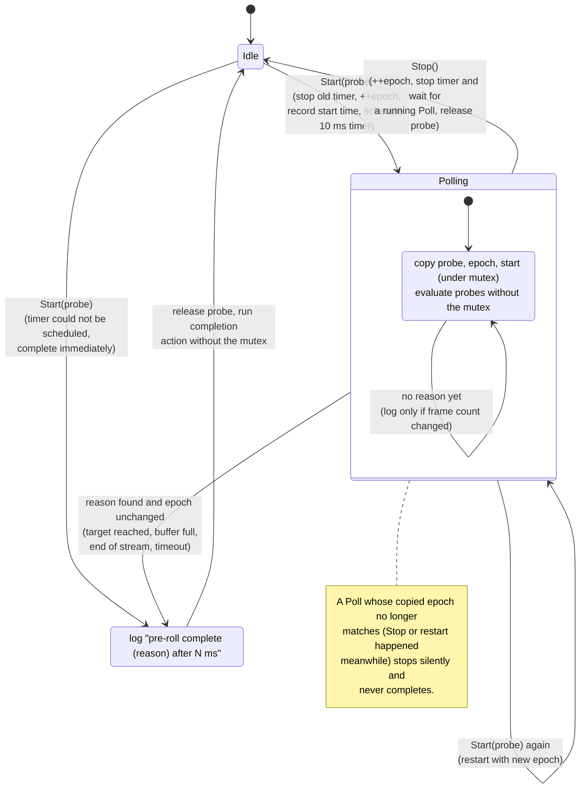
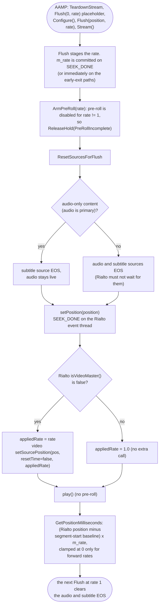

# Direct Rialto - Flush and seek

## Purpose

This page explains how the direct-rialto player moves the Rialto pipeline to a
new position (flush/seek), what it throws away when it does, and how it
decides when playback may restart afterwards. It also covers pre-roll (filling
Rialto with data before `play()`) and trick-play (rates other than 1x),
because both are armed by the same flush call and released by the same hold
mechanism. Read it when debugging a seek that hangs, plays from the wrong
place, reports a jumping position, or starts without buffered data.

## Source files

| File | Role |
|---|---|
| `direct-rialto/AampRialtoPlayer.cpp` / `.h` | `Flush()` and its steps (`FlushByTeardown`, `FlushWithoutCycle`, `ResetSourcesForFlush`, `IssueFlushSeek`), `WaitForFlushToComplete()`, `MaybeFlushForPendingPosition()`, `HandleSeekDone()`, `GetPositionMilliseconds()`, pre-roll wiring (`ArmPreRoll`, `StartPreRoll`), trick-play helpers (`ApplyTrickplaySegmentPosition`, `computeAppliedRate`) |
| `direct-rialto/AampRialtoPreRollMonitor.h` / `.cpp` | Polls the primary track on the GLib loop until enough data has been accepted, then signals completion once |
| `direct-rialto/AampRialtoPlaybackController.h` / `.cpp` | `PlayHold` bit set and the single "may `play()` run now?" decision; pre-roll episodes (`RunIfPreRollCurrent`) |
| `direct-rialto/AampPlayerStateMachine.h` / `.cpp` | `FLUSHING`/`FLUSHED` states, `waitForFlushComplete()` with timeout and abandon |
| `direct-rialto/AampRialtoSegmentPosition.h` / `.cpp` | Staged seek position/rate/authority, segment-start baseline, deferred-flush claim (covered in depth on the Media data path page) |
| `direct-rialto/AampRialtoMediaSource.h` / `.cpp` | Per-source `unblockInjection()` (abort in-flight data, set EOS) and `gateInjection()` (hold or release new data) |

## 1. Concepts and vocabulary

A "flush" in AAMP's `StreamSink` API means "discard what the sink has buffered
and continue from position P at rate R". direct-rialto implements it as a
Rialto pipeline-level flushing seek: `IMediaPipeline::setPosition(P)`, which
Rialto completes asynchronously with a `PlaybackState::SEEK_DONE`
notification. Everything on this page is about bridging that asynchronous gap
safely.

| Term | Meaning |
|---|---|
| Flush cycle | The interval from `PlayerStateMachine::onFlush()` (state `FLUSHING`) to `onFlushComplete()` (state `FLUSHED`). Only one cycle can be in flight. The state model is drawn on the Lifecycle and state machine page (`direct-rialto-state-machine`). |
| `FLUSHED` | `SEEK_DONE` has arrived but Rialto has not yet sent its follow-up `PLAYING`/`PAUSED`. It is treated as flushable, so a second seek can start from it. |
| `PlayHold` | Bit flags in `AampRialtoPlaybackController` that each block `play()`. Flush/seek uses three: `Flushing` (cycle in flight), `PositionPending` (the real position of a new period is not known yet) and `PreRollIncomplete` (pre-roll has not finished). The full hold semantics are owned by the Lifecycle and state machine page. |
| Play request | Recorded by `Stream()` (`RequestPlay`). The controller issues `play()` exactly once when a request is outstanding and no hold remains. A flush does not cancel the request. |
| Gate | Per-source data gate in `AampRialtoNeedDataHandshake`: `NONE` (data flows), `BLOCKED` (hold wanted data, injector waits), `DROPPED` (never block a caller; abort). See the Media data path page, section 5. |
| Generation | Per-source counter bumped by `unblockInjection()`. An injector that captured the old generation abandons its batch when it sees the bump. |
| Staged / committed | `Flush()` stages position, rate and an "authoritative" flag in `AampRialtoSegmentPosition`; `SEEK_DONE` commits them (rate into `m_rate`, position into the segment-start baseline). |
| Deferred flush | A `Flush()` issued by an injector thread from the first sample of a new period, when AAMP will not send an explicit flush (section 7). |

### Who calls `Flush()`

| AAMP caller | Arguments | Why |
|---|---|---|
| `PrivateInstanceAAMP::TeardownStream` | `Flush(0, rate)` (teardown allowed) | Placeholder flush before a re-tune/seek; real position follows later |
| `PrivateInstanceAAMP::TuneHelper` early flush (`DoEarlyStreamSinkFlush`) | `Flush(firstPTS or seek position, rate, false)` | Manifest-known PTS lets AAMP flush before fragments arrive, saving tune time |
| `PrivateInstanceAAMP::ProcessPendingDiscontinuity` (`DoStreamSinkFlushOnDiscontinuity`) | `Flush(firstPTS, rate, false)` | New period with a manifest-known PTS (DASH) |
| `PrivateInstanceAAMP::FlushStreamSink` -> `AampRialtoPlayer::SeekStreamSink` | `Flush(position, rate, false)` then `Stream()` | Mid-playback flushing seek (e.g. mid-fragment seek offset) |
| `AampStreamSinkManager::SetActive` | `Flush(position, rate, true, true)` | Single-pipeline ad/main switch; the position is authoritative |
| `AampRialtoPlayer::MaybeFlushForPendingPosition` (injector thread) | `Flush(firstSamplePts, m_rate, false)` then `Stream()` | Deferred flush, section 7 |

## 2. Flush/seek flow step by step

*The flushable path of `AampRialtoPlayer::Flush()` and its completion on SEEK_DONE, with threads and holds.*

*Decision flow of one `Flush()` call, including every early exit.*

**Calling thread:** the AAMP control thread (tune, seek, discontinuity,
teardown, ad switch), or a fragment injector thread for the deferred flush.
**Lock:** the whole call runs under `m_flushCallMutex` (a recursive mutex
taken first; lock order is `m_flushCallMutex` -> state machine mutex, or ->
controller play lock). It is recursive because `Flush()` may recover through
`StopInternal()`, which takes it again. The Rialto event thread never takes
it, so a `SEEK_DONE` can always be delivered while a `Flush()` waits.

`AampRialtoPlayer.cpp:Flush` runs these steps in order:

1. **Serialise.** Take `m_flushCallMutex`. Two flushes (control thread and a
   deferred flush on an injector) could otherwise both pass the state check
   in step 5 and both claim `FLUSHING`, sharing one `Flushing` hold bit.
2. **Wait for the previous cycle.** `WaitForFlushToComplete()` blocks in
   `PlayerStateMachine::waitForFlushComplete()` (condition variable on the
   state machine mutex) until the state is no longer `FLUSHING`, for at most
   `m_flushCompleteTimeout` (5000 ms). No claim is taken yet, so the state
   read in step 5 is the state the previous flush left behind. Timeout
   handling is in section 6.
3. **Add `PlayHold::Flushing`.** Done *before* releasing `PositionPending`
   so the hold set is never momentarily empty; an outstanding play request
   from `Stream()` must not be satisfied part-way through the flush.
   `AddHold` passes through the controller's play lock, so if a `play()` (or
   a pre-roll step) is already running, `AddHold` returns only after it has
   finished. This is what stops a stale `play()` from ungating sources after
   the flush has gated them.
4. **Stage and resolve the position.** `m_segmentPosition.StageRequested(
   posNs, rate, authoritative)` records the caller's intent unconditionally,
   so every exit path (including teardown) keeps it. The position is not
   clamped here; `AttachSource` clamps to >= 0 when it uses it. Then
   `ReleaseHold(PositionPending)` is called synchronously: the position this
   hold was waiting for is now known, so a sample injected concurrently must
   not trigger another deferred flush.
5. **Classify the current state.** Flushable states are `PLAYING`,
   `PAUSED`, `SOURCES_ATTACHED` and `FLUSHED`. Anything else (`IDLE`,
   `PIPELINE_CREATED`, `SOURCES_ATTACHING`, `ERROR`) goes to an early exit
   (section 6). This check is deliberately made before claiming `FLUSHING`;
   if it were after, a recovery `StopInternal()` would wait for its own
   flush and deadlock.
6. **Claim `FLUSHING`.** `m_stateMachine.onFlush()`. From here any thread
   in `WaitForFlushToComplete()` (`Configure()`, `Stop()`, another `Flush()`)
   blocks until `SEEK_DONE`.
7. **Re-arm pre-roll.** `ArmPreRoll(rate)` stops any running pre-roll
   monitor and adds `PreRollIncomplete` if pre-roll is enabled for this rate,
   otherwise releases it (section 8).
8. **Reset and gate every source.** `ResetSourcesForFlush(gate=true)`: for
   each source `unblockInjection()` (generation++, gate `DROPPED`, new EOS
   value, answer an orphaned needData request, clear statistics) and then
   `gateInjection(true)` (gate `BLOCKED`). The first call wakes and aborts an
   injector blocked on the old position; the second makes post-seek data
   wait instead of being dropped, because it is genuinely wanted once
   playback restarts. Details: Media data path page, section 4.5.
9. **Issue the seek.** `IssueFlushSeek()` calls `pipeline->setPosition(posNs)`
   and returns. If there is no pipeline or `setPosition` fails, it commits the
   staged rate, calls `onFlushComplete()` and releases `Flushing` at once,
   because no `SEEK_DONE` will ever come.

`Flush()` now returns to its caller with the seek still in flight. A
`Stream()` that follows (from AAMP, `SeekStreamSink()` or the deferred flush)
only records a play request, because `Flushing` is still held.

**Completion** runs on the Rialto pipeline event thread in
`AampRialtoPlayer.cpp:HandleSeekDone` (no `m_flushCallMutex`):

1. Ignore the event unless the state is `FLUSHING` (stray or duplicate
   `SEEK_DONE`, or one that arrives after a timeout abandoned the cycle).
2. Read the staged position and rate. They are read as a pair safely
   because no other `Flush()` can stage new values while `FLUSHING`.
3. `ApplyTrickplaySegmentPosition()` (video `setSourcePosition` with the
   applied rate, only when that rate is not 1; section 9) and
   `ApplySubtitleSegmentPosition()` (subtitle `setSourcePosition`, under
   `m_attachMutex`; the code comment calls the need for this a suspected
   Rialto issue, because `setPosition` should already have done it).
4. Commit the rate (`m_rate.store`) and the segment-start baseline
   (`CommitBaseline(posNs)`); the seek may land mid-fragment, so the first
   sample's PTS is not a reliable baseline.
5. `ReleaseHold(Flushing)` **while still `FLUSHING`**. If the state left
   `FLUSHING` first, a `Flush()` blocked in step 2 could add its own
   `Flushing` hold, and this release would then remove *that* hold. If a
   play request is outstanding and no other hold remains, the controller
   now runs `IssuePlay()` (ungate all sources, `play()`), or starts pre-roll
   if only `PreRollIncomplete` remains.
6. `onFlushComplete()`: `FLUSHING` -> `FLUSHED`, `notify_all` wakes waiters.

Rialto then sends `PLAYING` or `PAUSED`, which moves the state machine from
`FLUSHED` to `PLAYING`/`PAUSED` (`HandlePlaybackStarted` also sends the
first-frame notifications, using the `eSTATE_SEEKING` branch after a seek,
and starts or kicks the progress timer). `PLAYING` deliberately does not
ungate sources: it can be a late echo of a `play()` issued by
`StopBuffering()` while `PositionPending` is still held.

**Seek while paused.** No `Stream()` follows the flush, so no play request
is outstanding; releasing `Flushing` on `SEEK_DONE` issues nothing and the
sources stay `BLOCKED` until `Pause(false)` or `StopBuffering()` ungates
them and calls `play()`.

**Failure while flushing.** A Rialto `FAILURE` calls `onError()`, which
changes the state (`ERROR`) and notifies, so waiters wake without hitting the
timeout. The `Flushing` hold is left set; `Stop()`'s `Reset()` clears it.

## 3. Everything reset on flush

The table lists what a `Flush()` on the flushable path changes, when, and
why. The non-flushable and teardown paths are in section 6.

| Member / state | Change | When | Why |
|---|---|---|---|
| `m_stateMachine` | `-> FLUSHING`, then `-> FLUSHED` | `onFlush()` in `Flush()`; `onFlushComplete()` in `HandleSeekDone` | Lets `Configure()`, `Stop()` and the next `Flush()` wait for the cycle; `GetPositionMilliseconds` reports 0 while in these states |
| `PlayHold::Flushing` | Added, later released | Start of `Flush()`; released in `HandleSeekDone` (or an early exit / timeout) | Blocks `play()` until Rialto has finished the seek |
| `PlayHold::PositionPending` | Released | Step 4 of `Flush()`, on every path | The staged position resolves it; prevents a redundant deferred flush |
| `PlayHold::PreRollIncomplete` | Re-added (rate 1, `GStreamerBufferingBeforePlay` set) or released | `ArmPreRoll()` | Each seek gets a fresh pre-roll; trick-play never pre-rolls |
| Pre-roll monitor | Stopped without completion | `ArmPreRoll()` -> `AampRialtoPreRollMonitor::Stop()` | Counts from the old position are meaningless; a stale completion must not release the new hold |
| Controller pre-roll episode | Ended (episode number bumped) | Implicitly, when `AddHold(Flushing)` makes the hold set no longer "only `PreRollIncomplete`" | A `StartPreRoll()` or monitor completion for the old episode is dropped by `RunIfPreRollCurrent` |
| Play request | **Kept** | - | A `Stream()` before or during the flush must still play after `SEEK_DONE` |
| `m_segmentPosition` staged position, rate, authority | Overwritten | `StageRequested()` in `Flush()` | Records the caller's intent; used by `AttachSource` and `HandleSeekDone` |
| `m_segmentPosition` baseline | Set to the staged position | `CommitBaseline()` in `HandleSeekDone` | Segment start for position reporting; the first sample may be before the seek point |
| `m_rate` | Set to the staged rate | `HandleSeekDone` (or immediately on early exit, `setPosition` failure, no pipeline, timeout) | The old rate stays in force until Rialto's seek completes, so position reporting during the seek is consistent |
| Per-source handshake generation | Incremented | `unblockInjection()` | Injectors holding the old generation abandon their batch |
| Per-source gate | `DROPPED` then `BLOCKED` | `unblockInjection()` then `gateInjection(true)` | Wake blocked injectors, then hold post-seek data until `play()` |
| Per-source EOS flag | Set to `true` for audio (unless audio is primary) and subtitle when rate != 1; `false` otherwise | `unblockInjection(newEos)` | Trick-play has no audio/subtitle data; at 1x a previous EOS (trick-play entry or a discontinuity) must be cleared so injection resumes |
| Orphaned needData request | Answered (`haveData`) | `unblockInjection()` when no injector is active | A request that arrived just before the flush would otherwise stay open on Rialto's side |
| Per-source `bufferFull` | Cleared | `unblockInjection()` | Rialto's buffers are being flushed; also a pre-roll completion criterion |
| Per-source `firstPtsMs`, `lastAcceptedEndMs`, `acceptedFrames`, `needDataCount` | Cleared | `unblockInjection()` | Fresh statistics for the new position; `acceptedFrames` is the pre-roll counter |
| Rialto server buffers | Flushed | `setPosition(posNs)` | Server-side flushing seek |
| Video segment applied rate | Set (only when the applied rate is not 1) | `ApplyTrickplaySegmentPosition` in `HandleSeekDone` | Trick-play, section 9 |
| Subtitle source position | Set | `ApplySubtitleSegmentPosition` in `HandleSeekDone` | Avoids a visible subtitle delay until the next subtitle clock update |

Deliberately **not** reset by a flush: source attachment and Rialto source
ids, DRM sessions and queued protection, `m_firstFrameNotified` (so a seek
gets the "seeking" first-frame notifications, not tune-complete), the
progress timer and AV monitor (left running; `HandlePlaybackStarted` kicks
the progress timer), `m_lastKnownPts` (only `Stop()` clears it), the
per-source `droppedSampleCount` (only `reset()` clears it) and the
deferred-flush claim (re-opened only by `ArmPositionPending`).

## 4. Position pending and position reporting during a seek

### 4.1 Why `PositionPending` exists

Some content tells the sink its real start position only through the first
sample of a new period. HLS fMP4 is the main case: AAMP's
`DoEarlyStreamSinkFlush()` and `DoStreamSinkFlushOnDiscontinuity()` are false
for ISO BMFF, because GStreamer used a media-processor-level delayed flush
that `AampMp4Demuxer` does not implement. Without a flush, Rialto would be
told nothing about where the new segment starts. `PlayHold::PositionPending`
marks "the position is not known yet; hold `play()`, keep sources gated, and
let the first suitable sample supply it".

| Who arms it (`ArmPositionPending`) | Condition | Why |
|---|---|---|
| `Configure()` via `ArmPositionPendingForConfigure()` | Always, except when the state is `FLUSHED` and the last staged position was authoritative (`ConsumeAuthoritative()`) | `Configure()` cannot know whether an explicit `Flush()` will follow. The authoritative exception covers `AampStreamSinkManager::SetActive()` (single-pipeline ad switch): no sample may be injected while gated and no play request is outstanding, so re-arming would wait forever. Also gates every existing source `BLOCKED`. |
| `Discontinuity()` | `!aamp->WillFlushOnDiscontinuity()` | No explicit flush is coming for this period. Content that *will* get one must not be armed: PTS-restamped samples keep flowing, and an early deferred flush would race and duplicate the guaranteed one. |

Arming also calls `ResetFlushClaim()` so exactly one injector can claim the
deferred flush for this period.

| Who resolves it (`ReleaseHold(PositionPending)`) | Why |
|---|---|
| `Flush()` (any path), synchronously at step 4 | The caller supplied the position |
| `OnSourceNewlyAttached()` when the video source first attaches | The attach itself establishes a definitive baseline (`max(0, staged)`), so an ordinary tune's first sample must not trigger a redundant flush |
| `Stop()` via `m_playbackController.Reset()` | Session ended |

`HandleSeekDone` deliberately does **not** release it: by then it may have
been re-armed by a `Discontinuity()` for a newer period, and releasing it
would let playback run past the still-owed newer position.

### 4.2 Position reporting

**Calling thread:** any (AAMP progress reporting, the progress timer on the
GLib loop, application queries). **Guard:** the state machine mutex (state
read), the lock-free hold word, the atomics `m_rate` and the segment
baseline.

`AampRialtoPlayer.cpp:GetPositionMilliseconds` returns a position *relative
to the segment start*; AAMP adds it to its own seek position.

| Situation | Returned value | Reason |
|---|---|---|
| State `FLUSHING` or `FLUSHED` | 0 | Rialto may still be pre-rolling; `getPosition()` can fail or be stale. The staged target must not be returned: it is absolute and AAMP would double-count it (commit `129d87ef`: the progress bar jumped to the end of the TSB during a seek, because the doubled value poisoned AAMP's previous-position guard). |
| `PositionPending` held | 0 | No reliable segment start yet |
| Normal, rate > 0 | `max(0, getPosition - baseline) * rate` | Clamp avoids a negative blip from clock jitter at start |
| Normal, rate < 0 | `(getPosition - baseline) * rate` | Allows a decreasing value in reverse trick-play, mirroring GStreamer's `(pos - segmentStart) * rate` |
| `getPosition()` fails or no pipeline | 0, with a warning | - |

Because `m_rate` and the baseline are only committed in `HandleSeekDone`,
a query made between `SEEK_DONE` and Rialto's `PLAYING` still returns 0
(state `FLUSHED`), and the first non-zero value already uses the new rate
and baseline. `GetVideoPTS()` is different: it converts Rialto's raw
`getPosition()` to 90 kHz ticks with no baseline or state check.

See the Media data path page, section 7, for the stage/commit/elect model of
`AampRialtoSegmentPosition` and its sequence diagrams.

## 5. Rapid second seek

*A second Flush() arriving while the first is still waiting for SEEK_DONE.*

Rapid seeks happen with scrubbing, repeated trick-play rate changes and the
multi-step sequences AAMP uses for a seek (`Flush(0)` in `TeardownStream`,
`Configure()`, `Flush(realPosition)`, `Stream()`). The design guarantees
that the two cycles never overlap:

1. Flush A has returned with the state `FLUSHING` and `Flushing` held.
2. Flush B (control thread) takes `m_flushCallMutex` (free, because A's
   `Flush()` call has returned) and blocks in `WaitForFlushToComplete()`.
   It has not staged anything yet, so A's staged position and rate are
   intact for A's `SEEK_DONE`.
3. `SEEK_DONE` for A arrives on the Rialto event thread. `HandleSeekDone`
   commits A's rate and baseline, releases `Flushing` while still in
   `FLUSHING`, then moves to `FLUSHED`, waking B.
   - If a play request was outstanding and no other hold remained, the
     release issues `play()` for A's position. B's `AddHold(Flushing)` then
     waits on the controller play lock until that `play()` has finished,
     so A's `play()` cannot ungate sources after B has gated them.
4. B continues: adds `Flushing`, stages its own values, sees `FLUSHED`
   (flushable; this is why `FLUSHED` is in the flushable list), claims
   `FLUSHING`, re-arms pre-roll, aborts and re-gates every source and calls
   `setPosition(B)`.
5. Rialto's `PLAYING`/`PAUSED` for A may now arrive while the state is
   `FLUSHING`. The state machine has no `FLUSHING` + `PlaybackStarted`
   transition, so it logs "no transition" and stays in `FLUSHING`; B's
   `SEEK_DONE` still completes the cycle normally.
6. `SEEK_DONE` for B completes as in section 2.

If A's `SEEK_DONE` never arrives, B waits for at most 5000 ms, then A is
abandoned (section 6) and B proceeds from `FLUSHED`.

The same serialisation applies when one of the two flushes is the deferred
flush from an injector thread (section 7): both take `m_flushCallMutex`,
and the deferred flush re-checks `PositionPending` after it gets the lock,
so a control-thread flush that ran first makes it a no-op.

## 6. Flush timeout and early-exit paths

### 6.1 Flush timeout

`AampRialtoPlayer.cpp:WaitForFlushToComplete` is called at the start of
`Flush()`, `StopInternal()` and `Configure()`. It waits on the state
machine's condition variable for the state to leave `FLUSHING`, for at most
`m_flushCompleteTimeout` = 5000 ms. The value is generous on purpose:
abandoning a flush that is merely slow drops its position commit. Tests
shorten it with `SetFlushCompleteTimeout()`.

On timeout ("abandon"), still under the state machine mutex,
`waitForFlushComplete` dispatches `FlushComplete` (`FLUSHING` -> `FLUSHED`;
the state must still be `FLUSHING` because `SEEK_DONE` completes under the
same mutex). Then, outside the mutex, the player:

- commits the staged rate to `m_rate` (mirrors the `setPosition` failure
  path),
- releases `PlayHold::Flushing` (reason `FlushTimeout`),
- logs `SEEK_DONE not received within 5000 ms - abandoning flush` at error
  level.

The baseline is **not** committed, so position reporting keeps the old
segment start. A `SEEK_DONE` that arrives later is ignored because the
state is no longer `FLUSHING`. If the waiter was `Configure()` or `Stop()`
it then carries on and normally replaces or stops the pipeline. If no one
calls any of these three, a flush whose `SEEK_DONE` never comes is never
abandoned and playback stays held.

### 6.2 Early-exit paths inside `Flush()`

| Path | Condition | What happens | Why |
|---|---|---|---|
| Teardown, nothing to tear down | Not flushable, `shouldTearDown`, state `IDLE` and no pipeline | Log only; release `Flushing` | Typical pre-`Configure()` seek pre-stage; `Stop()` would only deregister the control backend for nothing |
| Teardown recovery (`FlushByTeardown`) | Not flushable, `shouldTearDown` | `StopInternal(true, preservePendingPosition=true)`; release `Flushing` | Recover from a state that cannot flush. The staged position survives, so the next `Configure()`/`AttachSource` uses it. `StopInternal`'s own `WaitForFlushToComplete` returns at once because `FLUSHING` was not claimed. |
| No cycle (`FlushWithoutCycle`) | Not flushable, `!shouldTearDown` | Commit `m_rate` now; `ResetSourcesForFlush(gate=false)`; release `Flushing` | Covers the pre-`Configure()` pre-stage and flushes during source attach. No `SEEK_DONE` and no ungating `Stream()` will follow, so the gate is cleared immediately and injectors are woken (sources may exist but not yet be Rialto-attached). Trick-play EOS is still applied or cleared. |
| No pipeline | Flushable, `GetPipeline()` is null | Commit rate, `onFlushComplete()`, release `Flushing` | No `SEEK_DONE` can arrive |
| `setPosition` refused | Flushable, `setPosition()` returns false | Same as no pipeline, with a warning | Same |

On every early exit `PositionPending` has already been released and the
position staged, so the caller's intent is never lost.

## 7. Deferred flush from the injector thread

Owned by the Media data path page: which injector's first sample drives the deferred flush: see the diagram in [Media data path](03-media-data-path.md).

**Calling thread:** a fragment injector thread, from `SendSample()` (fMP4
via `AampMp4Demuxer`) or `SendTransfer()` (tracks without a play context),
just before the sample is injected. **Locks:** the hold check is
lock-free; the flush runs under `m_flushCallMutex`.

`AampRialtoPlayer.cpp:MaybeFlushForPendingPosition(type, pts)`:

1. Return unless `PositionPending` is held (the common, cheap case).
2. Return if the state is `FLUSHING`. `Flush()` releases `PositionPending`
   when it commits, so seeing it held during `FLUSHING` means a
   `Discontinuity()` re-armed it for a newer period after the flush was
   claimed. That flush's `SEEK_DONE` is for the older position; issuing an
   overlapping flush now is avoided. A later sample, after `SEEK_DONE`,
   performs it.
3. Return unless this track is the elected one: video if an attached video
   source exists, otherwise audio. Video carries the reference timeline.
4. Take `m_flushCallMutex`, then re-check `PositionPending`: a control-thread
   `Flush()` or `Stop()` that ran while this thread waited has already
   resolved it.
5. `ClaimDeferredFlush()`: the source code comment states that video and
   audio inject on separate threads and only one may drive the flush; the
   election in step 3 is re-evaluated on every call, so this atomic claim is
   what guarantees a single winner. Only the first claimant since the last
   `ArmPositionPending` proceeds.
6. `Flush(pts, m_rate, shouldTearDown=false)` with the sample's own PTS and
   the current rate. The recursive mutex is re-entered.
7. `Stream()`. `Flush()` has just entered `FLUSHING`, so this only records
   a play request; without it the sources gated by `Configure()`/`Flush()`
   would never be released, because AAMP has already called `Stream()` for
   this period before the position was known.

The sample that triggered the flush is then injected on the same thread
(`injectSingleSample`). The source gate is `BLOCKED`, so the injector waits
until `SEEK_DONE` -> `IssuePlay()` ungates it; it is not dropped, because
it was gated after the flush's `unblockInjection` generation bump.

Holding `m_flushCallMutex` across both `Flush()` and `Stream()` means a
concurrent `Stop()` sees either neither or both; otherwise the trailing
`Stream()` could leave a stale play request behind `Stop()`'s controller
reset. `Configure()` does not take the mutex; AAMP stops injection, and so
the deferred flush, before calling `Configure()`.

## 8. Pre-roll

### 8.1 What and why

Pre-roll lets Rialto accept a small amount of data while the pipeline is
`PAUSED`, before `play()`, so playback after a tune or seek starts with data
already queued instead of underflowing immediately. It is the direct-rialto
counterpart of `InterfacePlayerRDK`'s `buffering_timeout` logic used by the
GStreamer path, and is enabled by the same AAMP setting,
`gstBufferAndPlay` (`eAAMPConfig_GStreamerBufferingBeforePlay`, default
true; `AampConfig` forces it off when `initialBuffer` > 0). Like the
reference, pre-roll only runs at normal rate (`IsPreRollEnabled(rate)`
requires rate == 1). It was added in commit `1dafd748`.

### 8.2 Arming and handover to play

*From arming the PreRollIncomplete hold to play(), including how a flush cancels a stale pre-roll.*

Pre-roll is expressed as one more `PlayHold`, `PreRollIncomplete`, so the
controller's single "may `play()` run now?" rule still applies.

1. **Arm.** `ArmPreRoll(rate, reason)` is called from `Configure()` (in
   `BeginNewSession`, with the current `m_rate`) and from every flushable
   `Flush()` (with the requested rate). It always stops the monitor first,
   then adds `PreRollIncomplete` if enabled for that rate, otherwise
   releases it.
2. **Become ready.** When a play request is outstanding and
   `PreRollIncomplete` is the *only* remaining hold, the controller enters
   the pre-roll-ready condition, bumps its episode number and calls the
   pre-roll action, `StartPreRoll(reason, episode)`, once per entry. It does
   so with its play lock released, because the action can block.
3. **Start (guarded by episode).** `StartPreRoll` picks the primary track
   (video if attached, else audio) and, inside
   `RunIfPreRollCurrent(episode, step)` (runs under the controller play
   lock, only if the episode is still current):
   - if there is no pipeline or attached primary source, release the hold
     ("skipped") and stop;
   - `pipeline->pause()`; Rialto does not promise data requests before
     `play()`, and `PAUSED` is its documented non-playing state. A refusal
     is logged and the timeout still bounds the wait;
   - `UngateAllSources("PreRoll")`: every other hold is clear, so data sent
     now is for the correct position;
   - record the episode in `m_preRollEpisode`.
   Outside the lock it builds a `Probe` over the primary source and calls
   `m_preRollMonitor->Start(probe)`.
4. **Complete.** When the monitor completes, its completion action calls
   `RunIfPreRollCurrent(m_preRollEpisode, ReleaseHold(PreRollIncomplete))`.
   With no hold left the controller issues `play()` (`IssuePlay`: ungate,
   `play()`). If the episode has ended, the completion is ignored and logged.

Other releases of `PreRollIncomplete`: `ArmPreRoll` when disabled (rate !=
1 or setting off), `Pause(true, forceStopGstreamerPreBuffering=true)` (stops
the monitor too; mirrors `InterfacePlayerRDK::Pause()` so pre-buffering
cannot later promote a paused pipeline to playing), and `Stop()`'s
controller `Reset()`.

### 8.3 Why episodes

The controller runs the pre-roll action with its play lock released. Before
commit `74b99c21` ("Prevent stale pre-roll from overriding flush holds") a
`Flush()` could add its hold and gate the sources while `StartPreRoll()` was
still inside `pause()`; the stale pre-roll then ungated them before
`SEEK_DONE`. A stale pre-roll could also release the `PreRollIncomplete`
hold the flush had just re-armed (via the monitor completing or the
"skipped" path), so playback after the seek started without pre-roll. The
fix numbers each entry into (and exit from) the pre-roll-ready condition;
every playback-changing step of a pre-roll runs under the play lock and
only while its episode is current. Since `AddHold`, `ReleaseHold`,
`CancelPlayRequest` and `Reset` all take the play lock first, a flush's
`AddHold(Flushing)` cannot return while a pre-roll step is running, and a
step for an ended episode never runs. `m_preRollEpisode` is written only
from inside such a step, so it never moves back to an ended episode. The
monitor's `Start()` (which blocks on stopping a previous timer) stays
outside the lock.

### 8.4 The monitor algorithm

*States of AampRialtoPreRollMonitor and the epoch check that discards an abandoned poll.*

`AampRialtoPreRollMonitor` is a small, thread-safe poller. `Start()`/`Stop()`
may be called from any thread; `Poll()` and completion run on the GLib
default main loop through `AampRialtoGlibTimer` (a host main loop is
required, see ARCH-22).

`Config` (compile-time constants in `AampRialtoPlayer.cpp`, ARCH-21):

| Field | Value | Meaning |
|---|---|---|
| `minAcceptedFrames` | 4 (`kPreRollMinAcceptedFrames`) | Frame floor for the primary track |
| `pollIntervalMs` | 10 (`kPreRollPollIntervalMs`) | GLib timer interval |
| `timeoutMs` | 1000 (`kPreRollTimeoutMs`) | Give up and complete anyway |

`Probe` (read-only views of the primary source, captured per pre-roll):

| Probe | Source of truth | Gates? |
|---|---|---|
| `acceptedFrames` | `AampRialtoMediaSource::acceptedFrames()`: segments Rialto accepted since the last flush/reset (client-side count) | Yes |
| `bufferFull` | Rialto returned `NO_SPACE` for the source | Yes |
| `endOfStream` | Source handshake EOS flag (read under the source state mutex) | Yes |
| `injectedSpanMs` | Media span accepted so far | No, logging only |

Each `Poll()`: copy probe, epoch and start time under the mutex; evaluate
the probes without the mutex (they read other objects); pick the first
reason in this priority order: `frames >= floor` ("target reached"),
`bufferFull` ("buffer full"), `endOfStream` ("end of stream"),
`elapsed >= timeout` ("timeout"). Then, under the mutex, if the monitor has
been stopped or restarted since the copy (epoch changed), stop polling
silently; if a reason was found, mark not running and complete; otherwise
log progress only when the frame count changed. Completion is logged at
milestone level (`pre-roll complete (<reason>) after N ms ...`), the probe is
released, and the completion action runs without the mutex.

`Start()` and `Stop()` each update the monitor state and its timer as **one step**, inside `AampRialtoGlibTimer::RunLocked()`. The timer's lock is the outer lock and `m_mutex` is taken inside it, in the same order as a GLib dispatch running `Poll()`. `Start()` stops any previous timer (waiting for a poll in progress), bumps the epoch, stores the probe and start time, and schedules the timer. If the timer cannot be scheduled it marks itself not running, releases the probe and completes immediately, so a missing timer can never hold playback forever. `Stop()` marks the monitor not running, bumps the epoch and stops the timer (waiting for a poll in progress, so no completion fires after it returns), then releases the probe. Because both happen under the timer lock, a `Stop()` racing a `Start()` either runs wholly before it or cancels both the state and the timer that `Start()` installed. Previously it could cancel only the timer, leaving the monitor "running" with no timer, so pre-roll never completed (commit `1da67fc4`). Earlier, `Start()` read the timer state while holding `m_mutex`, the reverse of the `Poll()` order, so two overlapping `Start()` calls could deadlock (commit `5b9ddef5`). The completion action may itself call `Start()` or `Stop()`, because the timer lock is recursive. Counts are taken on the client side rather than from the server's decoder so the gate does not depend on the Rialto server implementation.

### 8.5 Pre-roll and flush together

A flush during pre-roll: `AddHold(Flushing)` ends the episode (the hold set
is no longer "only `PreRollIncomplete`") and waits for any running pre-roll
step; `ArmPreRoll` stops the monitor and re-adds the hold;
`ResetSourcesForFlush` re-gates and clears `acceptedFrames`. After
`SEEK_DONE` releases `Flushing`, a new episode starts pre-roll from the new
position. A flush in trick-play releases `PreRollIncomplete`, so trick-play
goes straight to `play()`.

## 9. Trick-play and rate changes

*How a flush with rate != 1 changes source EOS, pre-roll, the applied rate and position reporting.*

Playback speed (`SetPlayBackRate`, used for latency correction) is separate from trick-play: it calls Rialto `setPlaybackRate()` directly, with no flush.

### 9.1 Two different rate mechanisms

| Mechanism | Entry point | What it does in direct-rialto |
|---|---|---|
| Trick-play (fast forward / rewind, integer rates such as 4, 16, -4) | `Flush(position, rate, ...)` (and `SeekStreamSink`, which casts its `double` rate to `int`) | Stages the rate; a flush cycle commits it to `m_rate` on `SEEK_DONE`. Rialto's pipeline keeps playing at 1x; AAMP selects and timestamps I-frames upstream (direct-rialto does not change timestamps, see the Media data path page, section 8). |
| Playback speed (latency correction, `PlayerInstanceAAMP::SetPlaybackSpeed`) | `SetPlayBackRate(double)` | Calls `IMediaPipeline::setPlaybackRate(rate)` directly. Does not touch `m_rate`, holds, gates or the state machine, and does not flush. Returns false when there is no pipeline. |

`AdjustPlayBackRate` is not overridden and `SignalTrickModeDiscontinuity` is
a log-only stub (ARCH-08).

### 9.2 What a rate other than 1 changes

1. **Audio and subtitle EOS.** `ResetSourcesForFlush` sets the source EOS
   flag for the audio source (unless audio is the primary track in
   audio-only content, commit `673f66d1`) and the subtitle source. AAMP sends no
   audio or subtitle data during trick-play, and Rialto would otherwise wait
   for it and stall the pipeline clock. The next flush at rate 1 clears the
   flag (`newEos=false`) so those tracks resume. The same applies on the
   non-flushable path (`FlushWithoutCycle`).
2. **No pre-roll.** `IsPreRollEnabled` is false for rate != 1, so
   `ArmPreRoll` releases `PreRollIncomplete` and playback starts on
   `SEEK_DONE` without the pause/poll step.
3. **Applied rate on the video segment.** `computeAppliedRate(rate, video)`
   returns `rate` only when Rialto's `IMediaPipelineCapabilities::isVideoMaster`
   reports that video is *not* the master clock; otherwise 1.0. Only the
   video source is affected, and the IPC query is skipped at 1x. The
   applied rate is passed (a) when a source attaches
   (`setSourcePosition(id, stagedPos, resetTime=true, appliedRate)`, using
   the staged rate) and (b) after `SEEK_DONE` by
   `ApplyTrickplaySegmentPosition` (`resetTime=false`, only if the applied
   rate is not 1; the pipeline `setPosition` has already flushed buffers).
4. **Position reporting.** `GetPositionMilliseconds` multiplies the elapsed
   pipeline time by `m_rate`: media time advances `rate` times faster than
   the 1x pipeline clock. For negative rates the value is not clamped, so it
   decreases.
5. **Pipeline reuse.** `ShouldRecreatePipeline` only treats a missing or
   changed subtitle source as a reason to rebuild at rate 1, so entering or
   leaving trick-play does not rebuild the pipeline because of subtitles.

### 9.3 Typical sequence

Entering trick-play, AAMP normally runs `TeardownStream` -> `Flush(0, rate)`
(placeholder) -> `Configure()` -> `Flush(position, rate, false)` ->
`Stream()`. Rapid rate changes produce exactly the rapid-second-seek case of
section 5, which is why `FLUSHED` is flushable.

### 9.4 Limitations

- Rates are integers in `Flush()`; `SeekStreamSink` truncates a fractional
  rate. AAMP's slow-motion rate (0.5) goes through
  `SetSlowMotionPlayRate`, which sets `mSetPlayerRateAfterFirstframe` and
  relies on the GStreamer sink's bus handler to call `SetPlayBackRate` after
  the first frame. direct-rialto's `HandlePlaybackStarted` has no equivalent,
  so slow motion is probably not applied (not verified end-to-end).
- Whether Rialto keeps a speed set by `SetPlayBackRate` across a later
  flushing seek is not visible in this code.
- `GetVideoPTS()` and `CheckForPTSChangeWithTimeout()` use Rialto's raw
  position and ignore `m_rate`.
- Audio is not played during trick-play (forced EOS) except in audio-only
  content, where the audio source is primary and stays live.

## Open questions

- **Subtitle `setSourcePosition` after `SEEK_DONE`.** The code comment calls this a suspected Rialto issue, since the pipeline-level `setPosition()` should already cover the subtitle source. Is it confirmed with the Rialto owners, and is there a ticket (FLUSH-01)?
- **Slow motion.** Is AAMP's slow-motion rate (0.5) expected to work with direct-rialto? Nothing here calls `SetPlayBackRate` after the first frame (FLUSH-02).
- **Placeholder flush.** Does Rialto do real work for the `Flush(0, rate)` placeholder cycle that precedes an ordinary seek, and how much latency does the second cycle add (FLUSH-05)?
- **`SetPlayBackRate` across a seek.** Does Rialto keep a playback speed set by `setPlaybackRate()` after a later `setPosition()`?
- **Rialto ordering guarantee.** `HandlePlaybackStarted` relies on Rialto sending `SEEK_DONE` before `PLAYING`/`PAUSED` for the same cycle (see Lifecycle and state machine, Open questions).

## Related pages

- [Lifecycle and state machine](02-player-lifecycle-and-state-machines.md)
- [Media data path](03-media-data-path.md)
- [Threading model and locking](05-threading-and-locking-model.md)
- [Monitoring and diagnostics](08-av-monitoring-timers-and-position.md)
- [Subtitles and TTML](07-subtitles-cc-and-ttml-offset.md)
- [Workarounds and improvement register](11-workarounds-and-improvement-register.md)

## Workarounds and improvement candidates

See the [FLUSH rows in the register](11-workarounds-and-improvement-register.md#flush-seek-and-pre-roll-flush). Related rows from other pages: LIFE-02 (`Pause(false)` bypasses the `Flushing` hold), LIFE-05 (the flush timeout needs a waiter), DATA-14 (audio-only tunes always take a deferred flush), THR-07 (staged position and rate are separate atomics), ARCH-08 (trick-mode stubs), ARCH-21 (pre-roll constants are compile-time), ARCH-22 (pre-roll needs a GLib main loop).

- FLUSH-01: subtitle `setSourcePosition` after every `SEEK_DONE` works around a suspected Rialto issue.
- FLUSH-02: slow-motion playback rate is probably never applied.
- FLUSH-03: `SeekStreamSink` truncates fractional rates to `int`.
- FLUSH-04: an abandoned flush keeps the old segment baseline, so position reporting is wrong until the next flush.
- FLUSH-05: an ordinary seek runs two Rialto seek cycles (placeholder `Flush(0)` then the real one).
- FLUSH-06: `GetVideoPTS` and `CheckForPTSChangeWithTimeout` ignore the trick-play rate.
