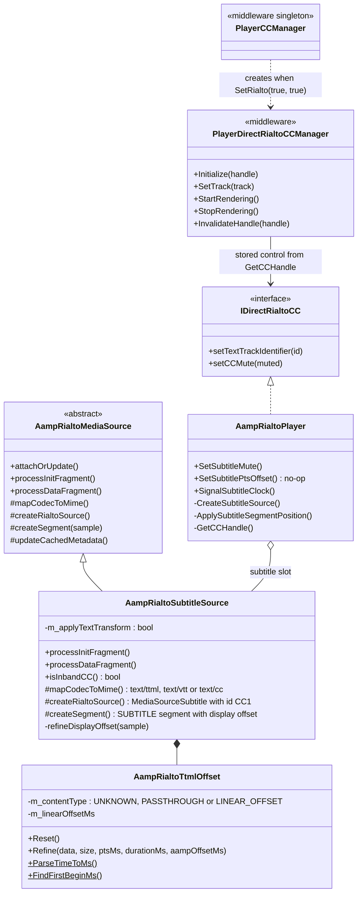
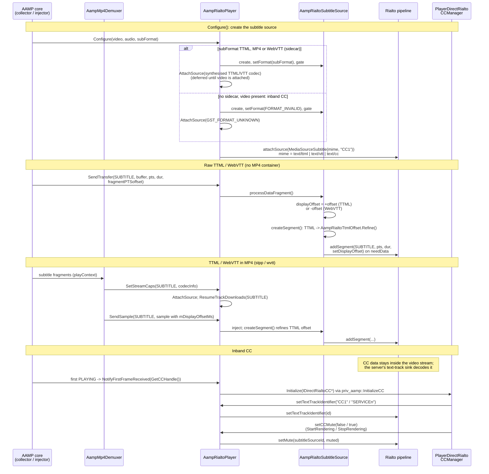
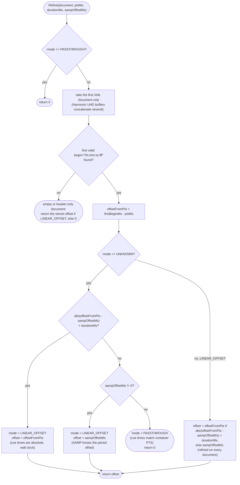

# Direct Rialto - Subtitles and TTML

## Purpose

This page explains how subtitles and closed captions are delivered on the direct-rialto path. That covers which subtitle forms are supported, how each one reaches the Rialto server, how cue timing is kept in step with audio and video (the TTML display-offset logic), and how the closed-caption (CC) manager controls inband captions. It also lists the subtitle-specific special cases that live outside `direct-rialto/` in AAMP core.

## Source files

| File | Role |
|---|---|
| `direct-rialto/AampRialtoSubtitleSource.{h,cpp}` | Subtitle specialisation of `AampRialtoMediaSource`: codec to mime mapping (`text/ttml`, `text/vtt`, `text/cc`), `MediaSourceSubtitle` creation, raw-document injection, per-segment display offset. |
| `direct-rialto/AampRialtoTtmlOffset.{h,cpp}` | Detects whether TTML cue times are relative to the container PTS or absolute, and computes the display offset. Mirrors `gstvipertransform` on the GStreamer path. |
| `direct-rialto/AampRialtoPlayer.cpp` (subtitle parts) | `CreateSubtitleSource`, `SetSubtitleMute`, `SetSubtitlePtsOffset`, `SignalSubtitleClock`, `ApplySubtitleSegmentPosition`, `GetCCHandle`, `IDirectRialtoCC` (`setTextTrackIdentifier`, `setCCMute`). |
| `IDirectRialtoCC.h` (middleware-player-interface, `closedcaptions/direct-rialto/`) | Two-method control interface the CC manager uses to drive the player. |
| `PlayerDirectRialtoCCManager.{h,cpp}` (middleware-player-interface) | GStreamer-free CC manager selected by `PlayerCCManager::SetRialto(true, true)`. |
| `mp4demux/AampMp4Demuxer.cpp` (AAMP core) | Demuxes subtitle-in-MP4 fragments and sets `AampMediaSample::mDisplayOffsetMs` from the restamp offset. |
| `streamabstraction.cpp`, `fragmentcollector_mpd.cpp` (AAMP core) | direct-rialto-specific subtitle special cases (section 7). |

## 1. Supported forms

*The subtitle source, its TTML offset helper, and the closed-caption control path through `IDirectRialtoCC`.*

`isInbandCC()` returns `format() == FORMAT_INVALID`.

The player creates at most **one** subtitle source per pipeline, in `AampRialtoPlayer.cpp:CreateSubtitleSource`, called from `CreateSources` during a `Configure()` that builds a pipeline:

| AAMP subtitle format | Form | Rialto mime | How data arrives | Display offset |
|---|---|---|---|---|
| `FORMAT_SUBTITLE_TTML` | Raw TTML documents (sidecar or DASH text) | `text/ttml` | `SendTransfer` -> `AampRialtoSubtitleSource::processDataFragment` (no demuxer) | `+fragmentPTSoffset`, refined by `AampRialtoTtmlOffset` |
| `FORMAT_SUBTITLE_WEBVTT` | Raw WebVTT | `text/vtt` | Same as raw TTML | `-fragmentPTSoffset` (no refinement) |
| `FORMAT_SUBTITLE_MP4` | TTML (`stpp`) or WebVTT (`wvtt`) in fragmented MP4 | `text/ttml` for `stpp`, `text/vtt` for `wvtt` (from the demuxer's codec); the queued synthesised attach says TTML (see Open questions) | `AampMp4Demuxer` -> `SetStreamCaps` + `SendSample` | `mDisplayOffsetMs` from the demuxer; TTML refined |
| none, but video present | Inband CEA-608/708 closed captions carried in the video | `text/cc` (`StreamFormat::RAW`) | No data is injected: the server extracts CC from the video stream | n/a |
| none, no video | No subtitle source; any stale one is dropped | | | |

Every subtitle source is created with the text-track identifier `"CC1"` (`AampRialtoSubtitleSource::createRialtoSource`), so the server starts rendering CC1 immediately for inband captions. Any other format (for example `FORMAT_SUBTITLE_UNKNOWN`) creates no source. `RIALTO_PLAYER_DISABLE_SUBTITLES` is a commented-out compile switch that removes subtitle support entirely. It was added because real Rialto on Ubuntu locks up intermittently without a text-track sink on the server (ARCH-11).

Why there is always an inband-CC source when video is present: Rialto needs the complete source set when `allSourcesAttached()` is called and cannot add sources later, so the player cannot wait to see whether captions are wanted. The CC source costs nothing until the CC manager unmutes it.

## 2. End-to-end data flow

*How each subtitle form is created, attached and fed, and how the CC manager controls inband captions.*

**Creation and attach.** For sidecar formats `CreateSubtitleSource` creates the source (gated, like every source), synthesises a TTML or WebVTT `MediaCodecInfo` and calls `AttachSource` under `m_attachMutex`. Raw formats have no init segment, so no `SetStreamCaps` call will come to trigger the attach. Like audio, the attach is deferred until video has attached (`DeferAttachUntilVideo`, ARCH-13). For `FORMAT_SUBTITLE_MP4` the synthesised attach is also queued, and `AampMp4Demuxer` later calls `SetStreamCaps(SUBTITLE)`, which attaches or updates with the real codec. For inband CC the source gets `FORMAT_INVALID` (which is what `isInbandCC()` tests) and is attached with `GST_FORMAT_UNKNOWN`, which maps to `text/cc`.

**Raw TTML and WebVTT.** AAMP passes each document to `SendTransfer` with `initFragment=false`. `processDataFragment` sees no demuxer, wraps the whole buffer in one `AampMediaSample` (PTS, DTS, duration and the display offset described in section 3) and calls `injectSingleSample`, which follows the normal handshake (Media data path). An init fragment for a raw format, if one ever arrives, is answered with the same synthesised codec info, and it resets the TTML detection state.

**Subtitle in MP4.** With `useMp4Demux` (forced on by `useDirectRialto`) AAMP core creates an `AampMp4Demuxer` for the subtitle track too (`streamabstraction.cpp`, ARCH-26). The demuxer calls `SetStreamCaps(SUBTITLE, codecInfo)`. That attaches the source, sets `m_applyTextTransform` through `updateCachedMetadata` (true for TTML), and explicitly calls `ResumeTrackDownloads(eMEDIATYPE_SUBTITLE)`. Rialto needData never triggers that resume, and `SelectSubtitleTrack` stops subtitle downloads during period transitions (DATA-12). The demuxer then delivers samples with `SendSample`. When PTS restamping is on, it puts the restamp offset (ms) in `mDisplayOffsetMs`.

**Segments.** `AampRialtoSubtitleSource::createSegment` builds a `MediaSegment` of type `SUBTITLE` with PTS and duration in nanoseconds. If the refined display offset is non-zero it calls `setDisplayOffset(offset)`. Rialto's field is unsigned, but the server reads it back as signed, so negative offsets are passed by a cast. There is no encryption, width/height or codec data for subtitle segments.

**Inband CC control.** The first `PLAYING` passes `GetCCHandle()` to `NotifyFirstFrameReceived`. For an inband-CC source the handle is the player's `IDirectRialtoCC*`; otherwise it is 0. `priv_aamp::InitializeCC()` passes it to `PlayerDirectRialtoCCManager::Initialize`, which stores the control and applies the default track `CC1`. After that:

- `SetTrack` calls `setTextTrackIdentifier`. A purely numeric track is prefixed with `CC` for 608 or `SERVICE` for 708 (so `"1"` becomes `"CC1"` or `"SERVICE1"`); alphabetic IDs pass through. This calls `IMediaPipeline::setTextTrackIdentifier`.
- `StartRendering` and `StopRendering` call `setCCMute(false/true)`, which calls `IMediaPipeline::setMute(subtitleSourceId, muted)` under `m_attachMutex`.
- `~AampRialtoPlayer` calls `PlayerCCManager::InvalidateHandle` so the manager never keeps a dangling control pointer (the pointer is cast to `IDirectRialtoCC*` explicitly because of multiple inheritance).

## 3. Display offset and TTML timing

*How `AampRialtoTtmlOffset::Refine` decides between passthrough and a linear offset.*

The result becomes the segment's display offset in milliseconds, and the Rialto server shifts cue times by it. The mode is reset only by `processInitFragment()` (see SUB-01 in the register).

The Rialto server's text-track renderer shows a cue at `cue time - displayOffset`, relative to the pipeline clock. The player's job is to choose `displayOffset` so that cues line up with the restamped audio and video.

**Raw WebVTT** (`m_applyTextTransform == false`). The offset is `-fragmentPTSoffset` in ms. With HLS PTS restamping, video is restamped to start at 0 but the subtitle `fpts` is the raw HLS position. The negative offset lets the renderer correct using `X-TIMESTAMP-MAP`, mirroring `GST_BUFFER_OFFSET = -(ptsOffset x 1000)` in `AAMPGstPlayer`. Without restamping the offset is 0, because AAMP has seeked the pipeline to the HLS start position. WebVTT in MP4 uses the demuxer's `mDisplayOffsetMs` unchanged.

**TTML** (raw or `stpp`; `m_applyTextTransform == true`). TTML documents can carry cue times either relative to the media timeline or as absolute wall-clock times (common in live DASH), and the stream does not say which. `AampRialtoTtmlOffset` decides from the first document that contains a `begin="..."` time:

| Condition on the first document with a `begin` | Mode | Offset used |
|---|---|---|
| \|firstBegin - pts - aampOffset\| > document duration | `LINEAR_OFFSET` | `firstBegin - pts` (absolute timestamps) |
| otherwise, and `aampOffset != 0` | `LINEAR_OFFSET` | `aampOffset` (AAMP's restamp offset) |
| otherwise | `PASSTHROUGH` | 0, for every later document |

In `LINEAR_OFFSET` mode the offset is recalculated with the same rule on **every** document, so it follows period changes. A document with no `begin` (empty or header-only) reuses the last offset. Only the first `<?xml` document in a buffer is used, because Harmonic UHD encoders concatenate several documents. `ParseTimeToMs` accepts only TTML clock-time (`hours:MM:SS`, optional `.fraction` rounded to ms, or `:frames`, where frames are ignored because the frame rate is unknown). Any other value, including offset-time forms such as `10s`, is treated as "no begin". The parser is bounds-checked because the text comes from the stream.

Example: a live DASH stream with cue `begin="10:15:30.000"` (36,930,000 ms), segment PTS 120,000 ms, duration 2,000 ms and AAMP offset 0. The difference is far larger than 2,000 ms, so the mode is `LINEAR_OFFSET` with offset 36,810,000 ms, and the renderer shows the cue at 120,000 ms on the pipeline clock.

## 4. Synchronisation with audio and video

- Subtitle segments carry the same restamped PTS domain as audio and video, plus the display offset above. The server's text-track sink renders against the pipeline clock, so no separate subtitle clock is needed.
- After every flush, `HandleSeekDone` calls `ApplySubtitleSegmentPosition`, which calls `setSourcePosition(subtitleSourceId, position, resetTime=false)` under `m_attachMutex`. Without it, cues appear late until the next `SignalSubtitleClock()`. The code comment calls the need a suspected Rialto issue (FLUSH-01).
- `SignalSubtitleClock()` (query `getPosition()`, then `setSourcePosition` on the subtitle source) exists, but its only AAMP caller, `UpdateSubtitleClockTask`, is not started when `UsingRialto()` is true, so it appears unreachable in production (ARCH-27).
- `SetSubtitlePtsOffset()` is a no-op. The GStreamer path sends a `set-pts-offset` event to the subtitle sink; direct-rialto carries the equivalent information per segment as the display offset (SUB-04).

## 5. Enable, disable and mute

| Call | Effect |
|---|---|
| `SetSubtitleMute(muted)` | Caches `m_subtitleMuted` (default **true**) under `m_attachMutex`, and calls `setMute(subtitleSourceId, muted)` if the subtitle source is attached. The cached value is re-applied when the source first attaches. |
| `setCCMute(muted)` (from the CC manager) | `setMute` on the subtitle source if attached; returns false otherwise. It does not update `m_subtitleMuted` (SUB-05). |
| `setTextTrackIdentifier(id)` | Forwards to the pipeline if one exists. |
| Track change (different subtitle format or adding/removing subtitles) | `ShouldRecreatePipeline` treats a missing or changed subtitle source as a reason to rebuild at rate 1, because Rialto cannot add or remove sources. A track switch within the same format reuses the source. |
| Subtitles off by the user | The source remains and is muted; AAMP still injects a subtitle init header so the source set is complete (ARCH-23). |

All three mute paths take `m_attachMutex`, so a mute can wait for a DRM licence fetch on another track (ARCH-04).

## 6. Flush, seek, trick-play and EOS

- **Flush**: the subtitle source is aborted and re-gated like every other source (Flush and seek, section 3). After `SEEK_DONE` its position is re-applied (section 4).
- **Trick-play**: the subtitle source is forced EOS for any rate other than 1, so Rialto's clock does not wait for it. The next rate-1 flush clears it. `streamabstraction.cpp` also skips subtitle restamping during trick-play.
- **EOS**: a video EOS also signals EOS on the subtitle source if it is not already EOS. Rialto sends `END_OF_STREAM` only when every attached source has reported EOS, and a subtitle source may never receive data (inband CC, or the injected header only).
- **TTML detection state** is reset only in `processInitFragment`. A rebuilt pipeline gets a fresh source, but a reused pipeline keeps the detected mode across seeks and periods (SUB-01).

## 7. Special cases outside direct-rialto

These live in AAMP core because of how Rialto works. They are recorded in the ARCH register:

| Where | What | Register |
|---|---|---|
| `fragmentcollector_mpd.cpp` (subtitle output format selection) | When subtitles are disabled, a saved subtitle init header is still injected, because Rialto needs the full source set before it plays video. Guarded by `UsingRialto()`, so it also applies to the GStreamer Rialto sink. | ARCH-23 |
| `fragmentcollector_mpd.cpp:ExtractAndAddSubtitleMediaHeader`, `AampStreamSinkManager` | The main asset's subtitle header is cached and injected for pre-roll ads without subtitles ("Rialto does not support dynamic streams"). | ARCH-24 |
| `fragmentcollector_mpd.cpp` (`SelectSubtitleTrack`) | `StopTrackDownloads(SUBTITLE)` is skipped for direct-rialto, because the subtitle playContext is never torn down on period change and the new init must keep flowing. | ARCH-25 |
| `streamabstraction.cpp` (media processor setup and restamp) | Subtitle MP4 is demuxed by `AampMp4Demuxer` only for direct-rialto. A `!playContext` guard prevents double restamping, which caused a uint64 underflow. | ARCH-26 |
| `streamabstraction.cpp` (`UpdateSubtitleClockTask`) | Not started for Rialto, which leaves `SignalSubtitleClock` unreachable. | ARCH-27 |

## 8. Differences from the GStreamer Rialto path

| Topic | GStreamer Rialto sink (`useRialtoSink`) | direct-rialto |
|---|---|---|
| Sink | `rialtomsesubtitlesink` inside a bin with `vipertransform` | `MediaSourceSubtitle` attached directly |
| TTML offset | `gstvipertransform` | `AampRialtoTtmlOffset` (same algorithm) |
| PTS offset | `set-pts-offset` OOB event | Per-segment `setDisplayOffset` |
| CC control | `PlayerRialtoCCManager` sets properties on a `GstElement` | `PlayerDirectRialtoCCManager` through `IDirectRialtoCC` |
| Subtitle demux (MP4) | `qtdemux` in playbin | `AampMp4Demuxer` in AAMP core |

## Open questions

- **`wvtt` in MP4.** `MP4Demux` reports `stpp` as `GST_FORMAT_SUBTITLE_TTML` and `wvtt` as `GST_FORMAT_SUBTITLE_WEBVTT`, so `SetStreamCaps` carries the right codec. But `CreateSubtitleSource` also queues a synthesised attach for `FORMAT_SUBTITLE_MP4`, which always says TTML. If that queued attach runs first (it waits only for video), WebVTT-in-MP4 is attached to Rialto as `text/ttml`, and a later caps update cannot change the mime of an attached source (SUB-03). Which attach wins in practice?
- **Offset-time `begin` values** (`begin="10.5s"`) are treated as "no begin". Do any target streams use them?
- **Default mute.** `m_subtitleMuted` defaults to true. Confirm that AAMP always calls `SetSubtitleMute(false)` when the user enables sidecar subtitles.
- **Ubuntu lock-up (ARCH-11).** Is the "no TextTrack sink on the Rialto server" lock-up still reproducible, and does it affect devices?

## Related pages

- [Media data path](03-media-data-path.md)
- [Flush and seek](04-flush-seek-and-preroll.md)
- [Lifecycle and state machine](02-player-lifecycle-and-state-machines.md)
- [Integration, configuration and build](09-integration-configuration-and-build.md)
- [Workarounds and improvement register](11-workarounds-and-improvement-register.md)

## Workarounds and improvement candidates

See the [SUB rows in the register](11-workarounds-and-improvement-register.md#subtitles-and-closed-captions-sub). Related rows: ARCH-11, ARCH-13, ARCH-23 to ARCH-27, DATA-12, FLUSH-01, ARCH-04.

- SUB-01: TTML passthrough/linear decision is never reset on a reused pipeline (seeks, period changes).
- SUB-02: stale comments (`isInbandCC` description, `application/x-subtitle-cc` mime).
- SUB-03: WebVTT-in-MP4 may be attached as `text/ttml` if the synthesised TTML attach runs before `SetStreamCaps`.
- SUB-04: `SetSubtitlePtsOffset` is a silent no-op.
- SUB-05: `setCCMute` and `SetSubtitleMute` drive the same Rialto mute without a shared cached state.
