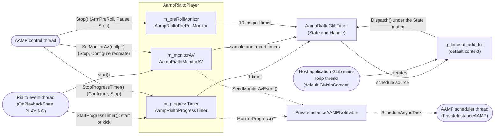
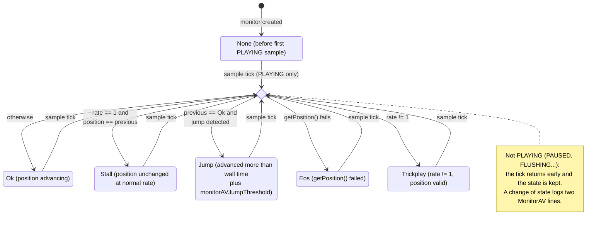
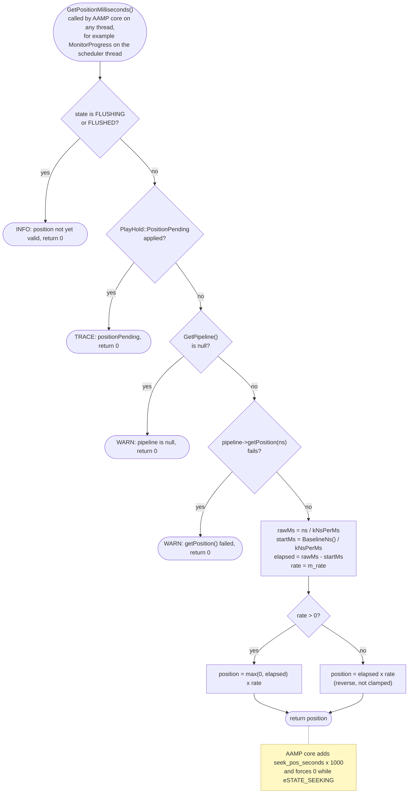
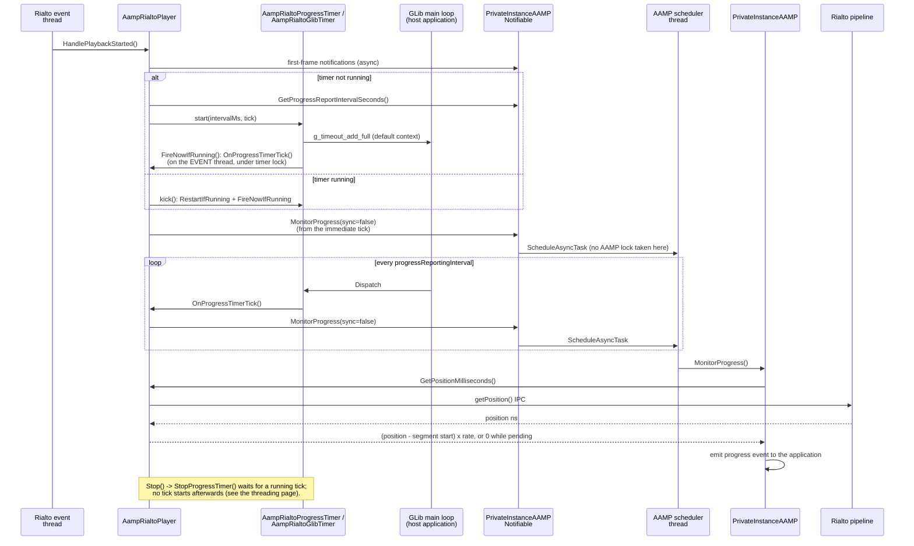

# Direct Rialto - Monitoring and diagnostics

## Purpose

This page explains how direct-rialto tells AAMP core where playback is and
whether it is healthy. It covers the GLib timers that drive periodic work,
the AV health monitor (`AampRialtoMonitorAV`), how position, duration and
video PTS are computed from the Rialto pipeline, how progress ticks reach
AAMP core, and how buffer underflow is forwarded. It ends with a table of
log messages that the Troubleshooting page reuses.

## Source files

| File | Role |
|---|---|
| `AampRialtoGlibTimer.h` | Thread-safe periodic timer on the default GLib main context; base of every direct-rialto timer |
| `AampRialtoProgressTimer.h` | Progress-report timer that fires immediately on start and can be "kicked" |
| `AampRialtoMonitorAV.h`, `AampRialtoMonitorAV.cpp` | AV health classifier (sample timer) and telemetry reporter (report timer) |
| `AampRialtoPreRollMonitor.h`, `AampRialtoPreRollMonitor.cpp` | Pre-roll completion poller; only its timer use is covered here (algorithm: [Flush and seek](04-flush-seek-and-preroll.md)) |
| `AampRialtoTime.h` | Shared unit constants (`kNsPerSecond`, `kNsPerMs`) and rounding conversions |
| `AampRialtoPlayer.cpp` | `GetPositionMilliseconds`, `GetDurationMilliseconds`, `GetVideoPTS`, `OnDuration`, `OnPosition`, `OnBufferUnderflow`, progress timer start/stop/tick, `CreateMonitorAV`, `GetVideoPlaybackQuality`, `CheckForPTSChangeWithTimeout` |
| `PrivateInstanceAAMPNotifiable.cpp`, `IStreamSinkNotifiable.h` | Adapter that forwards progress, AV-monitor events and underflow to `PrivateInstanceAAMP` |
| `AampRialtoMediaPipelineClient.cpp` | Receives Rialto callbacks (`notifyPosition`, `notifyDuration`, `notifyBufferUnderflow`, `notifyQos`) on the Rialto event thread |

## 1. Timers and the GLib main context

Every periodic job in direct-rialto is built on one small class,
`AampRialtoGlibTimer`. It wraps `g_timeout_add_full()` with a `NULL`
context, so **all ticks run on whichever thread iterates the default GLib
main context**. AAMP core does not run that loop itself; the host
application must (aamp-cli does so in a dedicated thread). If no loop runs,
progress reports, pre-roll completion and AV monitoring silently never fire
(see ARCH-22).



*Timer owners, the shared GLib timer building block, and the threads that start, stop and run them.*

AAMP core does not run this main loop. Without one there is no progress reporting, no MonitorAV and no pre-roll completion (ARCH-22).

### 1.1 Why a custom wrapper

A raw GLib source has two classic hazards: a tick can still be running on
the main-loop thread while another thread destroys the owner, and a
dispatch GLib has already picked up can arrive after `g_source_remove()`.
The wrapper removes both with a **State/Handle** split:

| Part | Owned by | Contents | Why |
|---|---|---|---|
| `State` | `std::shared_ptr`, shared by the timer object and every live `Handle` | recursive mutex, `running` flag, GLib source id, `generation` counter, the tick `std::function` | Outlives the timer object for as long as GLib can still dispatch |
| `Handle` | The GLib source (freed by the `Release` destroy-notify) | `shared_ptr<State>` plus the `generation` it was created for | Lets a late dispatch detect that it belongs to an old run |

Rules that follow from this design:

- `Start()`, `Restart()`, `RestartIfRunning()`, `FireNowIfRunning()`,
  `Stop()`, `IsRunning()` and `RunLocked()` all take `State::mutex`, so they may be called
  from any thread.
- `RunLocked(fn)` runs `fn` under the timer's lock, so an owner can update
  its own state and the timer as one step (no tick, and no `Start()`/`Stop()`
  from another thread, can interleave). The owner takes its own lock inside
  `fn`, the same order as a tick that takes it. `AampRialtoPreRollMonitor`
  uses it for `Start()` and `Stop()` (commit `1da67fc4`).
- `Dispatch()` takes the same mutex and runs the tick **under it**. So
  `Stop()` blocks until a tick in progress has returned, and no tick starts
  after `Stop()` returns. This is what lets the owners touch their own
  members from a tick without extra locks.
- A dispatch that finds `running == false` or a different `generation`
  does nothing and removes its source. This covers "GLib picked it up just
  before `Stop()`" and "the owner was destroyed".
- The mutex is recursive, so a tick may call `Stop()`/`Restart()` on its own
  timer. A tick must never wait for another thread that is itself calling
  into the same timer (that would deadlock).
- The tick returns `bool`; `false` stops the timer from inside the tick.
- `Start()` returns `false` both when already running and when GLib refuses
  the source (`id == 0`). Callers distinguish the two with `IsRunning()`.

### 1.2 Progress timer: immediate start and "kick"

`AampRialtoProgressTimer` adds two behaviours on top:

- **Immediate first report.** `start()` schedules the periodic source, then
  calls `FireNowIfRunning()` so the first `MonitorProgress` happens now, not
  one interval later. Because `FireNowIfRunning()` runs under the timer
  lock, a concurrent `stop()` either waits for it or wins and suppresses it.
  This race was fixed in commit "Stop progress timer kick and immediate
  reports racing stop" (`7efb0a89`).
- **Kick.** `kick()` uses `RestartIfRunning()` (stop + start as one locked
  step) and then fires once. The interval restarts from now, and a timer
  stopped concurrently is never brought back to life.
- If GLib cannot schedule the source at all, `start()` calls the callback
  once directly so at least one progress report is produced.

`AampRialtoPlayer::StartProgressTimer` kicks instead of starting when the
timer is already running. Because it is called on every Rialto `PLAYING`
notification, AAMP core receives a fresh progress report as soon as
playback resumes after a seek, pause or rate change.

### 1.3 Time units

`AampRialtoTime.h` holds the shared constants: `kNsPerSecond`,
`kNsPerMs`, `SecondsToNs()` and `SecondsToMs()`. Rialto works in
nanoseconds; AAMP reports milliseconds and configures intervals in
seconds. The conversions round to nearest because plain truncation turns
1.001 s into 1000999999 ns. Note that `ns -> ms` conversions in the player
and monitor use integer division (`/ kNsPerMs`), which truncates.

## 2. Timer inventory

| Timer | Owner (member) | Period | Started by (thread) | Tick runs on | Purpose | How stopped |
|---|---|---|---|---|---|---|
| Progress timer | `AampRialtoPlayer::m_progressTimer` (`AampRialtoProgressTimer`) | `progressReportingInterval` (`eAAMPConfig_ReportProgressInterval`, default 1 s) converted to ms | `StartProgressTimer()` from `HandlePlaybackStarted()` on every Rialto `PLAYING` (Rialto event thread); kicks if already running | GLib default main loop | Calls `IStreamSinkNotifiable::MonitorProgress(false, false)` so AAMP core emits progress events; at TRACE level also logs a per-source snapshot | `StopProgressTimer()` in `Configure()` and `Stop()` (AAMP control thread) and in `~AampRialtoPlayer`. Not stopped on `PAUSED` or during a flush |
| AV monitor sample timer | `AampRialtoMonitorAV::m_sampleTimer` | Same `progressReportingInterval`, as ms (`SecondsToMs`) | `AampRialtoMonitorAV::start()` from `HandlePlaybackStarted()` (Rialto event thread, under `m_monitorMutex`) | GLib default main loop | Samples `getPosition()` and classifies AV health (section 3) | Only by destroying the monitor: `SetMonitorAV(nullptr)` in `Stop()`, on pipeline re-creation in `Configure()`, and in `~AampRialtoPlayer`. Ticks are skipped while the player is not `PLAYING` |
| AV monitor report timer | `AampRialtoMonitorAV::m_reportTimer` | `monitorAVReportingInterval` (default 1000 ms) | Same as sample timer | GLib default main loop | Reads `getStats()` and sends `SendMonitorAvEvent` to AAMP core | Same as sample timer. Keeps firing while paused or flushing, re-sending the last classification |
| Pre-roll poll timer | `AampRialtoPreRollMonitor::m_timer` (owned by `AampRialtoPlayer::m_preRollMonitor`) | `kPreRollPollIntervalMs` = 10 ms (compile-time) | `AampRialtoPlayer::StartPreRoll()` via the playback controller, when only `PlayHold::PreRollIncomplete` blocks `play()` | GLib default main loop | Polls accepted frames until the pre-roll target or the 1000 ms timeout is met, then releases the hold (algorithm: [Flush and seek](04-flush-seek-and-preroll.md)) | Self-stops when the poll completes (tick returns `false`); `Stop()` from `ArmPreRoll()` (Configure/Flush), `Pause()`, `Stop()` and `~AampRialtoPlayer` |

There are no other GLib timers in direct-rialto. Stall detection for
discontinuities (`CheckForPTSChangeWithTimeout`) is not a timer: AAMP core
polls it (section 4.4).

## 3. AV health monitor (AampRialtoMonitorAV)

### 3.1 What it is for

`AampRialtoMonitorAV` is the direct-rialto port of the GStreamer
`MonitorAV()` / `MonitorAvTimerCallback` pair (`InterfacePlayerRDK.cpp`,
`aampgstplayer.cpp`). It periodically classifies the A/V state ("ok",
"stall", ...) and sends the result to AAMP core, which turns it into the
application-visible MonitorAV event. Keeping the same state names and log
format means existing dashboards and log parsers work unchanged for
Rialto.

It talks to AAMP only through the injected `IStreamSinkNotifiable` and
reads player state only through three getters passed at construction
(video source id, current rate, "is PLAYING"), so it can be unit tested
without a player.

### 3.2 Lifecycle

- **Created** by `AampRialtoPlayer::CreateMonitorAV()` right after every
  successful pipeline `load()` (`CreateAndLoadPipeline`), only if
  `monitorAV` is set. It holds its own `shared_ptr` to the pipeline.
- **Installed/replaced** only through `SetMonitorAV()`, which swaps the
  pointer under `m_monitorMutex` (a leaf lock) and destroys the old
  monitor *outside* the lock, because the destructor waits for a tick in
  progress.
- **Started** by `HandlePlaybackStarted()` on every Rialto `PLAYING`
  (Rialto event thread, under `m_monitorMutex`). `start()` is a no-op if
  already running and refuses non-positive intervals (zero would spin the
  main loop; negative wraps to a huge `guint`).
- **Never stopped on pause.** `stop()` is only reached via the destructor:
  `SetMonitorAV(nullptr)` in `Stop()`, before pipeline re-creation in
  `Configure()`, and in `~AampRialtoPlayer`. While not `PLAYING` the sample
  tick returns immediately, so classification state is frozen, but the
  report tick keeps sending the last classification (see MON-01).
- When `Configure()` reuses the pipeline, the monitor and its
  classification state survive unchanged.

### 3.3 Configuration

All values are read once, when the monitor is created (each pipeline
creation).

| Config key (`AampConfig` name) | Enum | Default | Used as |
|---|---|---|---|
| `monitorAV` | `eAAMPConfig_MonitorAV` | false | Create the monitor at all |
| `progressReportingInterval` | `eAAMPConfig_ReportProgressInterval` | 1 s | `Config::sampleIntervalMs` (seconds to ms, rounded) |
| `monitorAVReportingInterval` | `eAAMPConfig_MonitorAVReportingInterval` | 1000 ms | `Config::reportIntervalMs`; also the cap on reported time-in-state |
| `monitorAVSyncThresholdPositive` | `eAAMPConfig_MonitorAVSyncThresholdPositive` | 100 ms (range 1..10000) | `Config::syncThresholdPositiveMs` |
| `monitorAVSyncThresholdNegative` | `eAAMPConfig_MonitorAVSyncThresholdNegative` | -100 ms (range -10000..-1) | `Config::syncThresholdNegativeMs` |
| `monitorAVJumpThreshold` | `eAAMPConfig_MonitorAVJumpThreshold` | 100 ms (range 1..10000) | `Config::jumpThresholdMs` |

### 3.4 What the sample tick measures

On each sample tick, only while the player state machine is `PLAYING`:

1. Read wall-clock `tNow` (`aamp_GetCurrentTimeMS`).
2. Call `IMediaPipeline::getPosition()` **once**. Rialto returns a single
   pipeline position, so the "video" and "audio" slots of
   `m_avPositionMs[2]` always receive the same value.
3. At normal rate (`rate == 1`) both slots are evaluated; at any other rate
   only video (matches GStreamer, which ignores audio in trickplay).
4. For each evaluated slot: if the position equals the previous sample, the
   track is stalled; otherwise, for video and only if the previous
   classification was "ok" (`m_happy`), check for a forward jump:
   `(pos - prevPos) > (tNow - tLastSampled) + jumpThresholdMs`.
5. Classify from the number of slots that had a valid position and the
   flags above, log on change, and remember the result.

### 3.5 AvHealth states

| State (`toString`) | Condition in the code | Reachable in direct-rialto? |
|---|---|---|
| `None` ("none") | Initial value before the first sample | Yes, until the first `PLAYING` sample |
| `Ok` ("ok") | Position moved and no other condition | Yes |
| `Stall` ("stall") | Normal rate, position unchanged since the previous sample (both slots) | Yes |
| `Jump` ("jump") | Normal rate, previous state "ok", position advanced more than wall-clock time plus `jumpThresholdMs` | Yes |
| `Eos` ("eos") | `getPosition()` failed, so no slot has a position | Yes, but it means "position query failed", not end of stream |
| `Trickplay` ("trickplay") | Rate is not 1 and position is valid (overrides any freeze) | Yes |
| `VideoFreeze` ("video freeze") | Video stalled but audio moving | No: audio always has the same value, so the audio slot turns it into `Stall` |
| `AudioDrop` ("audio drop") | Audio stalled but video moving | No, same reason |
| `AvSync` ("avsync") | Video minus audio outside the sync thresholds | No: the delta is always 0 |

The source file comment states the `AvSync` limitation explicitly; the
`VideoFreeze`/`AudioDrop` ones follow from the same cause. Both are
recorded as MON-02.



*AvHealth classification evaluated on each sample tick; only the states reachable with a single Rialto pipeline position are shown as targets.*

`VideoFreeze`, `AudioDrop` and `AvSync` are never produced with Rialto: the audio slot has the same position as video, so a freeze becomes `Stall`, and the video minus audio delta is always 0.

Behaviours worth knowing when reading logs:

- The very first sample compares against an initial position of 0, so a
  stream that is genuinely at position 0 is first classified "stall".
- Positions are raw pipeline positions (not segment-relative). After a
  forward seek larger than the jump threshold, the first sample after the
  new `PLAYING` is expected to be "jump" if the state before the seek was
  "ok", because `m_avPositionMs` and `m_tLastSampled` are not reset by a
  flush. A backward seek classifies as "ok".
- Jump detection is only armed after an "ok" sample, matching
  `MonitorAVState::happy` in the GStreamer code.

### 3.6 What the report tick sends

On each report tick (any player state):

- Skipped (TRACE log) until a sample has been taken.
- Reads cumulative `rendered`/`dropped` frames from
  `IMediaPipeline::getStats()` for the video source id; on failure or with
  no video source, reports `dropped = 0`.
- Computes time-in-state = `tLastSampled - tLastReported`, clamped to
  `[0, reportIntervalMs]`.
- Calls `IStreamSinkNotifiable::SendMonitorAvEvent(status, videoMs,
  audioMs, timeInStateMs, dropped)`. The adapter defers it to the AAMP
  scheduler thread (section 5).

### 3.7 Thread safety

Both ticks run on the GLib main-loop thread, so they never run in parallel
with each other; the classification members are touched only by ticks.
`stop()` (from the destructor) waits for a tick in progress through the
timer lock, so a tick cannot outlive the monitor. The getters it calls read
atomics (`m_rate`) or the state machine (`currentState()`), which are safe
from any thread.

## 4. Position, duration and PTS reporting

Rialto has a `notifyPosition` callback, but direct-rialto does not use it:
`AampRialtoPlayer::OnPosition` is empty ("Not used"), see ARCH-14. All
position values are **polled** with `IMediaPipeline::getPosition()`, an
IPC call to the Rialto server, whenever AAMP asks.

### 4.1 Contract with AAMP core

`StreamSink::GetPositionMilliseconds()` returns the position **relative to
the start of the current segment**, i.e. relative to the last seek/flush
target. AAMP core adds it to its own seek position
(`PrivateInstanceAAMP::GetPositionMilliseconds`: `seek_pos_seconds * 1000 +
GetPositionRelativeToSeekMilliseconds()`). Core also forces 0 while its own
state is `eSTATE_SEEKING`. This is why direct-rialto must not return the
absolute staged flush target: core would count it twice.

### 4.2 Position formula

```
if state is FLUSHING or FLUSHED            -> 0   ("position not yet valid")
if PlayHold::PositionPending is applied    -> 0   ("positionPending")
if no pipeline or getPosition() fails      -> 0   (WARN logged)
rawMs     = getPosition() ns / kNsPerMs
startMs   = m_segmentPosition.BaselineNs() / kNsPerMs
elapsed   = rawMs - startMs
position  = max(0, elapsed) * rate          when rate > 0
position  = elapsed * rate                  when rate <= 0
```

Why each term exists:

- **Baseline (segment start).** Rialto's position is the media timeline
  position. The baseline is where the current segment actually began: the
  value staged at video attach time, or the flush target committed by
  `HandleSeekDone()` via `CommitBaseline()`. A seek may land mid-fragment,
  so the first injected sample's PTS is not a reliable baseline. How the
  baseline is elected and committed is covered in [Media data path](03-media-data-path.md)
  (`direct-rialto-segment-position-sequence`,
  `direct-rialto-position-election-sequence`).
- **Rate multiplication** mirrors GStreamer's
  `(pos - segmentStart) * rate`. For trickplay, AAMP injects frames whose
  timeline advances at normal speed while the content represents `rate`
  times more; reverse trickplay yields a decreasing (negative) delta.
- **Clamp to 0 for forward play** hides a small negative blip from clock
  jitter right after start or seek.
- **"Position pending -> report 0".** While `PlayHold::PositionPending` is
  applied (after `Configure()` or a discontinuity, until the deferred
  `Flush()` or a video attach establishes the baseline), the baseline is
  stale, so any computed value would be wrong. Reporting 0 keeps core's
  position equal to its own seek position. The same reasoning applies to
  `FLUSHING`/`FLUSHED`: until Rialto sends `PLAYING`/`PAUSED` after
  `SEEK_DONE`, `getPosition()` may fail or return a pre-seek value.



*Decision flow of AampRialtoPlayer::GetPositionMilliseconds.*

### 4.3 Duration

`GetDurationMilliseconds()` returns `m_durationMs`, an atomic updated only
by `OnDuration()` when Rialto sends `notifyDuration` (Rialto event thread,
`ns / kNsPerMs`). It is 0 until the first notification and is not reset
between sessions (MON-04). AAMP core only consults the sink duration for
progressive media (`PrivateInstanceAAMP::GetDurationMs`); for HLS/DASH it
uses the manifest duration, so this value rarely matters.

### 4.4 Video PTS and PTS-stall checks

Rialto has no PTS API. `GetVideoPTS()` derives a 90 kHz PTS from the raw
pipeline position: `(positionNs / 100000) * 9`, the same integer
conversion Rialto uses internally. It is not segment-relative. It returns
0 if there is no pipeline or the query fails. AAMP core uses it for
`reportVideoPTS` progress fields and for discontinuity stall detection.

`CheckForPTSChangeWithTimeout(timeout)` is called by
`PrivateInstanceAAMP::CheckForDiscontinuityStall()`; returning `false`
triggers a retune. It mirrors `InterfacePlayerRDK`:

- PTS 0 (not queryable yet) is treated as "still moving" (no retune).
- If the PTS changed, remember it and the steady-clock time.
- If unchanged for longer than `timeout` ms, log a WARN and return `false`.

`m_lastKnownPts` and `m_ptsUpdatedTimeMs` are read and updated together
under `m_ptsCheckMutex` and reset by `Stop()`.

### 4.5 Sharing across threads

| Value | Written by (thread) | Read by | Guard |
|---|---|---|---|
| `m_rate` | `Flush()` (control thread) on paths without `SEEK_DONE`; `HandleSeekDone()` (Rialto event thread) on the normal path | `GetPositionMilliseconds()` (any AAMP thread), AV monitor sample tick (GLib thread) | `std::atomic<int>`, relaxed |
| Segment baseline | `HandleSeekDone()` (Rialto event thread), video attach (injector thread) | `GetPositionMilliseconds()` | `std::atomic<int64_t>` inside `AampRialtoSegmentPosition` |
| `PlayHold::PositionPending` | `Configure()`, `Discontinuity()`, `Flush()`, attach | `GetPositionMilliseconds()` via `IsHeld()` | Playback controller lock |
| Player state | State machine transitions (control and Rialto event threads) | `GetPositionMilliseconds()`, AV monitor | State machine mutex; each read is atomic but "read then act" is not |
| Pipeline pointer | `Configure()`/`Stop()` (control thread) | Everyone | `GetPipeline()` copies the `shared_ptr` under the session mutex, so the object stays alive for the call |
| `m_durationMs` | `OnDuration()` (Rialto event thread) | `GetDurationMilliseconds()` | `std::atomic<int64_t>`, relaxed |
| PTS-stall pair | `CheckForPTSChangeWithTimeout()`, `Stop()` | same | `m_ptsCheckMutex` |

The individual reads in `GetPositionMilliseconds()` are not taken as one
snapshot: a flush can start between the state check and `getPosition()`.
In that window the result can be computed against the previous baseline
for one call. AAMP core's own `eSTATE_SEEKING` override hides most of this
(see Open questions).

## 5. Progress notifications to AAMP core

AAMP core emits progress events (position, duration, speed, buffer level)
from `PrivateInstanceAAMP::MonitorProgress`. With GStreamer, a GStreamer
timer drives that call. With direct-rialto, the progress timer does:

1. Rialto sends `PLAYING`; `HandlePlaybackStarted()` (Rialto event
   thread) sends the first-frame notifications and then calls
   `StartProgressTimer()`.
2. The first time, the interval is read via
   `IStreamSinkNotifiable::GetProgressReportIntervalSeconds()`
   (`progressReportingInterval`); a non-positive value disables progress
   reporting with a WARN. The timer fires once immediately, then every
   interval. On later `PLAYING` notifications the running timer is kicked.
3. Each tick (GLib main-loop thread) calls `OnProgressTimerTick()`, which
   (at TRACE level only) logs a per-source snapshot via
   `LogSourceSnapshot("steady-state")` and calls
   `MonitorProgress(sync=false, beginningOfStream=false)` on the
   notifiable.
4. `PrivateInstanceAAMPNotifiable::MonitorProgress` does not call core
   directly. It posts the call to the AAMP scheduler thread with
   `ScheduleAsyncTask` (`ScheduleOwned`). This avoids an AB/BA deadlock
   between Rialto-side locks on the calling thread and AAMP's `mLock` /
   `mStreamLock`, and keeps the GLib thread from blocking on AAMP work.
5. On the scheduler thread, core's `MonitorProgress` calls back into
   `GetPositionMilliseconds()` (section 4), which makes a `getPosition()`
   IPC call, and then emits the progress event. If a `SetRate` is in
   progress core skips the report ("Progress reporting skipped whilst tune
   (set rate)").



*Progress timer start, kick and tick, from Rialto PLAYING to the AAMP progress event.*

Consequences:

- Progress keeps ticking while paused and during flushes; core decides
  what to report (and position is reported as 0 relative to the seek
  target during a flush, section 4.2).
- If the scheduler drops a queued task on stop, the captured parameters
  are leaked (ARCH-17).
- `StartProgressTimer`, `StopProgressTimer` and `OnProgressTimerTick` are
  public only for tests (ARCH-12).

## 6. Buffer underflow handling

direct-rialto has no underflow detector of its own. Two paths exist:

- **Rialto `notifyBufferUnderflow`.** `AampRialtoMediaPipelineClient`
  forwards it on the Rialto event thread to
  `AampRialtoPlayer::OnBufferUnderflow`, which maps the Rialto source id to
  a media type (WARN and ignore if unknown) and calls
  `IStreamSinkNotifiable::NotifyBufferUnderflow(type)`. The adapter posts
  a task to the AAMP scheduler thread. There, if
  `enableAampUnderflowMonitor` is set (default true), it only logs
  "Underflow will be handled by AampUnderflowMonitor, skipping retune".
  Otherwise it calls `ScheduleRetune(eGST_ERROR_UNDERFLOW, type)`, which
  core ignores for underflow, so the documented retune never happens
  (ARCH-16). In both configurations a Rialto underflow event is therefore
  informational only.
- **AAMP's `AampUnderflowMonitor`** (core, enabled by default) decides
  underflow from `endPosition - GetPositionMs()`. It therefore depends
  directly on the accuracy of `GetPositionMilliseconds()` (section 4).
  direct-rialto tells it when the pipeline is paused for a discontinuity:
  `Discontinuity()` calls `StopBuffering(true)` and then
  `NotifyPipelinePausedToUnderflowMonitor()` (synchronously, on the
  injector thread, matching `AAMPGstPlayer::Discontinuity`). When the
  monitor pauses the pipeline for buffering, Rialto reports `PAUSED`;
  `OnPlaybackState(PAUSED)` deliberately does not mark sources paused, so
  injector threads keep waiting for `needData` instead of dropping the
  current batch.

## 7. Rialto QoS and statistics

| Rialto API | Used? | Where | Notes |
|---|---|---|---|
| `IMediaPipeline::getStats(sourceId, rendered, dropped)` | Yes | `AampRialtoMonitorAV::onReportTick` (dropped frames in the MonitorAV event); `AampRialtoPlayer::GetVideoPlaybackQuality` | `GetVideoPlaybackQuality` only queries in `PLAYING`/`PAUSED` with an attached video source; otherwise returns null with an INFO or ERR log. It writes into a member struct without a lock. The header says only "the AAMP monitor thread" calls it, but the only callers are the application APIs (`PlayerInstanceAAMP::GetVideoPlaybackQuality`, JS bindings), i.e. application threads (MON-05) |
| `notifyQos(sourceId, QosInfo)` | No | `AampRialtoMediaPipelineClient::notifyQos` | TRACE log only; QoS data is discarded (ARCH-14) |
| `notifyPlaybackInfo` | No | `AampRialtoMediaPipelineClient` | "Not Implemented" (ARCH-14) |
| `notifyPosition` | No | `AampRialtoPlayer::OnPosition` | Empty; position is polled (ARCH-14) |
| `notifyFirstFrameReceived` | No | `AampRialtoMediaPipelineClient` | First frame is inferred from the first `PLAYING` (ARCH-14) |

## 8. Observability: key log messages

Search a log for the quoted text. AAMP's log macros add their own prefix (level, function), so match on the message body. "MIL" is AAMP's milestone level, which is enabled in normal logs; INFO needs `info` logging; TRACE needs `trace`.

**Lifecycle and state**

| Message (start of text) | Level | Source | Meaning |
|---|---|---|---|
| `PlayerState: <A> -> <B>` | MIL | `AampPlayerStateMachine.cpp` | Every state change. The fastest way to build a timeline. |
| `PlayerState: event '<e>' has no transition from state '<s>' - ignored` | WARN | `AampPlayerStateMachine.cpp` | An unexpected event, for example `PLAYING` while `FLUSHING` (rapid second seek) or a late event after `Stop()`. |
| `Proceeding to createMediaPipeline despite Rialto state not RUNNING` | WARN | `AampRialtoPipelineSession.cpp` | The Rialto server did not report `RUNNING` within 2 s; needData may be lost (ARCH-18). |
| `Failed to create IMediaPipelineFactory - is the Rialto server running?` | ERR | `AampRialtoPipelineSession.cpp` | No connection to the Rialto server (check `RIALTO_SOCKET_PATH` and the server). |
| `createMediaPipeline returned nullptr - check Rialto server logs` | ERR | `AampRialtoPipelineSession.cpp` | The server refused the pipeline (resources or requirements). |
| `load() failed - Rialto will reject attachSource calls` | ERR | `AampRialtoPipelineSession.cpp` | See LIFE-04: playback will not start. |
| `allSourcesAttached() failed` | ERR | `AampRialtoPlayer.cpp` | `play()` will never be issued (LIFE-03). |
| `attach failed for mediaType=<t> codecFormat=<c>` | ERR | `AampRialtoPlayer.cpp` | Codec not mappable to Rialto; AAMP gets a pipeline error with retry disabled. |
| `attach of mediaType=<t> skipped: codec not yet identified` | WARN | `AampRialtoPlayer.cpp` | Normal for muxed HLS-TS before the PMT is parsed. |
| `issuing play() (<reason>)` / `play() failed (<reason>)` | MIL / ERR | `AampRialtoPlayer.cpp` | Which hold release or command started playback. |
| `Rialto FAILURE ignored in state <n> - <why>` | WARN | `AampRialtoPlayer.cpp` | A stale or repeated `FAILURE`; only the first is reported. |
| `sourceId=<id> error=<e>` | WARN | `AampRialtoPlayer.cpp:OnPlaybackError` | A Rialto `PlaybackError` (1 = decryption, 2 = output protection). |
| `... scheduling retune for HDCP recovery` | WARN | `AampRialtoPlayer.cpp` | `OUTPUT_PROTECTION` notification; AAMP retunes. |

**Flush, seek and pre-roll**

| Message | Level | Source | Meaning |
|---|---|---|---|
| `SEEK_DONE not received within <n> ms - abandoning flush` | ERR | `AampPlayerStateMachine.cpp` | The flush timed out (FLUSH-04: position baseline not committed). |
| `SEEK_DONE received outside FLUSHING (state=<s>) - ignored` | INFO | `AampRialtoPlayer.cpp` | A late `SEEK_DONE` after a timeout, or a duplicate. |
| `setPosition failed for posNs=<n>` | WARN | `AampRialtoPlayer.cpp` | The flush ends immediately without `SEEK_DONE`. |
| `Player was not in PLAYING/PAUSED/SOURCES_ATTACHED/FLUSHED ...` | WARN | `AampRialtoPlayer.cpp:Flush` | Early-exit path (teardown or no-cycle flush). |
| `pending position resolved by mediaType=<t> first sample` | MIL | `AampRialtoPlayer.cpp` | A deferred flush was triggered by the first sample (section 7 of Flush and seek). |
| `pre-roll started (<reason>) primary mediaType=<t>` | MIL | `AampRialtoPlayer.cpp` | Pre-roll began (`pause()` + ungate). |
| `pre-roll complete (<reason>) after <n> ms acceptedFrames=...` | MIL | `AampRialtoPreRollMonitor.cpp` | Reason is target reached, buffer full, end of stream or timeout. Frequent "timeout" suggests slow data delivery. |
| `pre-roll skipped (<reason>) - no pipeline or attached ...` / `pause() failed for pre-roll` | WARN | `AampRialtoPlayer.cpp` | Pre-roll bypassed. |
| `pre-roll timer could not be scheduled - completing now` | WARN | `AampRialtoPreRollMonitor.cpp` | GLib problem; pre-roll is skipped. |

**Position, progress and A/V health**

| Message | Level | Source | Meaning |
|---|---|---|---|
| `position not yet valid, reporting 0` | INFO | `AampRialtoPlayer.cpp:GetPositionMilliseconds` | No baseline yet (before first attach or during a seek). |
| `getPosition() failed` | WARN | `AampRialtoPlayer.cpp` | IPC failure; position reported as 0. |
| `video PTS has not been updated for <n> ms (timeout <t> ms)` | WARN | `AampRialtoPlayer.cpp:CheckForPTSChangeWithTimeout` | Video appears stalled (AAMP's stall detection). |
| `Starting progress timer <n>ms` / `Progress timer kicked (rescheduled)` / `Stopped progress timer` | INFO | `AampRialtoPlayer.cpp`, `AampRialtoProgressTimer.h` | Progress reporting lifecycle. Missing ticks after "Starting" means no GLib main loop (ARCH-22). |
| `Invalid progress interval=<f> seconds; timer disabled` | WARN | `AampRialtoPlayer.cpp` | `progressReportingInterval` is not positive. |
| `MonitorAvTimer started with interval <n> ms` / `MonitorAvTimer stopped` | MIL | `AampRialtoMonitorAV.cpp` | AV monitor lifecycle. |
| `MonitorAV_<state>: <videoMs>,<audioMs>,<delta>,<durationMs>` | MIL | `AampRialtoMonitorAV.cpp` | Logged on each classification change: the outgoing state with its duration, then the incoming state with duration 0. Same format as the GStreamer monitor, so existing log tooling works. |
| `unknown sourceId=<id> - ignoring underflow notification` | WARN | `AampRialtoPlayer.cpp` | An underflow for a source that no longer exists. |
| `Failed to get video sink stats` | ERR | `AampRialtoPlayer.cpp:GetVideoPlaybackQuality` | `getStats()` failed. |

**Data path** (details on Media data path)

| Message | Level | Meaning |
|---|---|---|
| `sourceId=<id> frameCount=<n> requestId=<r>` | INFO | Every needData from Rialto (DATA-02: very frequent). A gap means Rialto stopped asking for data. |
| `unknown sourceId=<id>` | WARN | needData for a source that does not exist; never answered (DATA-13). |
| `No source for mediaType=<t>` | WARN | Normal for ID3/DSM-CC packets in HLS-TS; otherwise a track without a source. |
| `mediaType=<t> is encrypted but has no queued protection` | WARN | An encrypted non-video track using the video track's protection (HLS convention), or missing protection. |

**Rialto client logs** are forwarded through `AampRialtoPipelineSession::LogHandler` in the form `<component> [<file>:<line> <function>] <message>`, at the matching AAMP level. Server-side detail is only in the Rialto server's own log (syslog or journal).

## Open questions

- **MonitorAV usefulness.** With one shared pipeline position, the `VideoFreeze`, `AudioDrop` and `AvSync` classifications cannot occur (MON-02). Is per-source position available from the Rialto server, which would make them meaningful?
- **Duration.** Should `m_durationMs` be reset in `Stop()`/`Configure()`, or does AAMP never read it across sessions for adaptive streams (MON-04)?
- **Position notifications.** Would using Rialto's `notifyPosition` instead of a `getPosition()` IPC call per query reduce IPC load on low-end devices without losing accuracy (MON-03)?

## Related pages

- [Lifecycle and state machine](02-player-lifecycle-and-state-machines.md)
- [Flush and seek](04-flush-seek-and-preroll.md)
- [Threading model and locking](05-threading-and-locking-model.md)
- [Integration, configuration and build](09-integration-configuration-and-build.md)
- [Troubleshooting and glossary](12-troubleshooting-and-glossary.md)
- [Workarounds and improvement register](11-workarounds-and-improvement-register.md)

## Workarounds and improvement candidates

See the [MON rows in the register](11-workarounds-and-improvement-register.md#monitoring-timers-and-position-mon). Related rows from other pages: ARCH-12 (test-only public methods), ARCH-14 (unused Rialto notifications), ARCH-16 (underflow never retunes when the AAMP underflow monitor is off), ARCH-17 (dropped scheduler tasks leak), ARCH-22 (timers need a GLib main loop), THR-03 (late PLAYING restarts the progress timer).

- MON-01: the AV monitor keeps reporting the last classification while paused.
- MON-02: `VideoFreeze`, `AudioDrop` and `AvSync` can never be detected.
- MON-03: every position query is a synchronous `getPosition()` IPC call.
- MON-04: `m_durationMs` is never reset between sessions.
- MON-05: `GetVideoPlaybackQuality` is called from application threads but is unsynchronised (same as THR-09).
