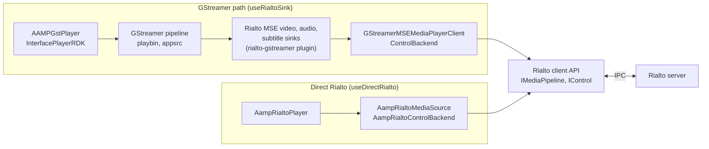
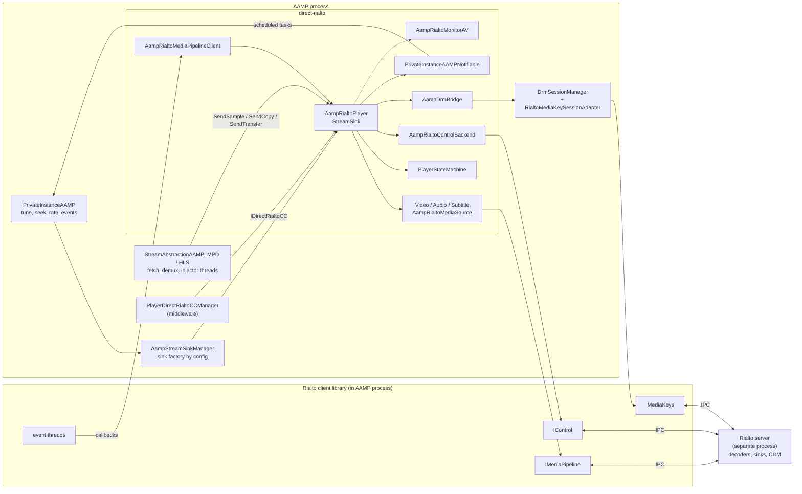

<!--
If not stated otherwise in this file or this component's license file the
following copyright and licenses apply:

Copyright 2026 RDK Management

Licensed under the Apache License, Version 2.0 (the "License");
you may not use this file except in compliance with the License.
You may obtain a copy of the License at

http://www.apache.org/licenses/LICENSE-2.0

Unless required by applicable law or agreed to in writing, software
distributed under the License is distributed on an "AS IS" BASIS,
WITHOUT WARRANTIES OR CONDITIONS OF ANY KIND, either express or implied.
See the License for the specific language governing permissions and
limitations under the License.
-->

# Direct Rialto

Direct Rialto is an alternative playback back end for AAMP. It is implemented
in [`direct-rialto/`](../../direct-rialto) and replaces the GStreamer pipeline
with calls straight into the Rialto client API.

This page is the 5-10 minute overview. The detail lives in the documents
listed in [Document map](#document-map).

> **Evidence convention.** Statements are *confirmed* when read in AAMP or in
> the Rialto source under `.libs/rialto`, *inferred* when they follow from the
> code but were not proven, and *unverified* when they could not be
> established. Design rationale is only given where the code or its comments
> state it. The repository has no separate design document for this feature.

## What it does

AAMP normally plays media by building a GStreamer pipeline
([`AAMPGstPlayer`](../../aampgstplayer.cpp) wrapping `InterfacePlayerRDK` from
the middleware player interface). Direct Rialto replaces that sink with
[`AampRialtoPlayer`](../../direct-rialto/AampRialtoPlayer.cpp), a
`StreamSink` that:

- creates a Rialto `IMediaPipeline` and attaches one Rialto source per track
  (video, audio, subtitle or in-band closed caption);
- feeds demuxed elementary-stream samples into Rialto's shared memory using
  Rialto's pull protocol (`needMediaData` then `addSegment` then `haveData`);
- creates DRM sessions through Rialto `IMediaKeys` and stamps each encrypted
  segment with the Rialto key-session id, so decryption happens inside the
  Rialto server;
- translates Rialto playback notifications into AAMP state, first-frame,
  end-of-stream, underflow and error events.

No GStreamer API is called from `direct-rialto/`.

It is selected by the `useDirectRialto` configuration. See
[integration.md](integration.md).

### Direct Rialto versus the Rialto GStreamer sink

AAMP already supports Rialto through GStreamer (`useRialtoSink`: GStreamer
pipeline with `rialtomsevideosink` and friends, see
[`rialto-gstreamer-overview.md`](../rialto-integration/rialto-gstreamer-overview.md)).
Direct Rialto is a third option and is not a variant of that one.

| Mode | Config | Sink class | Rialto access |
|---|---|---|---|
| GStreamer (default) | none | `AAMPGstPlayer` | none, local decode |
| Rialto GStreamer sink | `useRialtoSink` | `AAMPGstPlayer` | via `rialto-gstreamer` elements |
| **Direct Rialto** | `useDirectRialto` | `AampRialtoPlayer` | AAMP calls the Rialto client API |

### One Rialto client API, two callers

Both Rialto modes end at the same Rialto client API (`IMediaPipeline`,
`IControl`) and the same Rialto server. They differ in who makes the calls,
and in a few of the calls themselves (see the table). In the GStreamer mode,
the `rialto-gstreamer` plugin (source in
`.libs/rialto-gstreamer`) provides the `rialtomsevideosink`,
`rialtomseaudiosink` and `rialtomsesubtitlesink` elements. Each element
serves its GStreamer buffers to Rialto through
`GStreamerMSEMediaPlayerClient`, which implements `IMediaPipelineClient`. In
Direct Rialto, `AampRialtoPlayer` makes those calls itself.

*Both modes call the same Rialto client API. Only the layer in front of it
differs.*

| Concern | `rialto-gstreamer` sinks | Direct Rialto |
|---|---|---|
| Server readiness | `ControlBackend` registers an `IControlClient` and waits for `RUNNING` | `AampRialtoControlBackend`, modelled on the same pattern |
| Pipeline | `createMediaPipeline`, then `load` with `mse://1` | Same |
| Sources | `attachSource` per track, then `allSourcesAttached` once | Same |
| Data | Rialto asks (`needMediaData`). A puller thread parses buffers and calls `addSegment`, then `haveData` is posted to the plugin's backend queue. | Same protocol. AAMP's injector thread calls `addSegment` and `haveData` itself. |
| Play control | `play`, `pause`, `stop` | Same |
| Flush and seek | Per-source `flush` and `setSourcePosition` | Pipeline-level `setPosition`, then `setSourcePosition` after `SEEK_DONE` |
| Segment content | `BufferParser` builds each `MediaSegment` from a `GstBuffer` and its caps | `createSegment()` builds it from an AAMP sample |
| DRM | The sinks do not use `IMediaKeys`. The key-session id arrives as buffer protection metadata and is copied into the segment. | `RialtoMediaKeySystem` uses `IMediaKeys` directly and stamps the same segment fields |

So Direct Rialto is not a different protocol. It removes the GStreamer layer
between AAMP and the Rialto client, and takes over the work that layer did:
building segments, pacing, flush sequencing and position reporting. The
per-method comparison with the GStreamer path is in
[comparison.md](comparison.md), and the sink side is also described in
[`rialto-gstreamer-overview.md`](../rialto-integration/rialto-gstreamer-overview.md).

## Architecture at a glance

*Figure 1. Direct Rialto in the AAMP player. Fetching, manifest handling and
demuxing are shared with the GStreamer path. Only the sink and the DRM session
back end differ.*

## Key design points

1. **Pull-based injection.** Rialto asks for data (`needMediaData`). Each
   injector thread blocks inside `AampRialtoMediaSource::injectOneSample()`
   until a request is pending for its track, adds samples to the shared-memory
   request, and answers with `haveData`. Back-pressure therefore comes from
   Rialto, not from GStreamer `need-data` / `enough-data` signals. See
   [playback-flow.md](playback-flow.md).
2. **Source-set changes are constrained by Rialto.** Both Rialto modes face
   the server restriction on adding sources after `allSourcesAttached()`.
   Direct Rialto uses `ShouldRecreatePipeline()` to rebuild for source-set or
   codec changes; audio going away for trick play is handled with EOS.
   Narrower operations such as audio source switching exist in the plugin,
   so this is not a blanket claim that every track change requires a rebuild.
   See [comparison.md](comparison.md#advantages-and-trade-offs).
3. **Gating.** Every source has a gate (`NONE`, `BLOCKED`, `DROPPED`) that
   holds back or discards samples around configure, flush and stop so that
   stale-position data never reaches Rialto. Several atomics rendezvous
   `Stream()` with source attachment and flush completion. See
   [lifecycle.md](lifecycle.md).
4. **Rialto callbacks almost never call into AAMP directly.** Notifications
   are posted to AAMP's scheduler so the Rialto event thread cannot take AAMP
   locks. The exceptions are reads that take no AAMP lock: the atomic
   `GetState()` and the progress interval read in `StartProgressTimer()`.
   The reason is stated in
   [`PrivateInstanceAAMPNotifiable.cpp`](../../direct-rialto/PrivateInstanceAAMPNotifiable.cpp).
   See [threading.md](threading.md).
5. **DRM through Rialto.** `RialtoMediaKeySessionAdapter` implements AAMP's
   `DrmSession` on top of Rialto `IMediaKeys` and is injected into
   `DrmSessionManager` through a `DrmSessionCreator`. See
   [playback-flow.md](playback-flow.md#drm-session-creation).
6. **Position is derived, not read from a sink.** Position is Rialto's
   pipeline position minus a segment-start baseline staged by AAMP. A flush is
   a pipeline-level `setPosition()` that completes on `SEEK_DONE`.

Project testing has demonstrated **memory savings** and showed **faster tunes
during early development**, as reported by the project maintainer. Tune times
need confirmation on the current implementation, measured from the tune
request until video is actually presented on the screen, not from first-frame
notifications. Removing client-side GStreamer setup, elements and buffering
reduces overhead, but both modes retain AAMP's fragment cache and Rialto's
shared memory, server-side buffering and decryption. Benchmark figures are
not included here. See the
[comparison](comparison.md#advantages-and-trade-offs).

## Important findings

The full list with source locations and classification is in
[limitations.md](limitations.md). Highlights:

- Pipeline recreation inside `Configure()` does **not** call `Stop()`. The
  old `IMediaPipeline` is released only when `m_pipeline` is reassigned, and
  the discontinuity path (`ProcessPendingDiscontinuity`) reaches it. Whether
  the Rialto server tolerates the overlap is unverified.
- `m_pipeline`, `m_sources` and several caches are plain members read on the
  Rialto event thread and on injector threads while the control thread can
  reset them. Safety relies on the caller stopping injection before `Stop()`.
  The destructor does not release the pipeline first.
- `AttachSource()` can block on a DRM licence round trip while holding
  `m_attachMutex`, which the `SEEK_DONE` handler on the Rialto event thread
  also takes.
- Several declared interfaces are stubs or dead code (`STOPPED` state,
  `flushSource()`, `AampRialtoMediaPipelineClient::init()`), and some comments
  describe earlier designs.
- L1 coverage is broad (player, state machine, sources, DRM classes,
  notifiable, monitor), but no dedicated tests were found for
  `AampDrmBridge` or `makeRialtoSessionCreator`, nor for concurrent
  flush, stop and callback orderings. L2 tests run against a Rialto
  simulator, not a real Rialto server.

## Document map

| Document | Contents |
|---|---|
| [architecture.md](architecture.md) | Classes, responsibilities, ownership, class diagram |
| [comparison.md](comparison.md) | Direct Rialto versus the GStreamer path, comparison table, startup sequences |
| [lifecycle.md](lifecycle.md) | Player state machine, source gate, request lifecycle, flags |
| [playback-flow.md](playback-flow.md) | Startup, data handshake, flush and seek, EOS and discontinuity, DRM |
| [threading.md](threading.md) | Threads, callback contexts, locks, lifetime, shutdown |
| [error-handling.md](error-handling.md) | Error detection, mapping, recovery, scenarios, diagnostics |
| [integration.md](integration.md) | Selection, build, configuration, dependencies, tests |
| [limitations.md](limitations.md) | Accommodations, limitations, risks, improvement opportunities |

## Source map

| Area | Files |
|---|---|
| Sink and policy | [`AampRialtoPlayer.h`](../../direct-rialto/AampRialtoPlayer.h), [`.cpp`](../../direct-rialto/AampRialtoPlayer.cpp) |
| Lifecycle | [`AampPlayerStateMachine.h`](../../direct-rialto/AampPlayerStateMachine.h), [`.cpp`](../../direct-rialto/AampPlayerStateMachine.cpp) |
| Per-track sources | [`AampRialtoMediaSource.h`](../../direct-rialto/AampRialtoMediaSource.h), [`.cpp`](../../direct-rialto/AampRialtoMediaSource.cpp), `AampRialto{Video,Audio,Subtitle}Source.*`, [`AampRialtoSourceCreators.cpp`](../../direct-rialto/AampRialtoSourceCreators.cpp) |
| Rialto glue | [`AampRialtoMediaPipelineClient.*`](../../direct-rialto/AampRialtoMediaPipelineClient.h), [`AampRialtoControlBackend.*`](../../direct-rialto/AampRialtoControlBackend.h), [`IRialtoControlBackend.h`](../../direct-rialto/IRialtoControlBackend.h) |
| AAMP adapter | [`IStreamSinkNotifiable.h`](../../direct-rialto/IStreamSinkNotifiable.h), [`PrivateInstanceAAMPNotifiable.*`](../../direct-rialto/PrivateInstanceAAMPNotifiable.h) |
| DRM | [`AampDrmBridge.*`](../../direct-rialto/AampDrmBridge.h), [`IDrmBridge.h`](../../direct-rialto/IDrmBridge.h), [`RialtoSessionCreator.*`](../../direct-rialto/RialtoSessionCreator.h), [`RialtoMediaKeySystem.*`](../../direct-rialto/RialtoMediaKeySystem.h), [`RialtoMediaKeySession.*`](../../direct-rialto/RialtoMediaKeySession.h), [`RialtoMediaKeySessionAdapter.*`](../../direct-rialto/RialtoMediaKeySessionAdapter.h) |
| Monitoring | [`AampRialtoMonitorAV.*`](../../direct-rialto/AampRialtoMonitorAV.h) |
