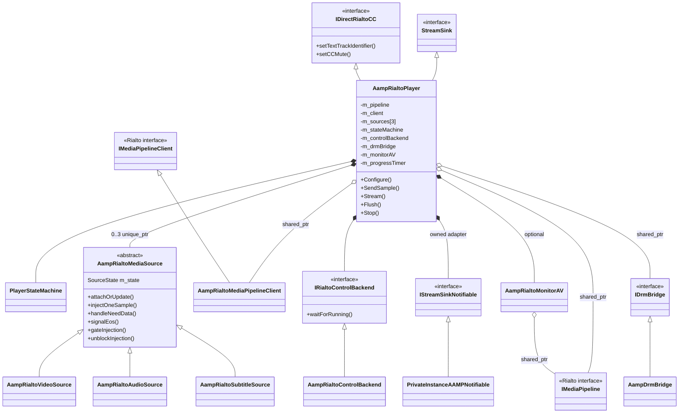
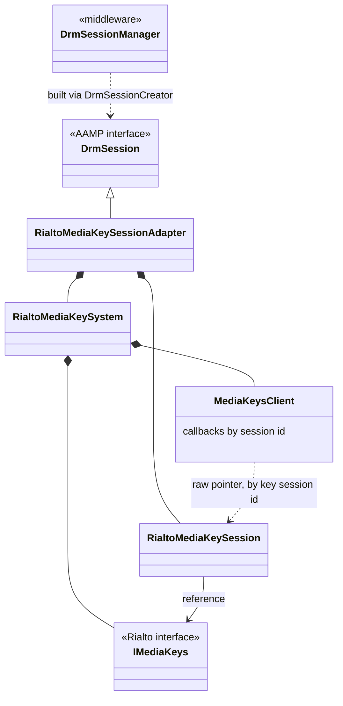

<!--
If not stated otherwise in this file or this component's license file the
following copyright and licenses apply:

Copyright 2026 RDK Management

Licensed under the Apache License, Version 2.0 (the "License");
you may not use this file except in compliance with the License.
You may obtain a copy of the License at

http://www.apache.org/licenses/LICENSE-2.0

Unless required by applicable law or agreed to in writing, software
distributed under the License is distributed on an "AS IS" BASIS,
WITHOUT WARRANTIES OR CONDITIONS OF ANY KIND, either express or implied.
See the License for the specific language governing permissions and
limitations under the License.
-->

# Architecture, classes and ownership

Back to [overview](README.md).

## Class responsibilities

| Class | Responsibility |
|---|---|
| [`AampRialtoPlayer`](../../direct-rialto/AampRialtoPlayer.h) | The `StreamSink` implementation (also `IDirectRialtoCC`). Owns the Rialto pipeline and the per-track sources. Holds all policy: when to rebuild the pipeline, source attach ordering, deferred `play()`, flush and position protocol, notification translation. |
| [`PlayerStateMachine`](../../direct-rialto/AampPlayerStateMachine.h) | Mutex-protected GoF state machine (`IPlayerState` subclasses private to the `.cpp`) tracking pipeline lifecycle. Logs every transition at MILESTONE level and warns on events with no transition. |
| [`AampRialtoMediaSource`](../../direct-rialto/AampRialtoMediaSource.h) | Abstract per-track source. Owns the `needData` / `haveData` handshake state (`SourceState`), gate mode, EOS flag, DRM key-session id (`mksId`), pending codec data and an optional `Mp4Demux`. Template-method hooks: `mapCodecToMime`, `createRialtoSource`, `updateCachedMetadata`, `createSegment`. |
| `AampRialtoVideoSource` | H.264 and HEVC mapping, `MediaSegmentVideo`. |
| `AampRialtoAudioSource` | AAC, AC-3 / EAC-3 and AC-4 mapping, `MediaSegmentAudio`. |
| `AampRialtoSubtitleSource` | TTML and WebVTT (raw or in MP4) and in-band CC. Refines the TTML display offset per sample. |
| `makeDefaultSourceCreator()` | Factory (`SourceCreator`) returning the concrete source by `AampMediaType`. Lives in its own `.cpp` so tests can substitute a fake. |
| [`AampRialtoMediaPipelineClient`](../../direct-rialto/AampRialtoMediaPipelineClient.h) | `IMediaPipelineClient`. Forwards seven notifications (playback state, position, need-data, cancel need-data, underflow, duration, error) to `std::function` callbacks installed by the player. A source-flushed callback can be installed but `notifySourceFlushed` never invokes it. The remaining notifications are log-only stubs. |
| [`AampRialtoControlBackend`](../../direct-rialto/AampRialtoControlBackend.h) | Registers an `IControlClient` with Rialto `IControl` and exposes `waitForRunning(timeoutMs)`. Behind the `IRialtoControlBackend` interface. |
| [`PrivateInstanceAAMPNotifiable`](../../direct-rialto/PrivateInstanceAAMPNotifiable.h) | Adapter from `IStreamSinkNotifiable` to `PrivateInstanceAAMP`. Posts most notifications to AAMP's scheduler. |
| [`AampRialtoMonitorAV`](../../direct-rialto/AampRialtoMonitorAV.h) | Optional AV health classifier and reporter using two GLib timers. |
| `AampRialtoPlayer::ProgressTimer` | GLib timer that calls `MonitorProgress`. |
| `AampRialtoPlayer::RialtoLogHandler` | Forwards Rialto client logs into AAMP logging. |
| [`AampDrmBridge`](../../direct-rialto/AampDrmBridge.h) (`IDrmBridge`) | Calls `AampDRMLicenseManager::createDrmSession()` and returns the Rialto key-session id. |
| [`makeRialtoSessionCreator()`](../../direct-rialto/RialtoSessionCreator.cpp) | `DrmSessionCreator` that makes `DrmSessionManager` build Rialto-backed sessions. |
| [`RialtoMediaKeySessionAdapter`](../../direct-rialto/RialtoMediaKeySessionAdapter.h) | `DrmSession` implementation over `RialtoMediaKeySystem` / `RialtoMediaKeySession`. Decryption is server-side. |
| [`RialtoMediaKeySystem`](../../direct-rialto/RialtoMediaKeySystem.h) | Owns `IMediaKeys` and the inner `IMediaKeysClient` that routes callbacks to per-session handlers. |
| [`RialtoMediaKeySession`](../../direct-rialto/RialtoMediaKeySession.h) | Thin wrapper over `update` / `close` / `release` plus a key-status cache. |

## Class diagram

*Figure 2. Ownership and inheritance. `*--` is composition (unique ownership),
`o--` is shared or non-exclusive ownership. The DRM classes are shown
separately below.*

*Figure 3. DRM class relationships. `RialtoMediaKeySession` holds a reference to
`IMediaKeys` owned by its `RialtoMediaKeySystem`, so both must be destroyed
together, which the adapter guarantees by owning both.*

## Creation, ownership and lifetime

| Object | Created by and when | Owner | Destroyed |
|---|---|---|---|
| `AampRialtoPlayer` | `AampStreamSinkManager::CreateSinkInstance()` when `useDirectRialto` is set | `AampStreamSinkManager` | By the manager. One per player in multi-pipeline mode, one shared in single-pipeline mode. |
| `PrivateInstanceAAMPNotifiable` | Player constructor when no test notifiable is injected | player (`unique_ptr`) | with the player |
| `AampRialtoControlBackend` | First `Configure()`, lazily | player (`unique_ptr`) | **`Stop()`**, and recreated on the next `Configure()` |
| `IMediaPipelineFactory`, capabilities | First `Configure()` | player | with the player |
| `AampRialtoMediaPipelineClient` | First `Configure()` that recreates the pipeline | player (`shared_ptr`); Rialto holds a `weak_ptr` | with the player. It is reused across pipeline recreations. |
| `IMediaPipeline` | `Configure()` when `ShouldRecreatePipeline()` is true | player (`shared_ptr`), plus a copy in `AampRialtoMonitorAV` | `Stop()` resets it. `Configure()` replaces it **after** creating the new one. |
| `AampRialtoMediaSource` (x3) | `Configure()` via `SourceCreator` | player (`array<unique_ptr>`) | Replaced or reset in `Configure()`. Otherwise with the player. |
| `Mp4Demux` (per source) | Lazily on first `processInitFragment()` | the source | with the source |
| `AampDrmBridge` | First `AttachSource()`, or `SetEncryptedAamp()` | player (`shared_ptr`) | with the player |
| `AampRialtoMonitorAV` | `Configure()` when `monitorAV` is set and `load()` succeeded | player | `Stop()` |
| `RialtoMediaKeySessionAdapter` | `DrmSessionManager` through the creator | `DrmSessionManager` slots | by `DrmSessionManager` |

Raw pointers and borrowed references worth knowing about:

- Injector threads receive `IMediaPipeline &` dereferenced from `m_pipeline`
  (`*m_pipeline`) without taking shared ownership. Nothing keeps the pipeline
  alive for the duration of `injectOneSample()`.
- `PrivateInstanceAAMPNotifiable` stores a raw `PrivateInstanceAAMP *` that
  `ChangeAamp()` rewrites without synchronisation.
- `RialtoMediaKeySystem::MediaKeysClient` holds raw `RialtoMediaKeySession *`.
  Entries are removed by `RialtoMediaKeySession::destruct()` through a
  `weak_ptr`-guarded callback.
- `AampRialtoControlBackend::ControlClient` holds a reference to its owner.

## Public surface

AAMP interacts with the sink only through `StreamSink`
([`StreamSink.h`](../../StreamSink.h)). Notable parts of the surface:

- **Lifecycle:** `Configure`, `Stream`, `Stop`, `Flush`, `SeekStreamSink`.
- **Data:** `SendSample` (demuxed samples), `SendCopy` (HLS-TS elementary
  stream frames), `SendTransfer` (container fragments and raw subtitles),
  `SetStreamCaps`, `Discontinuity`, `EndOfStreamReached`.
- **Control:** `Pause`, `SetPlayBackRate`, `StopBuffering`,
  `NotifyFragmentCaching*`, `NotifyInjectorTo{Pause,Resume}`,
  `UnblockTrackInjection`, `SetVideoRectangle`, `SetVideoMute`,
  `SetSubtitleMute`, `SetAudioVolume`.
- **Queries:** `GetPositionMilliseconds`, `GetDurationMilliseconds`,
  `GetVideoPTS`, `CheckForPTSChangeWithTimeout`, `GetVideoPlaybackQuality`.
- **Multi-player:** `IsAssociatedAamp`, `ChangeAamp`, `SetEncryptedAamp`,
  `ResetFirstFrame`.

Methods that are no-ops or partial in Direct Rialto are listed in
[limitations.md](limitations.md#not-implemented-or-partial-streamsink-methods).

## Which data path feeds the sink

| Content | Demuxer | Sink call |
|---|---|---|
| DASH fMP4 (default, because `useMp4Demux` is forced on) | `AampMp4Demuxer` in stream abstraction, shared with the GStreamer path when `useMp4Demux` is set | `SetStreamCaps` for the init segment, then `SendSample` per sample |
| HLS-TS | `TSProcessor` produces elementary-stream frames | `SendCopy`. The source has no demuxer, so it wraps each frame in an `AampMediaSample`. |
| Raw TTML / WebVTT | none (no `playContext`) | `SendTransfer` |
| Container fragments handed to `SendTransfer` | `Mp4Demux` owned by the source (`processInitFragment`, `processDataFragment`) | `SendTransfer` |

Which production callers still deliver container fragments through
`SendTransfer` in the default DASH configuration was not traced. The owned
`Mp4Demux` path is exercised by L1 tests and by raw-subtitle handling, so treat
it as secondary. Source:
[`streamabstraction.cpp`](../../streamabstraction.cpp)
(`InitializeMediaProcessor`), [`AampMp4Demuxer.cpp`](../../mp4demux/AampMp4Demuxer.cpp).
