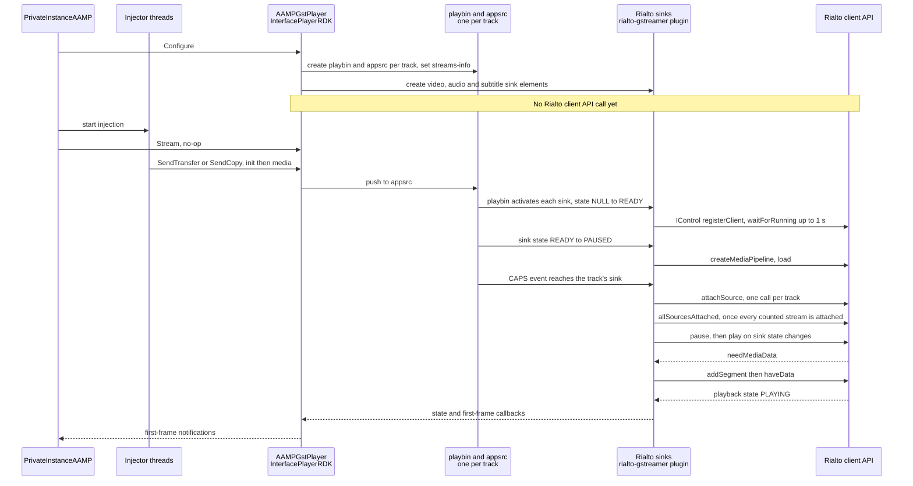
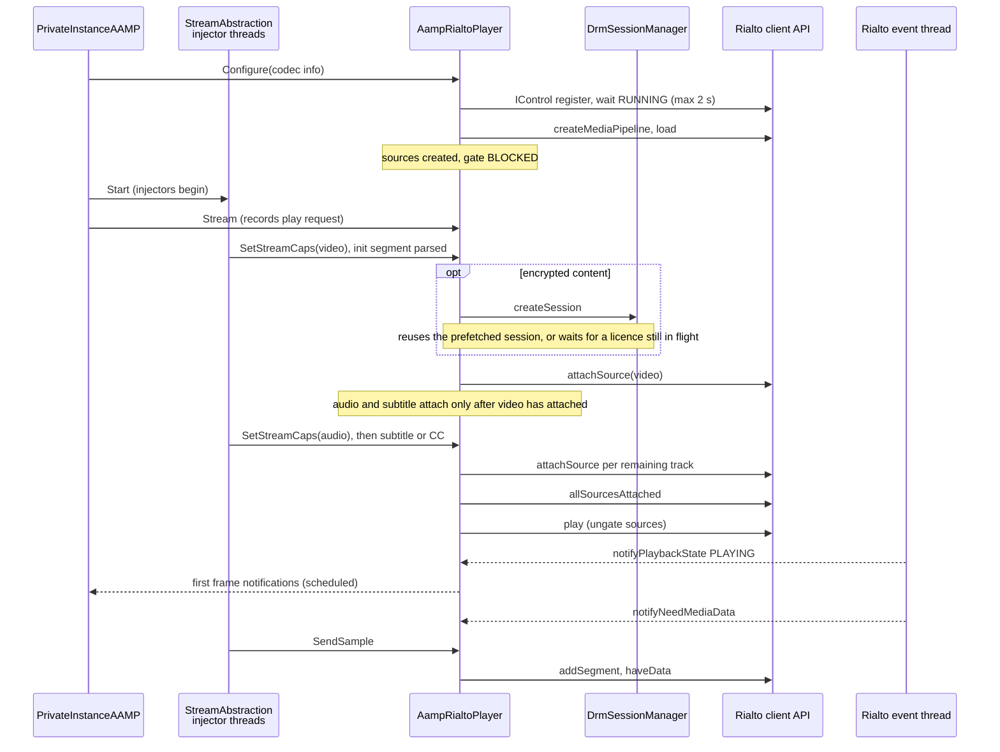

<!--
If not stated otherwise in this file or this component's license file the
following copyright and licenses apply:

Copyright 2026 RDK Management

Licensed under the Apache License, Version 2.0 (the "License");
you may not use this file except in compliance with the License.
You may obtain a copy of the License at

http://www.apache.org/licenses/LICENSE-2.0

Unless required by applicable law or agreed to in writing, software
distributed under the License is distributed on an "AS IS" BASIS,
WITHOUT WARRANTIES OR CONDITIONS OF ANY KIND, either express or implied.
See the License for the specific language governing permissions and
limitations under the License.
-->

# Direct Rialto versus the GStreamer path

Back to [overview](README.md).

"Existing path" below means `AAMPGstPlayer`
([`aampgstplayer.cpp`](../../aampgstplayer.cpp)) driving `InterfacePlayerRDK`
from the middleware player interface (`.libs/middleware-player-interface`),
optionally with Rialto GStreamer sinks (`useRialtoSink`).

The local-decode and Rialto-sink variants must not be conflated: with
`useRialtoSink`, GStreamer runs inside AAMP as an adapter to the same Rialto
client API used by Direct Rialto. Decryption, decoding and server-side
buffering remain in the Rialto server in both Rialto modes.

Where the GStreamer-side behaviour comes from the GStreamer framework and not
from AAMP code, it is marked *(framework)* and was not re-verified here.

## What is shared and what is replaced

| Shared | Replaced or bypassed |
|---|---|
| `PrivateInstanceAAMP` tune, seek, rate and event logic | `AAMPGstPlayer` / `InterfacePlayerRDK` |
| Manifest parsing, ABR, fragment download, fragment cache | AAMP's GStreamer pipeline (playbin, appsrc and sinks; local decoders only in the local-decode variant) |
| `StreamAbstractionAAMP` injector threads and `AampMp4Demuxer` (when `useMp4Demux`) | `AampBufferControl` need / enough-data driven download control |
| `StreamSink` call sites in `priv_aamp.cpp` and `streamabstraction.cpp`; server-side decryption in both Rialto modes | The client-side DRM session adapter; this does not change where Rialto decrypts samples |
| `AampStreamSinkManager` ownership and activation | GStreamer bus message handling and error mapping |
| `DrmSessionManager` and `AampDRMLicenseManager` | `PlayerCCManager` default variant (Direct Rialto selects `PlayerDirectRialtoCCManager`) |

## Comparison table

| Aspect | Existing GStreamer path | Direct Rialto | Basis |
|---|---|---|---|
| Selection | `AampStreamSinkManager::CreateSinkInstance()` returns `AAMPGstPlayer` | returns `AampRialtoPlayer` when `useDirectRialto` | confirmed, [`AampStreamSinkManager.cpp`](../../AampStreamSinkManager.cpp) |
| Config change after creation | n/a | Reverted by `AampConfig::DoCustomSetting()`. The setting is read at player construction. | confirmed, [`AampConfig.cpp`](../../AampConfig.cpp) |
| Demux | `IsoBmffProcessor` passes ISO BMFF to GStreamer's demuxer, or `AampMp4Demuxer` if `useMp4Demux` | `AampMp4Demuxer` always (`useMp4Demux` is forced on) | Confirmed: `IsoBmffProcessor` is created when `useMp4Demux` is off, and `InterfacePlayerRDK` handles a `qtdemux` element for that case. Its comments say that with mp4 demux "there is no qtdemux element in the pipeline" (`InterfacePlayerRDK.cpp`). The forced setting is confirmed in `AampConfig.cpp`. |
| Media handoff | `SendCopy` / `SendTransfer` build a `MediaSample`; `InterfacePlayerRDK::SendHelper` pushes to `appsrc` | `SendSample` hands elementary samples to the source, which waits for a Rialto request and calls `addSegment` | confirmed |
| Flow control | `appsrc` need-data / enough-data signals call `AampBufferControl`, which calls `ResumeTrackDownloads` / `StopTrackDownloads` | Rialto `needMediaData` releases a blocked injector thread. Downloads are not stopped by sink fullness. | confirmed |
| `Stream()` | `AAMPGstPlayer::Stream()` is empty | Requests `play()`. Deferred until sources are attached and no flush or position is pending. | confirmed |
| Pipeline start | `Configure()` builds AAMP's GStreamer pipeline (a `playbin` and `appsrc` per track) and creates the Rialto sinks. With `useRialtoSink` the Rialto pipeline is created later, by the sink plugin; see [Playback startup](#playback-startup-existing-path-with-rialto-gstreamer-sinks). | `createMediaPipeline` + `load` in `Configure()`, then `attachSource` per track, `allSourcesAttached`, `play` | confirmed (AAMP code and plugin source) |
| Track-set changes | Local decode can reconfigure individual track bins. With Rialto sinks, retaining the outer GStreamer container does **not** establish that the Rialto session can accept a new source set. | `ShouldRecreatePipeline()` selects a new Rialto pipeline for source-set or codec changes; audio EOS for trick play is an exception. | The plugin's `sendAllSourcesAttachedIfPossibleInternal()` explicitly documents the server restriction on adding sources after `allSourcesAttached()`. Both Rialto paths face that restriction; see below for supported source switching. |
| DRM | Local decode uses pipeline decryptor elements. With Rialto sinks, encrypted samples and per-segment key metadata go to the server for decryption. | `RialtoMediaKeySessionAdapter` obtains the licence and key-session id; encrypted segments carry the same kind of metadata to the server. | Plugin `BufferParser::addProtectionMetadataToSegment()` sets the encrypted flag, session id, key id, IV and sub-samples. Server-side `GstSrc::setupAndAddAppSrc()` installs the decryptor. Server-side decryption is shared, not a Direct Rialto advantage. |
| Position | GStreamer position query minus segment start, times rate | `getPosition()` minus a staged baseline, times rate, clamped at 0 for forward play | confirmed (comment mirrors the GStreamer formula) |
| Flush and seek | Flushing seek on the pipeline | `IMediaPipeline::setPosition()`, completion on `SEEK_DONE` | confirmed |
| First frame | Bus state change and first-frame callbacks from the pipeline | First `PLAYING` notification. `notifyFirstFrameReceived` is a stub. | confirmed; "first frame" is an approximation (inferred) |
| Callback thread | GStreamer threads and the GLib main context *(framework)* | Rialto client `rialto-media-player-events` thread, then AAMP scheduler | confirmed for Rialto; GStreamer side unverified |
| Callback lifetime guard | `GstHandlerControl` helper macro in the need-data / enough-data handlers | None. Callbacks capture `this` (see [threading.md](threading.md)). | confirmed: `GstHandlerControl` documents the macro as a thread-safe way to disable handlers and confirm they are disabled |
| Errors | Bus error messages mapped by string matching in `HandleBusMessage()` | `PlaybackError` enum (`DECRYPTION`, `OUTPUT_PROTECTION`, `UNKNOWN`) and `PlaybackState::FAILURE` | confirmed |
| Underflow | Pipeline underflow handling in `InterfacePlayerRDK` | `notifyBufferUnderflow`, then retune or `AampUnderflowMonitor` | confirmed |
| Trick play | Audio EOS and video-only injection | Audio and subtitle sources forced to EOS while rate is not 1. Applied rate comes from `isVideoMaster`. | confirmed |
| Subtitles | GStreamer subtitle path (subtec, or Rialto text sink with `useRialtoSink`) | `text/ttml`, `text/vtt` and `text/cc` sources, with TTML offset refinement | confirmed |
| Closed captions | Default or Rialto CC manager | `PlayerDirectRialtoCCManager` via `IDirectRialtoCC` | confirmed |
| Teardown | Pipeline set to `GST_STATE_NULL`, then `DestroyPipeline()` (`InterfacePlayerRDK::Stop`) | `Stop()`: drop injection, `stop()`, release pipeline and control backend | Confirmed on both sides. |
| Muxed HLS-TS | One pipeline demuxes | Each track needs a Rialto source, so all sources are attached on the first `SendCopy`. The ordering workaround is in [limitations.md](limitations.md). | confirmed |
| Unsupported | n/a | Video zoom, text style, subtitle PTS offset, `FlushTrack` | confirmed |

### Advantages and trade-offs

Project testing has demonstrated memory savings and, during early
development, faster tunes. The tune-time improvement needs confirmation on
the current implementation. These results are reported by the project
maintainer; benchmark figures and the measurement setup are not included here.

- **Fewer layers.** No GStreamer pipeline inside AAMP, so no `appsrc`
  buffering decisions, plugin sample queues or bus-message translation.
  AAMP controls segment delivery through the Rialto client API. The Rialto
  server still uses its own playback pipeline, buffering and decryptor elements.
- **Faster tunes observed in early development; confirmation required.**
  More direct control of startup and removal of client-side GStreamer element
  setup, state changes and buffering are expected to help. One mechanism is
  visible in the source: with Rialto sinks, the Rialto pipeline and each source
  are created only once playbin has activated the sinks and caps have reached
  them (118 ms and 137 ms after `Configure()` in one device log), whereas
  Direct Rialto does both from `Configure()` and the init segment. That
  observation is a single tune and does not show the effect on total tune time.
  See [Playback startup](#playback-startup-existing-path-with-rialto-gstreamer-sinks).
  Reconfirm using
  elapsed time from the tune request to the first video image actually
  presented on the screen, with comparable content, platform and settings.
  Do not use first-frame notifications as the measurement endpoint: the
  notifications differ between paths and do not establish when video becomes
  visible. In particular, Direct Rialto reports its first frame on `PLAYING`.
- **Demonstrated memory savings.** Removing AAMP's GStreamer elements,
  `appsrc` buffering and plugin sample queues reduces client-side overhead.
  `PullModePlaybackDelegate::handleBuffer()` queues up to 24 samples per
  sink before waiting for space. Those samples reference buffers, so queue
  removal is not a fixed byte saving. AAMP's fragment cache, in-flight
  samples, Rialto shared memory and server buffers remain. The demonstrated
  saving is not quantified here; any published figures should specify the
  measurement scope, content, platform and settings.
- **Shared server-side decryption.** Both Rialto modes send encrypted data
  with per-segment key metadata to the same server-side decryption path.
  Direct Rialto changes the client-side adapter, not the decryption location.
- **AAMP owns more policy.** Position baselines, flush sequencing, play
  gating, attach ordering and error mapping are all re-implemented in
  `AampRialtoPlayer`. Many comments say "mirrors" a GStreamer behaviour, so
  parity must be maintained by hand.
- **Coarser feedback.** Rialto reports fewer, coarser events than GStreamer.
  The first-frame approximation and the three-value error mapping are
  examples.
- **Shared Rialto source-set constraints.** A surviving GStreamer container
  is not evidence that the underlying Rialto session can be reused for an
  arbitrary new track set. The plugin destroys its client backend when the
  last sink releases it (`MediaPlayerManager::releaseMediaPlayerClient()`).
  Do not describe Direct Rialto's rebuild policy as a disadvantage relative
  to Rialto GStreamer sinks on that basis. There are narrower supported
  operations: the plugin handles a `switch-source` event carrying audio caps
  in `PullModeAudioPlaybackDelegate::handleEvent()` by calling
  `switchSource()`, and the server implements it. Thus neither
  "every track change requires a rebuild" nor
  "every track can be reconfigured without a rebuild" is a general Rialto
  guarantee.
- **Concurrency responsibility moves into AAMP.** Direct Rialto explicitly
  coordinates injector threads, Rialto callbacks, playback transitions and
  shutdown rather than delegating part of that work to GStreamer and its
  plugin. This provides more direct control but makes AAMP responsible for
  maintaining the synchronisation and lifetime guarantees. It is an
  architectural trade-off, not evidence that either implementation is
  inherently safer. See [threading.md](threading.md).

## Playback startup: existing path with Rialto GStreamer sinks

This sequence is for `useRialtoSink`, where the `rialto-gstreamer` plugin makes
the Rialto client API calls. With the default local-decode variant AAMP makes
no Rialto calls at all. Sources: `InterfacePlayerRDK.cpp` in
`.libs/middleware-player-interface`, and `.libs/rialto-gstreamer/source`.

*Figure 4. Startup through `AAMPGstPlayer` with Rialto sinks. The step
"playbin activates each sink" is inferred from the device log below, because
GStreamer's own source was not read. Which GStreamer thread runs each callback
is not established and is not claimed here.*

### What triggers each Rialto call

All of these are confirmed in the plugin source under
`.libs/rialto-gstreamer/source`.

| Rialto client call | Trigger in the plugin |
|---|---|
| `IControl::registerClient`, then `waitForRunning` | The sink's `NULL` to `READY` state change creates the delegate and its control backend (`rialto_mse_video_sink_change_state`, `PullModePlaybackDelegate::createControlBackend`). `waitForRunning` waits at most 1 s, and a timeout fails the state change. |
| `createMediaPipeline`, then `load("mse://1")` | The sink's `READY` to `PAUSED` state change calls `attachToMediaClientAndSetStreamsNumber()`, which reaches `GStreamerMSEMediaPlayerClient::createBackend()`. |
| `attachSource` | A `GST_EVENT_CAPS` arriving on that track's sink pad (`PullModeVideoPlaybackDelegate::handleEvent`, and the audio and subtitle equivalents). Each track attaches independently. |
| `allSourcesAttached` | After an attach, once every stream counted in the `streams-info` context has attached (`sendAllSourcesAttachedIfPossibleInternal`). AAMP sets that context in `ConfigurePipeline`. |
| `pause`, `play` | The sink's `READY` to `PAUSED` and `PAUSED` to `PLAYING` state changes (`PullModePlaybackDelegate::changeState`). |
| `addSegment`, `haveData` | A puller thread per source calls `addSegment`. `haveData` is posted to the plugin's backend queue. |

AAMP creates the sink elements in `Configure()` (`SetupStream`) but makes no
Rialto call there. Every Rialto call above happens later, when playbin
activates the sinks and caps reach them.

### Observed timing on a device

The second rotated messages log in `aamp_test_internal/test/l3test/AAMP_Logs/`
(`*-messages.log.2`, lines 5507 to
6060) holds one tune on a device with Rialto sinks. It interleaves AAMP logs
with `RialtoServer` IPC logs, so client-side events can be lined up with the
server's receipt of each call. Offsets are from `ConfigurePipeline`
(13:59:10.839).

| Offset | Event |
|---|---|
| +0 ms | `ConfigurePipeline` starts and creates the playbins |
| +10 to +13 ms | AAMP finds the appsrc for each track |
| +118 ms | Server receives `createSession` (`createMediaPipeline`) |
| +123 ms | Server receives `load` |
| +129 ms | First video media fragment sent into the pipeline |
| +137 ms | `attachSource` for video |
| +139 ms | `attachSource` for audio |
| +331 ms | First subtitle fragment sent into the pipeline |
| +337 ms | `attachSource` for subtitle |
| +338 ms | `allSourcesAttached` |
| +342 ms | `pause` |
| +372 ms | First `needMediaData` (subtitle) |

Limits of this observation. It is one tune, with the default configuration
(`IsoBmffProcessor` and `qtdemux` in the pipeline, `useMp4Demux` off) and
clear content, so it says nothing about DRM or about `useMp4Demux`. The device
build may differ from the sources in this tree.

### Is `attachSource` delayed until media data arrives?

Largely yes, for the observed configuration.

- **Mechanism.** The plugin attaches a source when the caps event reaches the
  sink, so it depends on playbin delivering caps, not on appsrc itself. In the
  log each video and audio `attachSource` followed the first media fragments
  by under 10 ms, and `createSession` coincided with the first injection.
- **Slowest track gates `allSourcesAttached`.** The subtitle fragment was
  injected about 200 ms after the video and audio, because it was downloaded
  later. Its attach, and so `allSourcesAttached`, waited for it.
- **Not measured.** With `useMp4Demux`, AAMP sets caps on appsrc itself
  (`SetStreamCaps`). Whether caps then reach the sink before the first media
  buffer depends on playbin and was not tested.

## Playback startup: Direct Rialto

*Figure 5. Startup through `AampRialtoPlayer`. `Stream()` and source
attachment can happen in either order, see
[lifecycle.md](lifecycle.md#play-rendezvous). The full sequence including
DRM and position handling is in [playback-flow.md](playback-flow.md#startup).*

### When each path first calls the Rialto client API

| Step | Rialto GStreamer sinks | Direct Rialto |
|---|---|---|
| `IControl` register and wait for `RUNNING` | Sink `NULL` to `READY`, so after playbin activates the sink. Waits 1 s, and a timeout **fails** the state change. | In `Configure()`. Waits 2 s, then **continues**. |
| `createMediaPipeline` and `load` | Sink `READY` to `PAUSED`. Observed 118 ms after `Configure()` in the device log above. | In `Configure()`, before any media is injected. |
| `attachSource` trigger | Caps event at that track's sink. Observed after the first media fragment. | DASH: the init segment parsed by `AampMp4Demuxer` (`SetStreamCaps`), so no media sample is needed. HLS-TS: the first `SendCopy`, which attaches every source. Video attaches first. |
| `allSourcesAttached` trigger | Every stream in `streams-info` has attached. | Every created source has attached. |
| DRM session on the attach path | Not established, see below. | `AttachSource()` calls `createSession` before `attachSource`. |
| First media to Rialto | After `needMediaData`. | After `needMediaData`. |

The structural difference is that Direct Rialto removes the wait for playbin to
create and activate the sinks and to deliver caps. Both paths still wait for
the init segment of each track, and for the slowest track before
`allSourcesAttached`. How much time that saves on the current implementation
has not been measured. See the tune-time note in
[Advantages and trade-offs](#advantages-and-trade-offs).

### DRM licence acquisition and the attach path

- **Both paths start the licence early.** `QueueContentProtection` in the MPD
  collector queues the protection data, and `AampLicensePreFetcher` starts its
  own thread to acquire the licence. This happens during manifest processing,
  independently of the sink. `DrmSessionManager::createDrmSession()` takes
  `mDrmSessionLock` and returns an already-created session immediately.
- **Direct Rialto waits on the attach path.** `AttachSource()` calls
  `AampDrmBridge::createSession()` before `attachSource`. It waits only for the
  part of the licence round trip that the prefetch thread has not finished.
  This is confirmed in the code.
- **Rialto GStreamer sinks: not established.** The plugin takes the
  key-session id from buffer protection metadata (`GStreamerEMEUtils.cpp`), so
  a decryptor must run upstream of the sink. AAMP's in-pipeline decryptor
  element (in the middleware plugins) calls
  the same `createDrmSession()` on the streaming thread when it receives the
  protection event. Whether that happens before or after the sink's caps event,
  and so whether it delays `attachSource`, was not determined. The Rialto OCDM
  library that stamps the metadata is not in this tree (only a stub under
  `.libs/rialto/stubs/opencdm`).
- **No measurement.** The device logs contain no DRM tune, so the effect of
  licence acquisition on attach time is not measured for either path. Both
  depend on the same licence, so a delay from DRM is not specific to one path.
  It needs a DRM tune log from each path.

## Behavioural and compatibility differences

- **`Configure()` is heavier and can block.** It can wait up to 2 s for
  Rialto to report `RUNNING`, and can wait indefinitely for an in-flight flush
  to complete (`WaitForFlushToComplete`).
- **Injector threads block in the sink.** `injectOneSample()` blocks until
  Rialto issues a request or the generation changes. The caller therefore must
  call `UnblockTrackInjection` (done in
  [`PrivateInstanceAAMP::StopTrackInjection`](../../priv_aamp.cpp)) before
  joining injector threads.
- **Several `StreamSink` methods do nothing**, so features such as subtitle
  PTS offset, text style and video zoom are unavailable.
- **Single-pipeline mode** is supported through `ChangeAamp`,
  `SetEncryptedAamp` and `ResetFirstFrame`, with `positionIsAuthoritative`
  on `Flush()` for ad transitions.
