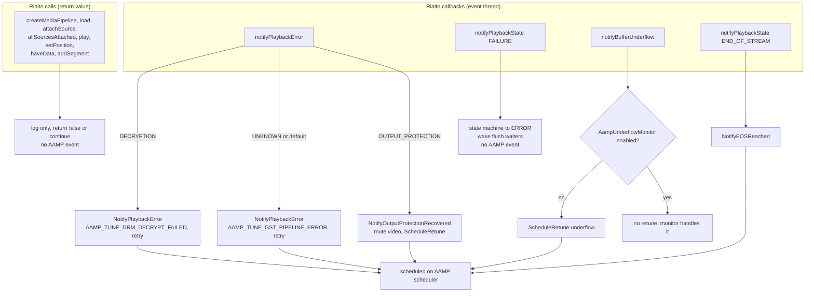

<!--
If not stated otherwise in this file or this component's license file the
following copyright and licenses apply:

Copyright 2026 RDK Management

Licensed under the Apache License, Version 2.0 (the "License");
you may not use this file except in compliance with the License.
You may obtain a copy of the License at

http://www.apache.org/licenses/LICENSE-2.0

Unless required by applicable law or agreed to in writing, software
distributed under the License is distributed on an "AS IS" BASIS,
WITHOUT WARRANTIES OR CONDITIONS OF ANY KIND, either express or implied.
See the License for the specific language governing permissions and
limitations under the License.
-->

# Error handling, recovery and diagnostics

Back to [overview](README.md).

Direct Rialto has **no recovery logic of its own**. It logs, translates a
small set of Rialto errors into AAMP events, and relies on AAMP's retune to
rebuild a session. Several failures are only logged and never reach AAMP.

## Error propagation

*Figure 17. Error routing. Only the paths ending at the scheduler reach AAMP.*

## Error scenario table

Classification uses the terms in [limitations.md](limitations.md).

| Scenario | Detected | Behaviour | Reaches AAMP |
|---|---|---|---|
| Rialto factory not available | `Configure()` | Error log, no pipeline, `Configure()` returns. Later `Send*` calls warn and return false or ignore. | No |
| Rialto not `RUNNING` within 2 s | `waitForRunning` | Warning, continues to `createMediaPipeline()` | No |
| `createMediaPipeline` returns null | `Configure()` | Error log, returns. | No |
| `load()` fails | `Configure()` | Error log. **The pipeline pointer is kept**, callbacks are not installed, no `onPipelineLoaded`, sources are still created. | No |
| `attachSource` fails or the codec is unsupported (for example MP3 or Atmos audio) | `attachOrUpdate` returns `FAILED` | Error log. Source stays unattached, so `allSourcesAttached()` is never called and `play()` is never issued. | No |
| `allSourcesAttached()` fails | `CheckAllSourcesAttached` | Error log. State stays `SOURCES_ATTACHING`. | No |
| `play()` or `pause()` fails | `Stream`, `Pause`, `StopBuffering` | Error log. `Pause` returns the result. | No (`Pause` returns false) |
| `setPosition()` fails | `Flush()` | Warning, commits the staged rate and completes the flush without `SEEK_DONE`. | No |
| `haveData` fails | any source | Warning. The request is already cleared locally. | No |
| `addSegment` status other than OK or `NO_SPACE` | `handleAddSegmentCompletion` | Warning. The sample counts as consumed. | No |
| `createSegment` returns null | `injectOneSample` | Request is answered (`EOS` or `NO_AVAILABLE_SAMPLES`) so it is not leaked. | No |
| DRM session creation fails | `attachOrUpdate` | Warning. Source attaches without a key session. Encrypted samples are sent without encryption metadata. | Indirect (DRM manager errors) |
| Encrypted sample with no key session | `annotateEncryption` | Warning per sample | No |
| `PlaybackError::DECRYPTION` | event thread | Scheduled `SendErrorEvent(AAMP_TUNE_DRM_DECRYPT_FAILED)`, retry enabled | Yes |
| `PlaybackError::OUTPUT_PROTECTION` | event thread | Mute video, `ScheduleRetune(eGST_ERROR_OUTPUT_PROTECTION_ERROR)`. Not an error event, by design (HDCP recovery). | Yes (retune) |
| `PlaybackError::UNKNOWN` | event thread | Scheduled `SendErrorEvent(AAMP_TUNE_GST_PIPELINE_ERROR)`, retry enabled | Yes |
| `PlaybackState::FAILURE` | event thread | State machine to `ERROR`, wakes flush waiters. Nothing else. | **No** |
| Buffer underflow | event thread | Retune, or nothing when `AampUnderflowMonitor` handles it | Yes |
| Video PTS not advancing | `CheckForPTSChangeWithTimeout` | Returns false, so AAMP retunes. A PTS of 0 is treated as "still moving". | Yes (caller) |
| Rialto application state `INACTIVE` | control event thread | Recorded. Nothing reacts except the next `waitForRunning()`. The Rialto client then drops `needMediaData`. | No (*server-side effects unverified*) |
| Flush never gets `SEEK_DONE` | `WaitForFlushToComplete` | Waits **without timeout**. Only `FAILURE` or a `setPosition` failure exits. | No |
| Unexpected state event | `PlayerStateMachine::dispatch` | Warning and ignore | No |

### Error mapping

Rialto's `PlaybackError` has no message text, so only three categories are
mapped. The GStreamer path matches substrings in `GstMessage` errors and
distinguishes more cases (`HandleBusMessage()` in
[`aampgstplayer.cpp`](../../aampgstplayer.cpp)).

## Recovery and cleanup

- **Retry.** The sink retries nothing. Retries come from AAMP
  (`ScheduleRetune`, `isRetryEnabled`), which runs `TeardownStream()`, then
  `Stop()`, then `Configure()`.
- **Partial initialisation.** `Configure()` can leave a pipeline pointer with
  no callbacks (failed `load()`). The next `Stop()` or `Configure()` replaces
  it. No dedicated clean-up exists for the partially built state.
- **Cleanup after failure.** `Stop()` always runs the full release sequence and
  moves `ERROR` to `IDLE`. See [lifecycle.md](lifecycle.md).
- **Pending requests.** Every path that abandons a request answers it with
  `NO_AVAILABLE_SAMPLES` (see [lifecycle.md](lifecycle.md#3-needdata-request-lifecycle)).
  A cancel from Rialto clears it silently.
- **Asynchronous failure.** A fatal failure arriving while a thread is in
  `WaitForFlushToComplete()` wakes it through `m_flushCv`. A failure while an
  injector blocks in `injectOneSample()` does not wake it. The injector waits
  for a generation change, which only `Flush()`, `Stop()` or
  `UnblockTrackInjection()` produce.

## Diagnostics

| Aid | Detail |
|---|---|
| State transitions | `AAMPLOG_MIL "PlayerState: A -> B"`. Unexpected events: `AAMPLOG_WARN "event ... has no transition"`. |
| Gate and EOS changes | `gateMode changed (...)`, `eos (...)` with the caller's reason string |
| Request handshake | `handleNeedData`, `haveData` (trace level includes request id, frame count, first PTS, durations, byte counts) |
| Rialto logs | `RialtoLogHandler` maps Rialto levels to AAMP levels with the tag `RialtoClient`, registered once with `ignoreLogLevels=true`. |
| AV health | With `monitorAV`: `MonitorAV_<state>` log lines (`ok`, `video freeze`, `audio drop`, `stall`, `eos`, `trickplay`, `jump`) and `SendMonitorAvEvent`. In Direct Rialto both tracks share one position, so `avsync` cannot trigger. |
| Progress | `MonitorProgress` via the progress timer |
| Verbosity | Almost every method logs `ENTRY` and `EXIT` at INFO. Useful, but noisy on injection paths. |

Rialto server logs (syslog) are needed for server-side causes. The code says so
in its `createMediaPipeline` failure message.
