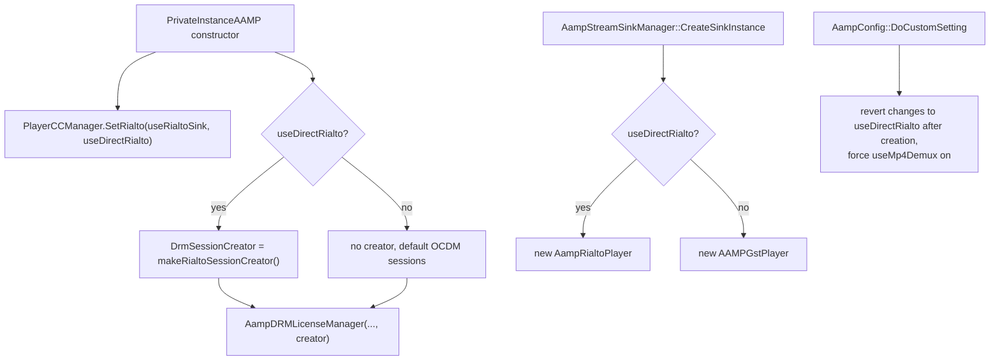

<!--
If not stated otherwise in this file or this component's license file the
following copyright and licenses apply:

Copyright 2026 RDK Management

Licensed under the Apache License, Version 2.0 (the "License");
you may not use this file except in compliance with the License.
You may obtain a copy of the License at

http://www.apache.org/licenses/LICENSE-2.0

Unless required by applicable law or agreed to in writing, software
distributed under the License is distributed on an "AS IS" BASIS,
WITHOUT WARRANTIES OR CONDITIONS OF ANY KIND, either express or implied.
See the License for the specific language governing permissions and
limitations under the License.
-->

# Configuration, integration and testing

Back to [overview](README.md).

## How Direct Rialto is selected

*Figure 18. The three places that consume `useDirectRialto`.*

| Consumer | File | Effect |
|---|---|---|
| Sink creation | [`AampStreamSinkManager.cpp`](../../AampStreamSinkManager.cpp) | `AampRialtoPlayer` instead of `AAMPGstPlayer` |
| DRM | [`priv_aamp.cpp`](../../priv_aamp.cpp) (constructor) | Rialto `DrmSessionCreator` passed to `AampDRMLicenseManager` and on to `DrmSessionManager` |
| Closed captions | `PlayerCCManager::SetRialto` (middleware) | `PlayerDirectRialtoCCManager`, driven through `IDirectRialtoCC` |
| Demux | [`AampConfig.cpp`](../../AampConfig.cpp) | `useMp4Demux` forced on with a warning |
| Stream abstraction | [`streamabstraction.cpp`](../../streamabstraction.cpp), [`fragmentcollector_mpd.cpp`](../../fragmentcollector_mpd.cpp) | Subtitle demuxer selection, no teardown of the subtitle `playContext`, extra Rialto conditions |
| `UsingRialto()` | [`priv_aamp.h`](../../priv_aamp.h) | True for **either** Rialto mode, so the branches below also apply to `useRialtoSink`. Uses: text-track mute notification, secure-buffer copy avoidance, dropping audio and subtitle format during local-TSB trick play, saving the subtitle init header for pre-roll ads, and requiring a subtitle init fragment because Rialto will not start video without a complete pipeline (`fragmentcollector_mpd.cpp`). |

Because the setting is consumed at player construction,
`AampConfig::DoCustomSetting()` reverts attempts to change it from stream,
application or tune settings. Set it from device configuration, environment
or operator settings **before** the player is created.

## Configuration

Only items that exist in the repository.

| Option | Type | Effect on Direct Rialto |
|---|---|---|
| `useDirectRialto` | bool, default false | Enables the mode. Not listed in `README.md` or `CONFIGURATION.md` (only `useRialtoSink` is). |
| `useRialtoSink` | bool | A different mode. Both flags make `UsingRialto()` true. Setting both is not specifically handled here. |
| `useMp4Demux` | bool | Forced on. |
| `monitorAV` | bool | Creates `AampRialtoMonitorAV`. |
| `progressReportingInterval` | seconds | Progress timer and AV monitor sample interval. A value that gives 0 ms disables the progress timer. |
| `monitorAVReportingInterval`, `monitorAVSyncThresholdPositive`, `monitorAVSyncThresholdNegative`, `monitorAVJumpThreshold` | numbers | AV monitor thresholds |
| `enablePTSReStamp` | bool | Chooses the no-flush branch in `Discontinuity()` |
| `enableAampUnderflowMonitor` | bool | Retune is skipped on underflow, the monitor decides |
| `disableTTML` | bool | When not set, a non-live Rialto stream saves the subtitle init header for later reuse (`fragmentcollector_mpd.cpp`) |

Compile-time constants in `AampRialtoPlayer.cpp`: Rialto `RUNNING` wait of
2000 ms, pipeline video requirements 3840 x 2160, URL `mse://1`,
`isLive=false` (a TODO in code notes live is not determined). The subtitle
source can be compiled out with `RIALTO_PLAYER_DISABLE_SUBTITLES` (the comment
says real Rialto on Ubuntu locks up intermittently without a text-track sink).

## Build and dependencies

- The `direct-rialto` sources are **always compiled** into `libaamp`
  ([`CMakeLists.txt`](../../CMakeLists.txt) `LIBAAMP_DEPENDS` list). There is no
  build-time switch. Selection is run-time only.
- `find_package(Rialto)` ([`cmake/FindRialto.cmake`](../../cmake/FindRialto.cmake))
  looks for `libRialtoClient.so` and `IMediaPipeline.h`. If it is not found,
  or on macOS, or when `RIALTO_FORCE_SIMULATOR` is set, CMake builds the
  simulator in [`test/rialto/`](../../test/rialto) and links it as
  `libRialtoClient.so`. Headers come from `.libs/include/rialto` in that case.
- `install-aamp.sh` with the `rialto` option builds real Rialto (and
  `rialto-gstreamer`) into `.libs`. Without it the simulator is used. The
  option is rejected on macOS. Public headers are always cloned because L1
  tests need them. `--rialto-force-simulator` overrides `rialto`.
- Direct runtime dependencies: Rialto client (`IMediaPipeline`,
  `IMediaPipelineCapabilities`, `IControl`, `IMediaKeys`, `IClientLogControl`),
  GLib (timers), the middleware player interface (`DrmSession`,
  `DrmSessionManager`, `PlayerCCManager`, `IDirectRialtoCC`), and AAMP's
  `Mp4Demux`.
- **Platform assumptions:** a Rialto server must be running and reachable
  through Rialto's socket for real playback. The embedding application must run
  a GLib main loop for the progress and AV timers (`aamp-cli` does,
  `test/aampcli/Aampcli.cpp`).

### When Direct Rialto is unavailable

- The classes build against the simulator, so the code always links.
- If `useDirectRialto` is not set, none of this code runs.
- If it is set and no Rialto server answers, `Configure()` logs errors and
  returns without a pipeline. No error is raised to AAMP
  ([error-handling.md](error-handling.md)).

## Integration with other player components

| Component | Integration |
|---|---|
| `AampStreamSinkManager` | Creates, owns and activates the sink. Single-pipeline mode calls `SetActive`, `ChangeAamp`, `ResetFirstFrame`, and `Flush(..., positionIsAuthoritative=true)`. |
| `PrivateInstanceAAMP` | Calls the `StreamSink` interface. Receives notifications through scheduled tasks. Owns `mDRMLicenseManager`. |
| `StreamAbstractionAAMP` | Demuxes (`AampMp4Demuxer`, `TSProcessor`) and drives injector threads. The sink calls `ResumeTrackDownloads` after `Configure()` to unblock track workers. |
| `DrmSessionManager` | Builds Rialto sessions through the creator. |
| `AampUnderflowMonitor` | Notified through `NotifyPipelinePausedToUnderflowMonitor()` on discontinuity. |
| `PlayerDirectRialtoCCManager` | Receives the player as `IDirectRialtoCC` through the CC handle returned in `NotifyFirstFrameReceived`. The player clears the handle in its destructor (`InvalidateHandle`). |

## Tests

| Level | Location | Covers |
|---|---|---|
| L1 | `test/utests/tests/AampRialtoPlayerTests` (about 265 cases) | The sink, using mocks for `IMediaPipeline`, control backend, DRM bridge and notifiable |
| L1 | `AampPlayerStateMachineTests` (about 46), `AampRialtoMediaPipelineClientTests`, `AampRialtoControlBackendTests`, `AampRialtoVideoSourceTests` (about 60, also exercise the base-class handshake), `AampRialtoAudioSourceTests`, `AampRialtoSubtitleSourceTests`, `AampRialtoMonitorAVTests`, `PrivateInstanceAAMPNotifiableTests`, `RialtoMediaKeySystemTests`, `RialtoMediaKeySessionTests`, `RialtoMediaKeySessionAdapterTests` | Individual classes |
| L2 | `aamp_test_internal/test/l2test/AAMP-RIALTO-10000_Tune`, `10001_Tune_HLS`, `10002_TrickModes` | Tune, HLS and trick modes against the Rialto simulator |
| Simulator | [`test/rialto/`](../../test/rialto) ([README](../../test/rialto/README.md)) | In-process `libRialtoClient.so` that fires playback, need-data and position callbacks |

Counts are approximate and were taken by counting test macros.

**Missing or thin coverage** (not an exhaustive search):

- No dedicated tests for `AampDrmBridge` or `makeRialtoSessionCreator`.
- No tests that run flush, stop, `SEEK_DONE`, and need-data on different
  threads concurrently.
- L2 runs against a simulator, so real Rialto server behaviour (for example
  event ordering and pipeline overlap) is not exercised in CI.
