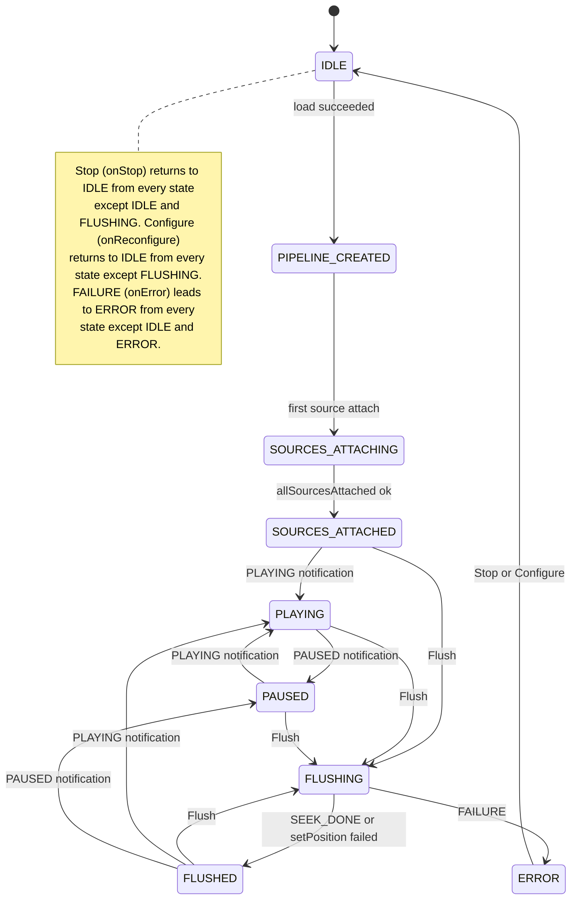
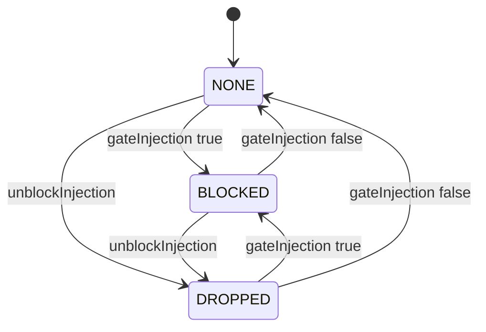
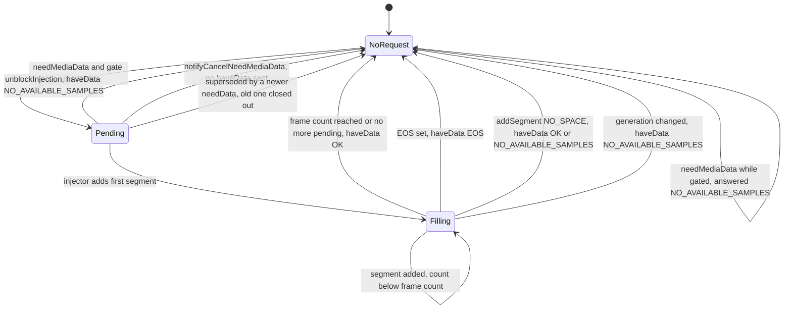
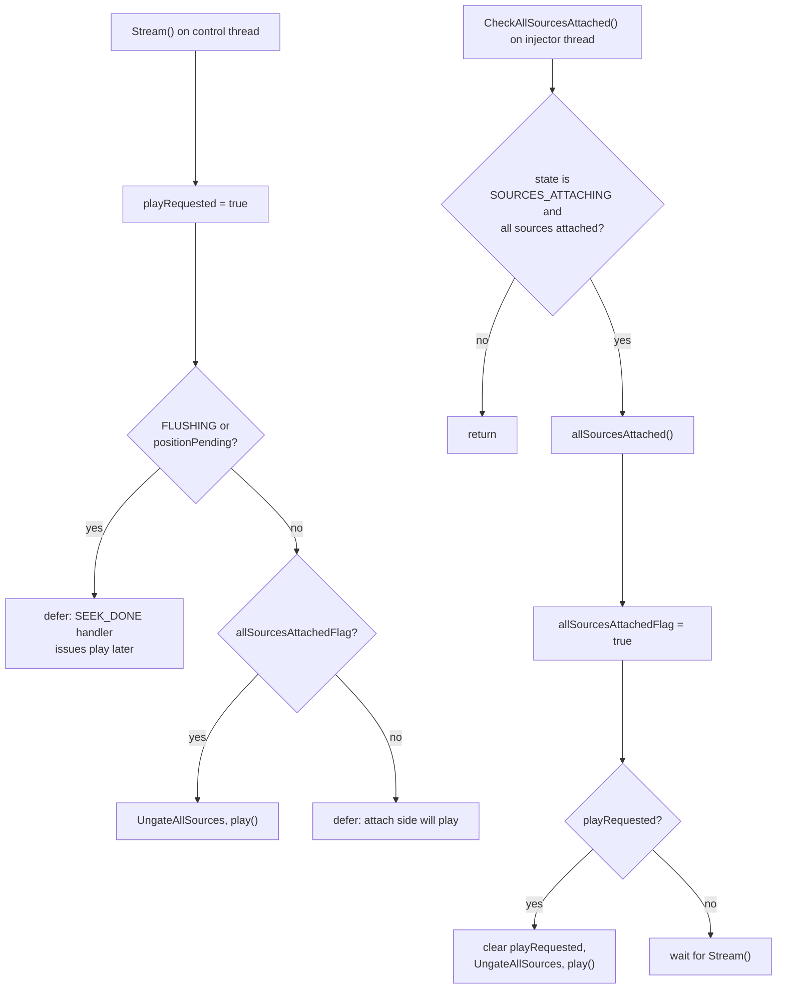
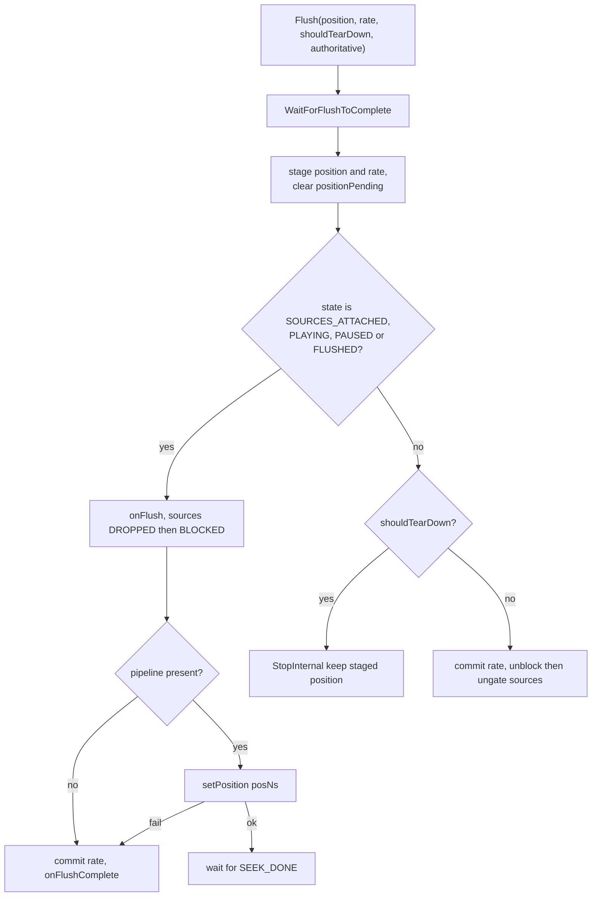

<!--
If not stated otherwise in this file or this component's license file the
following copyright and licenses apply:

Copyright 2026 RDK Management

Licensed under the Apache License, Version 2.0 (the "License");
you may not use this file except in compliance with the License.
You may obtain a copy of the License at

http://www.apache.org/licenses/LICENSE-2.0

Unless required by applicable law or agreed to in writing, software
distributed under the License is distributed on an "AS IS" BASIS,
WITHOUT WARRANTIES OR CONDITIONS OF ANY KIND, either express or implied.
See the License for the specific language governing permissions and
limitations under the License.
-->

# Lifecycle and state management

Back to [overview](README.md).

Direct Rialto has several independent pieces of state. They interact, so they
are documented separately first and tied together at the end.

| State | Where | Scope |
|---|---|---|
| Player lifecycle (`PlayerStateId`) | `PlayerStateMachine` | one per pipeline session |
| Source gate (`GateMode`) | `AampRialtoMediaSource::SourceState` | per track |
| `needData` request (`hasPending`, `generation`, `eos`) | `SourceState` | per track |
| Session flags (`m_playRequested`, `m_allSourcesAttachedFlag`, `m_positionPending`, ...) | `AampRialtoPlayer` | per player |

## 1. Player lifecycle state machine

Implemented in [`AampPlayerStateMachine.cpp`](../../direct-rialto/AampPlayerStateMachine.cpp).
Every public method takes the machine's internal mutex. A transition is logged
with `AAMPLOG_MIL`. An event with no transition from the current state is
**ignored and logged with `AAMPLOG_WARN`**.

*Figure 6. Player lifecycle. The `STOPPED` enumerator exists but is never
entered: `onStop()` goes straight to `IDLE` (the `StoppedState` class has no
transitions and the header comment is stale).*

### Transition reference

| Event | Raised by (thread) | From | To | Action and preconditions |
|---|---|---|---|---|
| `onPipelineLoaded` | `Configure()` (AAMP control thread, or an injector thread when a TS demuxer reports the codec mid-session) | `IDLE` | `PIPELINE_CREATED` | After `createMediaPipeline()` and a successful `load()`. |
| `onSourceAttaching` | `AttachSource()` (injector thread, or `Configure()` for subtitle) | `PIPELINE_CREATED` | `SOURCES_ATTACHING` | Fired for every source's first attach, but only the first one transitions. The second and third source find `SOURCES_ATTACHING`, which has no `onSourceAttaching` handler, so each logs a `WARN` "no transition ... ignored". This is expected noise on a normal A/V start. |
| `onAllSourcesAttached` | `CheckAllSourcesAttached()` | `SOURCES_ATTACHING` | `SOURCES_ATTACHED` | Every non-null source is attached and `allSourcesAttached()` returned true. |
| `onPlaybackStarted` | `OnPlaybackState(PLAYING)` (Rialto event thread) | `SOURCES_ATTACHED`, `PAUSED`, `FLUSHED` | `PLAYING` | A duplicate while `PLAYING` is silently ignored. |
| `onPlaybackPaused` | `OnPlaybackState(PAUSED)` (event thread) | `PLAYING`, `FLUSHED` | `PAUSED` | From any other state the event is ignored with a warning. |
| `onFlush` | `Flush()` | `SOURCES_ATTACHED`, `PLAYING`, `PAUSED`, `FLUSHED` | `FLUSHING` | Claimed under `m_flushMutex`. |
| `onFlushComplete` | `OnPlaybackState(SEEK_DONE)` (event thread), or `Flush()` on `setPosition` failure or no pipeline | `FLUSHING` | `FLUSHED` | Wakes `WaitForFlushToComplete()` waiters. |
| `onStop` | `StopInternal()` | all except `IDLE`, `FLUSHING` | `IDLE` | `Stop()` first waits for any flush to finish. |
| `onError` | `OnPlaybackState(FAILURE)` (event thread) | all except `IDLE`, `ERROR` | `ERROR` | Wakes flush waiters. No pipeline teardown happens here. |
| `onReconfigure` | `Configure()` when the pipeline is recreated | all except `FLUSHING` | `IDLE` | `Configure()` waits for a flush first. |

### State assumptions and invalid transitions

- **`SEEK_DONE` before `PLAYING` / `PAUSED`.** The machine has no memory of the
  pre-flush state. `FLUSHED` relies on Rialto sending `PLAYING` or `PAUSED`
  after `SEEK_DONE`. A `PLAYING` or `PAUSED` that arrives while `FLUSHING` is
  deliberately not handled (warning only). This ordering is an assumption in
  AAMP's comments. It was not confirmed in the Rialto source.
- **`PAUSED` while `SOURCES_ATTACHED` has no transition.** If Rialto reports it
  (not verified), the machine logs a warning and stays put.
- **`END_OF_STREAM` does not change state.** `NotifyEOSReached()` is scheduled
  and the machine stays `PLAYING`.
- **`ERROR` is a dead end until the next `Stop()` or `Configure()`.** Nothing
  in the sink escalates `FAILURE` to AAMP. See
  [error-handling.md](error-handling.md).
- **Not valid:** `Flush()` from `IDLE`, `PIPELINE_CREATED`, `SOURCES_ATTACHING`
  or `ERROR`. `Flush()` handles this explicitly. See
  [Flush decision](#flush-decision).
- **Stale `STOPPED`.** Treat the enumerator as unused.

## 2. Source gate

`GateMode` decides what `injectOneSample()` and `handleNeedData()` do for a
track.

| Mode | Injector behaviour | `needData` behaviour |
|---|---|---|
| `NONE` | Samples flow when a request is pending | Request is staged as pending |
| `BLOCKED` | New samples **wait** until the gate clears or the generation changes | Answered immediately with `NO_AVAILABLE_SAMPLES` |
| `DROPPED` | New samples are discarded at once. The caller never blocks. | Answered immediately with `NO_AVAILABLE_SAMPLES` |

*Figure 7. Per-source gate. `unblockInjection()` also bumps `generation`,
which aborts in-flight injectors. `reset()` deliberately does not touch the
gate.*

| Caller | Effect |
|---|---|
| `Configure()` | `BLOCKED` on existing sources and on each new source. Held until `play()` is confirmed. |
| `Flush()` flushable path | `DROPPED`, then `BLOCKED` |
| `Flush()` non-flushable path | `DROPPED`, then `NONE` (no `Stream()` will follow) |
| `Stop()`, `NotifyInjectorToPause()`, `UnblockTrackInjection()`, destructor | `DROPPED`. Stays dropped until the next `Configure()` or `Flush()`. |
| Ungate points: `Stream()`, `CheckAllSourcesAttached()`, `Pause(false)`, `StopBuffering()`, `NotifyInjectorToResume()`, `SEEK_DONE` play branch (all through `UngateAllSources()`) | `NONE`. Also replays a deferred EOS (see below). |

**Why gating exists.** Rialto treats a `needData` issued while a flush or seek
is outstanding as stale. Data added to such a request would be discarded and
the sample lost. The sink therefore holds wanted data (`BLOCKED`) until
playback is genuinely resumed, and answers early requests with
`NO_AVAILABLE_SAMPLES`. Source: comments in `handleNeedData()` and
`gateInjection()`.

**EOS ordering.** `signalEos()` sets `eos`, but a pending request is answered
with `EOS` only when no injector is active and the gate is not `BLOCKED`.
`gateInjection(false)` replays it, so EOS is never answered ahead of samples
still waiting behind the gate.

## 3. `needData` request lifecycle

*Figure 8. Request lifecycle for one track. Every path that owns a request
must answer it exactly once, otherwise Rialto's bookkeeping for that request
id is left unanswered. A cancel from Rialto is the one case where nothing is
sent.*

State fields (`SourceState`, all under `mu`): `hasPending`,
`pendingRequestId`, `pendingFrameCount`, batch accumulators, `eos`,
`generation`, `gateMode`, `injectorActive`, `attachPending`.

`generation` is a monotonic abort token. Injectors capture it before blocking
and abandon their sample if it changes.

## 4. Session flags and rendezvous

| Member | Meaning | Set | Cleared |
|---|---|---|---|
| `m_playRequested` | `Stream()` wants `play()` | `Stream()` | when `play()` issues; `Stop()` |
| `m_allSourcesAttachedFlag` | `allSourcesAttached()` succeeded for this session | `CheckAllSourcesAttached()` | `Configure()` recreation |
| `m_positionPending` | No position established for the current period | `Configure()`, `Discontinuity()` (see below) | `Flush()` entry; `AttachSource()` of a new video source |
| `m_pendingPositionFlushClaimed` | One thread owns the deferred flush | first elected sample | when re-armed |
| `m_pendingPositionNs` | Flush position staged for the next attach, `-1` for none | `Flush()` | `Stop()` (not in teardown-recovery) |
| `m_segmentStartPositionNs` | Baseline for position reporting | new video attach, `SEEK_DONE` | `Stop()` |
| `m_rate` / `m_pendingFlushRate` | Committed and staged playback rate | `SEEK_DONE` commits staged value | |
| `m_lastFlushPositionAuthoritative` | Last `Flush()` carried the real resume position | `Flush()` | `Configure()` |
| `m_firstFrameNotified` | First `PLAYING` already forwarded | `PLAYING` handler | `Configure()` recreation, `ResetFirstFrame()` |
| `m_audioInVideoSlot` | Audio-only content delivered on the video track | `Configure()` | |

### Play rendezvous

`play()` must wait until every source is attached, but `Stream()` is called by
AAMP right after starting the injectors, before init segments have arrived. The
two sides use `seq_cst` atomics so that exactly one of them issues `play()`.

*Figure 9. Stream and attach rendezvous. Each side stores its flag, then
loads the other's. Sequential consistency guarantees at least one side sees
the other's write. Both sides can also see it, in which case `play()` is
issued twice. That is harmless to Rialto but is not prevented
(`playRequested` is cleared with a separate store).*

### Deferred position

When a position is owed (`m_positionPending`), `Stream()` and the `SEEK_DONE`
handler both defer `play()`. `MaybeFlushForPendingPosition()` supplies the
position from the first sample of the elected track (video if attached, else
audio) and calls `Flush()` followed by `Stream()`. Every `Configure()` arms
this unless the preceding `Flush()` was authoritative, because the sink cannot
know whether the caller will flush explicitly (HLS fMP4 never does). See
[playback-flow.md](playback-flow.md#flush-and-seek).

## 5. Lifecycle phases

| Phase | What happens |
|---|---|
| Construction | Wraps `PrivateInstanceAAMP` in the notifiable adapter. **No Rialto object is created.** A player that is never tuned never registers with the Rialto server. |
| First `Configure()` | Creates the log bridge, control backend, pipeline factory and capabilities. Waits up to 2 s for `RUNNING`. Creates the pipeline and calls `load("mse://1")`. Creates sources (`BLOCKED`). Applies cached audio volume. Creates `AampRialtoMonitorAV` if configured. |
| `Configure()` again | If `ShouldRecreatePipeline()` is false: re-gate, fix up formats, resume downloads, return. Otherwise `onReconfigure`, reset per-source state, rebuild. |
| Attach | Per track via `SetStreamCaps` (or `SendCopy` first-data). Video first. See [playback-flow.md](playback-flow.md). |
| Play | `Stream()` rendezvous. First `PLAYING` starts the progress timer and AV monitor and emits first-frame notifications. |
| Pause and resume | `Pause(true)` calls `pause()` and clears the pending-play flag. `Pause(false)` ungates and calls `play()`. `PAUSED` does **not** abort injection. Rialto keeps asking for data. |
| Fragment caching hold | `NotifyFragmentCachingOngoing()` sets `m_pendingPlayOnFragCaching` and calls `pause()` unless the state is already `PAUSED`. `NotifyFragmentCachingComplete()` calls `play()` only if that flag is set. `Pause(true)` clears the flag, so an explicit pause wins. The flag is a plain `bool` (see [threading.md](threading.md#members-with-no-synchronisation)). |
| Trick play and seek | `Flush(position, rate)`. See [playback-flow.md](playback-flow.md#flush-and-seek). |
| Stop | Waits for any flush, stops timers and the AV monitor, `DROPPED` on all sources, `stop()`, releases pipeline **and control backend**, resets staged positions, `onStop`. |
| Error | `FAILURE` moves to `ERROR`. Non-fatal `PlaybackError` is mapped to an AAMP event. No automatic recovery in the sink. |
| Destruction | Stops the progress timer, drops injection, invalidates the CC handle. The pipeline is released by member destruction. See [threading.md](threading.md#shutdown-and-destruction). |

### Flush decision

*Figure 10. `Flush()` branches. The non-flushable, no-teardown branch covers
a position staged before the pipeline exists.*
