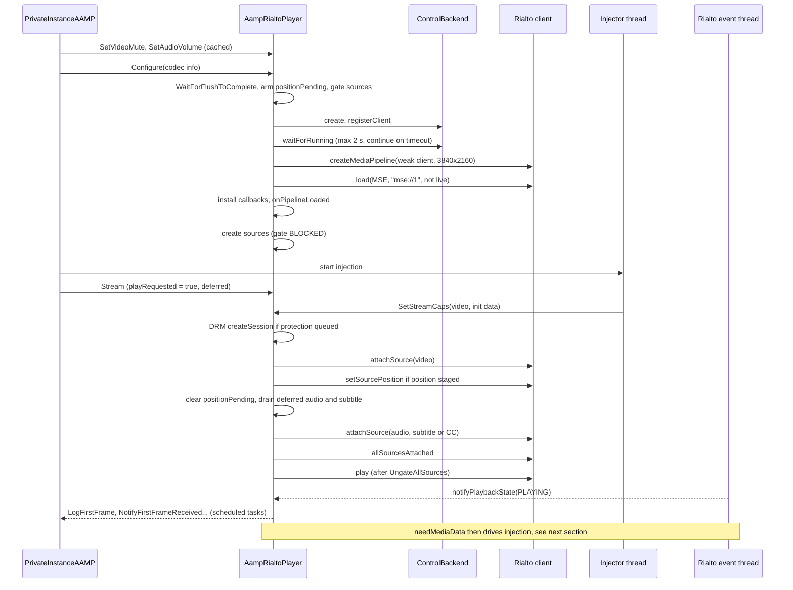
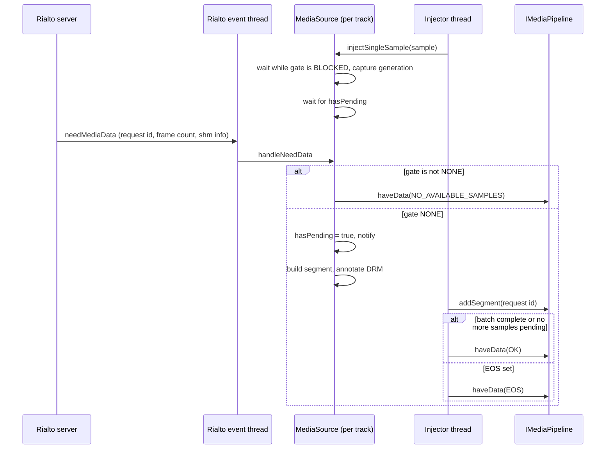
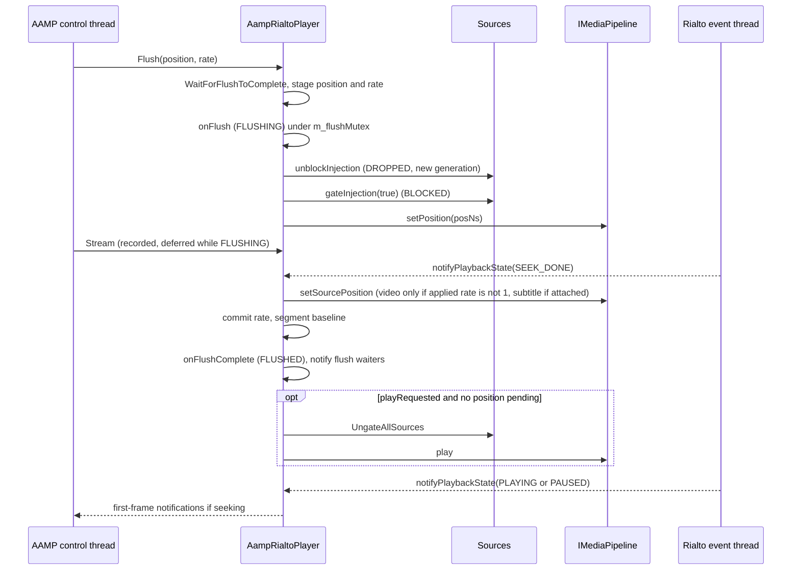
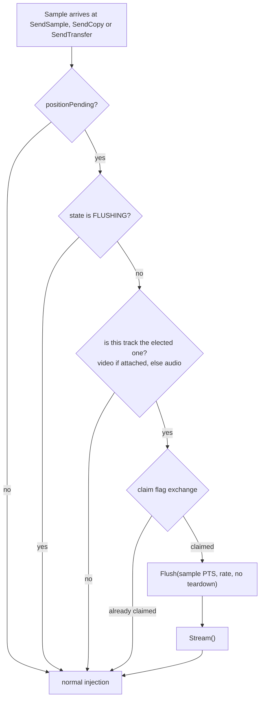
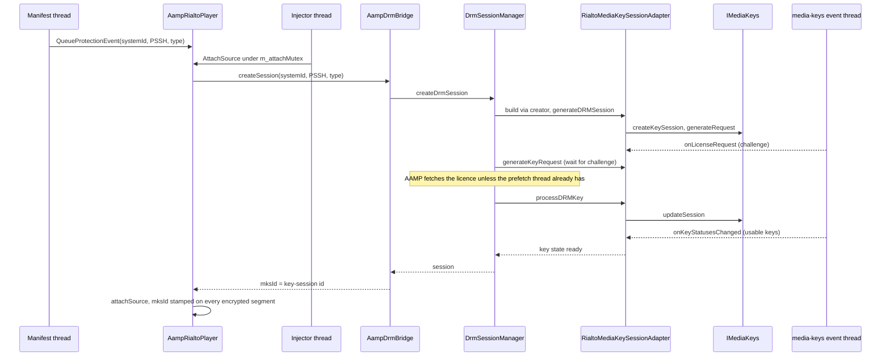

<!--
If not stated otherwise in this file or this component's license file the
following copyright and licenses apply:

Copyright 2026 RDK Management

Licensed under the Apache License, Version 2.0 (the "License");
you may not use this file except in compliance with the License.
You may obtain a copy of the License at

http://www.apache.org/licenses/LICENSE-2.0

Unless required by applicable law or agreed to in writing, software
distributed under the License is distributed on an "AS IS" BASIS,
WITHOUT WARRANTIES OR CONDITIONS OF ANY KIND, either express or implied.
See the License for the specific language governing permissions and
limitations under the License.
-->

# Playback, control and data flow

Back to [overview](README.md). State terms (gate, generation, rendezvous) are
defined in [lifecycle.md](lifecycle.md).

## Startup

The call order comes from `PrivateInstanceAAMP::TuneHelper()`: cached mute and
volume are applied, `Configure()`, an optional early `Flush()`, start of the
stream abstraction (injector threads), then `Stream()`.

*Figure 11. First tune of a DASH A/V stream. The steps from `SetStreamCaps`
to `play` normally run on the injector thread, not the control thread.*

Points that are easy to miss:

- **Video attaches first.** A non-video source arriving first is deferred in
  `m_pendingAttach` and its injector blocks on `attachPending`. The comment in
  `AttachSource()` marks the reason as an **unproven theory** (a server
  "not-linked" error seen when audio attached first). It is a workaround, see
  [limitations.md](limitations.md).
- **Subtitle or in-band CC source is created** alongside video (unless the
  build defines `RIALTO_PLAYER_DISABLE_SUBTITLES`): a
  sidecar `text/ttml` or `text/vtt` source, otherwise an in-band `text/cc`
  source. This keeps Rialto's `END_OF_STREAM` accounting complete, because
  Rialto reports end of stream only after every attached source has delivered
  EOS.
- **HLS-TS** has one injection thread for muxed content and the TS processor
  produces frames through `SendCopy`. On the first `SendCopy` for an
  unattached source, the player attaches **all** unattached sources using only
  the codec format (`toGstStreamOutputFormat`), to avoid a deadlock between
  tracks.
- **`allSourcesAttached()` exactly once** per pipeline session, guarded by
  `SOURCES_ATTACHING`.
- **`hasDrm` is forced to true** for video and audio sources regardless of
  protection. The code comment says a Rialto server crash was seen otherwise.
- **Audio-only content** that AAMP delivers on the video track is remapped:
  `Configure()` creates an AUDIO source and `getSource()` redirects VIDEO to
  it (`m_audioInVideoSlot`, `toSourceSlot`, `toAampTrack`).

## Data handshake

Per track, Rialto issues `needMediaData(sourceId, frameCount, requestId)`
on the Rialto event thread. The injector thread, which may already be waiting
with a sample, delivers it.

*Figure 12. One request. `addSegment` returning `NO_SPACE` closes the batch
early with `haveData(OK)` (or `NO_AVAILABLE_SAMPLES` if empty) and the
injector waits for the next request.*

Behaviour worth knowing:

- **Batching.** `haveData(OK)` is sent when `segmentsAddedInBatch` reaches the
  requested frame count, or when `morePending` is false.
- **Segment content.** Video and audio segments carry PTS and duration in
  nanoseconds, codec data on the first sample after attach, and, if encrypted,
  key-session id, key id, IV, cipher mode, CBCS pattern and sub-sample table.
  An encrypted sample with no key session is injected **without** encryption
  metadata and a warning.
- **Flow control** is therefore implicit. Rialto stops asking when its buffers
  are full, injector threads block, and the fragment cache fills.
- **Rialto client filtering.** The Rialto client forwards `needMediaData` only
  when the source is known and not flushing, the application state is
  `RUNNING`, and its own pipeline state is `BUFFERING` or `PLAYING`. That
  state moves out of `IDLE` on a `PLAYING` or `PAUSED` notification (both map
  to `PLAYING`), and `SEEK_DONE` maps to `BUFFERING`. Requests in `SEEKING`,
  `IDLE`, `END_OF_STREAM` or `FAILURE` are dropped
  (`MediaPipeline::notifyNeedMediaData` and `updateState`, `.libs/rialto`).
  Direct Rialto never sees the dropped requests.
- **First-PTS baseline.** `m_firstPtsMs` is set from the first successful
  `addSegment`. `Discontinuity()` ignores a track whose first PTS is not yet
  set.

## Flush and seek

A flush is a pipeline-level `setPosition()`. Completion arrives as
`PlaybackState::SEEK_DONE` on the Rialto event thread.

*Figure 13. Seek or trick-play flush from a playable state.*

Details:

- **Applied rate.** For trick play the video segment must carry an applied
  rate. It is set only when `candidateRate != 1` and the pipeline capability
  `isVideoMaster` reports false (`computeAppliedRate`). That query is an IPC
  call.
- **Trick play audio.** While the rate is not 1, the audio and subtitle
  sources are kept at EOS (`isEosDuringTrickplay`) so the pipeline clock does
  not wait for audio that will not arrive. Leaving trick play clears audio EOS
  in `Configure()`.
- **Position reporting.** `GetPositionMilliseconds()` returns 0 while
  `FLUSHING` or `m_positionPending`. Otherwise it is
  `(getPosition() - segmentStart) * rate`, clamped at 0 for forward play but
  allowed negative for reverse trick play. The value is relative to the
  segment start because the caller adds its own seek position.
- **Pre-flush staging.** A `Flush()` before the pipeline exists only stages the
  position. The next video attach consumes it through `setSourcePosition(...,
  resetTime=true)`.
- **Discontinuity re-arm.** If a `Discontinuity()` re-arms `m_positionPending`
  while a flush is in flight, the `SEEK_DONE` handler leaves `playRequested`
  set and does not play, so the flush that resolves the newer position does.

### Deferred position

*Figure 14. Implicit flush, used when AAMP never issues an explicit
`Flush()` (HLS fMP4, and DASH PTS-restamped discontinuities without a
guaranteed flush). Samples of other tracks still go through, and are held by
the gates set in `Configure()` / `Flush()`.*

## EOS and discontinuity

- **End of stream.** `EndOfStreamReached(type)` calls `signalEos()` on the
  source. Subtitle EOS is signalled automatically with video EOS. Rialto
  answers with `PlaybackState::END_OF_STREAM` once every source has delivered
  `haveData(EOS)`, and the sink forwards it as `NotifyEOSReached()` (scheduled
  on AAMP's scheduler).
- **Discontinuity.** `Discontinuity(type)` returns false when the track has not
  injected a sample. With PTS restamping on and no elementary-stream change
  pending it calls `CompleteDiscontinuityDataDeliverForPTSRestamp()` and does
  no pipeline work. Otherwise it signals EOS on the track (and on subtitle for
  video), calls `StopBuffering(true)` which ungates and issues `play()`, and
  notifies the underflow monitor. It arms `m_positionPending` unless AAMP will
  flush explicitly (`WillFlushOnDiscontinuity()`).
- **Codec change.** `Configure()` with an ES change recreates the pipeline.
  See the hazard in [limitations.md](limitations.md#recreation-without-stop).

## DRM session creation

DRM works through the normal `DrmSessionManager` flow, with Rialto-specific
`DrmSession` objects substituted at construction (`makeRialtoSessionCreator()`
passed into `AampDRMLicenseManager`).

*Figure 15. DRM session creation during source attach. The licence is normally
requested earlier by the prefetch thread (`AampLicensePreFetcher`), which
starts when `QueueContentProtection` runs during manifest processing. The
injector thread therefore blocks only for the part of the licence round trip
that has not finished, and does so while holding `m_attachMutex`. Because
`DrmSessionManager::createDrmSession()` serialises on `mDrmSessionLock`, it
waits behind a prefetch still in flight, and returns an existing session
immediately once the prefetch is done.*

Notes:

- Protection is queued per `AampMediaType` by `QueueProtectionEvent()` into
  `m_pendingProtection`. HLS queues under VIDEO even for audio-only tracks, so
  an encrypted non-video source with no entry falls back to the VIDEO entry.
- A new period with different protection data on an already-attached source
  creates a new key session and replaces `mksId`. Unchanged parameters are
  compared and skipped to avoid a repeat licence round trip.
- If `createSession` fails, the source still attaches. Encrypted samples then
  go out without encryption metadata (warned).
- `SetEncryptedAamp()` lets a clear-ad player use the encrypted player's DRM
  session manager for pre-roll content.
- `AampDrmBridge::createSession()` always passes `eMEDIAFORMAT_DASH` to
  `AampDRMLicenseManager::createDrmSession()`, including for HLS content. This
  changes ClearKey and Verimatrix helper behaviour for HLS (see C13 in
  [limitations.md](limitations.md)). Widevine and PlayReady are unaffected.
- **Cleanup.** `Stop()` and `ClearProtectionEvent()` do not call
  `IDrmBridge::clearSessions()`. Nothing in `direct-rialto/` calls it, so Rialto
  key sessions stay in `DrmSessionManager` slots until the stream abstraction
  calls `clearDrmSession()` at tune start (`fragmentcollector_mpd.cpp`,
  `fragmentcollector_hls.cpp`) or the manager is destroyed.
- The individualisation challenge (`individualization-request` or type `3`) is
  routed to `DrmCallbacks::Individualization` and does not complete the
  challenge wait.
- Key status: `RialtoMediaKeySessionAdapter::processDRMKey()` treats a key as
  usable when the session's key-status cache says `USABLE`. An
  `OUTPUT_RESTRICTED` key returns `HDCP_OUTPUT_PROTECTION_FAILURE`.
