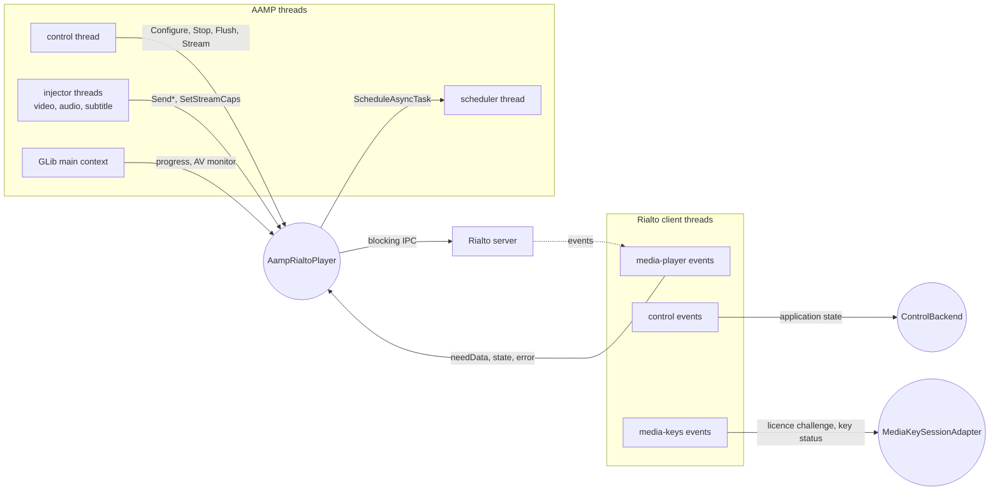

<!--
If not stated otherwise in this file or this component's license file the
following copyright and licenses apply:

Copyright 2026 RDK Management

Licensed under the Apache License, Version 2.0 (the "License");
you may not use this file except in compliance with the License.
You may obtain a copy of the License at

http://www.apache.org/licenses/LICENSE-2.0

Unless required by applicable law or agreed to in writing, software
distributed under the License is distributed on an "AS IS" BASIS,
WITHOUT WARRANTIES OR CONDITIONS OF ANY KIND, either express or implied.
See the License for the specific language governing permissions and
limitations under the License.
-->

# Threading and concurrency

Back to [overview](README.md). Read [lifecycle.md](lifecycle.md) first for the
terms used here.

**Evidence labels.** *Direct Rialto* = guaranteed by code in `direct-rialto/`.
*Rialto source* = confirmed in `.libs/rialto`. *Inferred* = follows from the
code. *Unverified* = could not be established.

## Threads and execution contexts

| Thread | Created by | Runs in Direct Rialto |
|---|---|---|
| AAMP control thread (the thread executing `TuneHelper`, `TeardownStream`, `ProcessPendingDiscontinuity`, API calls such as seek, pause, mute) | AAMP (API caller or `AampScheduler`) | `Configure`, `Stream`, `Stop`, `Flush`, `Pause`, `SetPlayBackRate`, `SetVideoMute`, ... |
| Fragment injector threads, one per track (one thread for muxed HLS-TS) | `StreamAbstractionAAMP` | `SendSample`, `SendCopy`, `SendTransfer`, `SetStreamCaps` (so `AttachSource` and DRM), `Discontinuity`, `EndOfStreamReached`. **Blocks inside `injectOneSample()`**. |
| Manifest and download threads | AAMP | `QueueProtectionEvent`, `ClearProtectionEvent` |
| Rialto media-player event thread (`rialto-media-player-events`, one per pipeline) | Rialto client (`MediaPipelineIpc`) | All `IMediaPipelineClient` callbacks |
| Rialto control event thread (`rialto-control-events`) | Rialto client (`ControlIpc`) | `IControlClient::notifyApplicationState` |
| Rialto media-keys event thread (`rialto-media-keys-events`) | Rialto client (`MediaKeysIpc`) | `IMediaKeysClient` callbacks |
| AAMP scheduler thread (`AampScheduler`), or the GLib main context when no scheduler exists | AAMP | Tasks posted by `PrivateInstanceAAMPNotifiable` |
| GLib main-context thread | the application | `ProgressTimer` and `AampRialtoMonitorAV` timers (`g_timeout_add`) |
| Rialto IPC channel and server threads | Rialto | Not visible to AAMP |

Event-thread facts are *Rialto source*: each IPC event handler enqueues work on
the thread's `EventThread` object, so the callback is **not** invoked on the
caller's thread or directly on the IPC receive thread. Callbacks of one
pipeline are therefore serial (*inferred* from the single `EventThread`).
Ordering across the three event threads is not defined.

Direct Rialto itself creates **no threads**. All timing and waiting use the
threads above plus GLib timers.

*Figure 16. Thread interaction. `RP` is shared state reached from five
different thread groups, which is why the synchronisation inventory below
matters.*

## Callback contexts

| Callback | Context | Handler | What it touches | Blocking |
|---|---|---|---|---|
| `notifyPlaybackState` | media-player event thread | `OnPlaybackState` | State machine mutex, `m_flushMutex`, `m_attachMutex` (SEEK_DONE), atomics. Calls `setSourcePosition` and `play` (blocking IPC). Notifiable (scheduled). Starts progress timer and AV monitor. | Yes, IPC |
| `notifyNeedMediaData` | media-player event thread | `OnNeedMediaData` then `handleNeedData` | `SourceState::mu`. May call `haveData` (blocking IPC). | Yes, IPC |
| `notifyCancelNeedMediaData` | media-player event thread | `handleCancelNeedData` | `SourceState::mu` | No |
| `notifyBufferUnderflow`, `notifyPlaybackError` | media-player event thread | `OnBufferUnderflow`, `OnPlaybackError` | Notifiable (scheduled) | No |
| `notifyDuration` | media-player event thread | `OnDuration` | atomic store | No |
| `notifyPosition`, `notifyQos`, `notifyNetworkState`, others | media-player event thread | log only, or ignored | none | No |
| `notifyApplicationState` | control event thread | `onApplicationStateChanged` | own mutex and condition variable | No |
| `onLicenseRequest`, `onLicenseRenewal`, `onKeyStatusesChanged` | media-keys event thread (*dispatch details unverified*) | `MediaKeysClient` | its map mutex, adapter mutexes. `onKeyStatusesChanged` calls adapter callbacks **while holding** the client mutex. | No |
| GLib timers | GLib main context | `ProgressTimer`, `AampRialtoMonitorAV` | `MonitorAV` calls `getPosition` (blocking IPC) on the main context | Yes, IPC |
| Scheduled tasks | scheduler thread | `PrivateInstanceAAMP` methods | AAMP locks | n/a |

The Rialto client calls most callbacks **without holding its own locks**. The
exception is `notifyNeedMediaData`, which first waits for an in-progress
`attachSource` and takes the request-map lock
(`MediaPipeline.cpp`, *Rialto source*). `ClientController` copies the client
list and notifies after releasing its mutex.

## Design rationale stated in the code

[`PrivateInstanceAAMPNotifiable.cpp`](../../direct-rialto/PrivateInstanceAAMPNotifiable.cpp)
states the main rule: **Rialto callbacks must not take AAMP locks.** A Rialto
callback thread may hold a Rialto-side lock while an AAMP thread holds an AAMP
lock (`mLock`, `mStreamLock`) and waits for a Rialto call. To break that
AB/BA cycle, most notifications are posted with `ScheduleAsyncTask`.
Exceptions called synchronously from injector threads:
`CompleteDiscontinuityDataDeliverForPTSRestamp` and
`NotifyPipelinePausedToUnderflowMonitor`. `GetState()` is read synchronously
and is safe because `mState` is atomic.

## Synchronisation inventory

| Primitive | Protects | Used by |
|---|---|---|
| `PlayerStateMachine::m_mutex` | state object | all threads |
| `m_flushMutex` + `m_flushCv` | FLUSHING claim and wait. The predicate is the state machine, not a local flag. | control thread, event thread |
| `m_attachMutex` | `AttachSource`, `CheckAllSourcesAttached`, mute flags, deferred attach | injector (`SetStreamCaps`, `SendTransfer`), control (mute), event (SEEK_DONE subtitle) |
| `m_pendingProtectionMutex` | `m_pendingProtection` | manifest and injector threads |
| `m_ptsCheckMutex` | PTS stall detector | any caller of `CheckForPTSChangeWithTimeout` |
| `SourceState::mu` + `cv` | all per-track handshake state | injector, event, control |
| Atomics (seq_cst for the rendezvous, relaxed otherwise) | `m_playRequested`, `m_allSourcesAttachedFlag`, `m_positionPending`, `m_pendingPositionFlushClaimed`, `m_rate`, `m_pendingFlushRate`, `m_pendingPositionNs`, `m_segmentStartPositionNs`, `m_firstFrameNotified`, `m_durationMs`, `m_audioInVideoSlot`, `m_lastFlushPositionAuthoritative`, `m_firstPtsMs` | various |
| `MediaKeysClient::mutex`, adapter `m_mutex` / `m_eventMutex` / `m_usableKeysMutex`, session `m_keyStatusMutex` | DRM caches and waits | DRM and key event threads |

Lock order observed in the DRM code: client mutex, then adapter
`m_usableKeysMutex`, then session `m_keyStatusMutex`. No cycle was found.
No lock-order rule is documented for the player mutexes. The only mutex held
across `m_pipeline->...` IPC calls is `m_attachMutex`: in `AttachSource`
(including the DRM licence round trip), `SetStreamCaps`, the mute setters and
the SEEK_DONE subtitle update.

### Members with no synchronisation

These are written on one thread and read on others. Safety depends on
call-ordering conventions, not on locks. Each is a candidate for
[limitations.md](limitations.md).

| Member | Written by | Read by |
|---|---|---|
| `m_pipeline` (`shared_ptr`) | `Configure`, `Stop` (control) | every injector, event and timer thread |
| `m_sources[]` (`unique_ptr` array) | `Configure` | injector, event (`findSourceByRialtoId`), control |
| `m_pendingAttach` | `AttachSource`, `Configure` (the comment says guarded by `m_attachMutex`, but `Configure` does not take it) | injector |
| `m_client` callbacks (`std::function`) | `Configure` | event thread |
| `m_videoRectangle` (`std::string`) | `SetVideoRectangle` | `GetVideoRectangle` on the event thread (PLAYING) and others |
| `m_audioVolume`, `m_pendingPlayOnFragCaching`, `m_drmBridge` | control | injector, control |
| `ProgressTimer::started`, `source_id`, `m_progressTimer` | event thread (`PLAYING` starts it), control (`Stop` stops it) | GLib main context |
| `PrivateInstanceAAMPNotifiable::m_aamp` | `ChangeAamp` | any thread |
| `AampRialtoMediaSource::m_sourceId`, `m_mksId` (plain ints) | attach (injector) | event thread (`findSourceByRialtoId`) |

## Cross-thread protocols

**Play rendezvous and flush completion** are the two designed cross-thread
protocols. See [lifecycle.md](lifecycle.md#play-rendezvous) and
[playback-flow.md](playback-flow.md#flush-and-seek).

**Flush claiming.** `Flush()` has two separately locked steps: read the state
to decide flushable or not, then claim `FLUSHING`. The comment states there is
no race because `Flush()`, `Stop()` and `Configure()` are "always on the AAMP
control thread". `MaybeFlushForPendingPosition()` breaks that premise: it
calls `Flush()` from an injector thread, guarded only by the
`m_pendingPositionFlushClaimed` flag and an unlocked `FLUSHING` check. A
concurrent control-thread `Flush()` between those two steps is not excluded.

**Generation tokens.** `generation` makes an abort idempotent and lock-cheap:
an injector captures it before blocking and bails out if it changed. The
injector that observes the change closes out the request it owns. This is the
central cancellation mechanism.

**Nested calls.** Callbacks call back into `IMediaPipeline` (`play`,
`setSourcePosition`, `haveData`). The Rialto source calls callbacks outside its
main locks, so this is not prohibited (*inferred*). Whether a blocking call
from the event thread can stall event delivery was **not verified**.

## Shutdown and destruction

What is guaranteed and by whom:

| Fact | Source |
|---|---|
| Destroying the last reference to `IMediaPipeline` destroys `MediaPipelineIpc`, which destroys its `EventThread`, whose destructor sets a shutdown flag and **joins** the thread. After that no further callbacks arrive for the pipeline. | *Rialto source* (`MediaPipeline.cpp`, `MediaPipelineIpc.cpp`, `EventThread.cpp`) |
| `~MediaPipelineProxy` removes the pipeline's registration from `ClientController`. | *Rialto source* |
| Rialto does not document a drain for the control client list or `IMediaKeys` destruction. | *Unverified* |
| `StopInternal()` waits for any flush, stops timers and the AV monitor, marks sources `DROPPED`, calls `stop()`, then releases the pipeline. Releasing it joins the event thread. | *Direct Rialto* + *Rialto source* |
| `TeardownStream()` stops and deletes the stream abstraction (joining injector threads) **before** `sink->Stop()`. | `PrivateInstanceAAMP::TeardownStream` |
| `StopTrackInjection(discard)` calls `UnblockTrackInjection()` so a blocked injector can be joined. | `priv_aamp.cpp` |

Consequences:

- After `Stop()` returns, no callback of that pipeline can still be running
  (*inferred* from the join), so the lambdas capturing `this` are safe while
  the player is alive.
- Injector threads hold `IMediaPipeline &` without ownership. This is safe only
  because the stream abstraction has joined them before `Stop()`. Nothing in
  the sink enforces it.
- **Destructor.** `~AampRialtoPlayer` stops the progress timer, unblocks
  sources and invalidates the CC handle, but does not reset `m_pipeline`. Member
  destruction runs in reverse declaration order, and `m_pipeline` is declared
  **before** `m_sources`, `m_stateMachine` and `m_monitorAV`. If the player is
  destroyed without a prior `Stop()`, those members are destroyed while the
  pipeline's event thread can still run callbacks that use them. Normal flows
  call `Stop()` first.
- **Control backend.** `AampRialtoControlBackend` declares its mutex and
  condition variable **after** `m_control` and `m_controlClient`, so they are
  destroyed **first**. A `notifyApplicationState` in flight during destruction
  would use a destroyed mutex. The window is small. `Control` keeps the
  `ControlClient` alive until its registration is removed, but `ControlClient`
  holds a reference to the (already partly destroyed) backend.
- **GLib timers.** `~ProgressTimer` and `~AampRialtoMonitorAV` call
  `g_source_remove`, which does not wait for a callback already running on the
  main context. The timer data pointer is the object itself.

## Potential races and deadlocks

The classified list is in [limitations.md](limitations.md#concurrency-and-lifetime).
The main hazards are:

1. Unsynchronised `m_pipeline` and `m_sources` (above).
2. `m_attachMutex` held across a DRM licence round trip, stalling the
   `SEEK_DONE` handler and so flush completion.
3. Flush claim not atomic between control and injector threads.
4. Late `PLAYING` after `Stop()`: prevented in practice because `Stop()`
   destroys the pipeline, which joins the event thread. During a `Configure()`
   recreation without `Stop()`, the old pipeline lives until reassignment.
5. Timer and destructor orderings.
